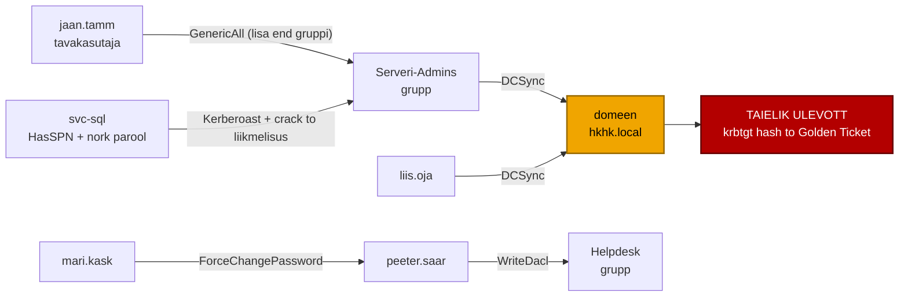

# Laboriharjutus: Active Directory ründeteede kaardistamine BloodHoundiga

> **Moodul:** Operatsioonisüsteemi ja küberturbe alused
> **Kestus:** ~4 akadeemilist tundi (1 teooriaplokk + labor)
> **Vorm:** praktiline labor isoleeritud virtuaalkeskkonnas

---

## ⚠️ Eetika ja piirangud

See harjutus toimub **ainult isoleeritud laboridomeenis** (eraldi virtuaalvõrk, ilma internetiühenduse ja ilma kooli/tootmis-AD-ühenduseta). BloodHoundi ja SharpHoundi kasutamine võõra organisatsiooni võrgus ilma kirjaliku loata on **seadusevastane** (KarS § 206/217 — arvutikuritegevus). Õppija allkirjastab enne laborit vastutuse teadmiseks võtmise.

---

## Õpiväljundid

Pärast harjutust oskab õppija:

1. selgitada, **mis probleemi BloodHound lahendab** (AD õiguste graafi analüüs);
2. **koguda** AD andmeid SharpHoundi / bloodhound-pythoniga tavakasutaja õigustes;
3. **lugeda ründeteed** (attack path) graafil ja seletada iga serva (edge) tähendust;
4. kirjeldada, kuidas ründaja iga seadistust **ära kasutaks** ja kuidas administraator selle **parandab**;
5. seostada leitud teed **monitooringu ja logidega** (kaitsja vaade).

---

## 1. Mis rünne / tehnika?

BloodHound ei murra ise kuhugi sisse — see on **luure- ja analüüsietapi** tööriist (ingl *reconnaissance*, MITRE ATT&CK **T1069 Permission Groups Discovery**, **T1482 Domain Trust Discovery**). Ründaja, kellel on juba üks jalgealune (nt phishinguga saadud tavakonto), kasutab seda, et leida **lühim tee** oma madalast kontost kuni Domain Adminsini.

Tööpõhimõte:

- **Kogumine (SharpHound):** üks autentitud domeenikasutaja pärib LDAP-i ja SMB kaudu kokku kõik objektid ja seosed — grupiliikmelisused, ACL-id, aktiivsed sessioonid, local admin õigused, delegeerimised.
- **Graaf (Neo4j):** andmed laaditakse graafiandmebaasi, kus **sõlmed** on kasutajad/grupid/arvutid ja **servad** on õigussuhted (`MemberOf`, `GenericAll`, `ForceChangePassword`, `DCSync`, `HasSPN`, `AdminTo`, …).
- **Analüüs:** päring „Shortest Path to Domain Admins" leiab ahela, mida inimsilm käsitsi ei märkaks.

Peamine oht: **tavakasutaja õigustest piisab kogumiseks** — AD on „loetav" igale autentitud kontole.

---

## 2. Laboritopoloogia

| Masin | Roll | OS |
|---|---|---|
| `DC01` | Domeenikontroller, domeen `labor.local` | Windows Server 2022 |
| `WIN11` | Domeeniga liidetud tööjaam (ründaja jalgealune) | Windows 11 |
| `KALI` | Ründaja analüüsijaam (valikuline) | Kali Linux |

Kõik ühes isoleeritud host-only / internal võrgus. Kellad DC ja klientide vahel **peavad olema sünkroonis** (ajahälve lõhub Kerberose ja kogumise).

---

## 3. Osa A — Keskkonna ettevalmistus (õpetaja)

1. Püstita `labor.local` domeen (vt varasem WS2022 labor).
2. Kopeeri `Seed-ADLabor.ps1` DC01-le ja jooksuta **Domain Admins** õigustes:

   ```powershell
   Set-ExecutionPolicy -Scope Process RemoteSigned
   .\Seed-ADLabor.ps1
   ```

3. Skript loob OU `Labor` alla kasutajad, grupid ja **6 tahtlikku väärseadistust**. Lõpus kuvatakse istutatud teede kokkuvõte.
4. Tee DC01-st **VM hetktõmmis** — nii saab labori järgmise grupi jaoks sekunditega lähtestada.
5. Anna õppijale ainult stardikonto: **`jaan.tamm` / `Suvi2026!`**. Ülejäänu peab ta ise avastama.

> **Õpetaja legend** — kes mis tasemel ja mis õigus igal kontol/grupil on: `Seed-ADLabor.ps1` päises (kommentaariplokk) ja tabelina failis [Rundeteede-lahenduskaik.md](./Rundeteede-lahenduskaik.md) (jagu 1). Õppijale seda ette ei anta — see on tema avastamisülesanne.

---

## 4. Osa B — BloodHound CE paigaldus ja andmete kogumine (õppija)

> **Märkus:** vanad juhendid (sh paljud Mediumi postitused) näitavad *legacy* BloodHoundi lahtipakitava `.exe` + Neo4j Desktopiga. Praegune versioon on **BloodHound Community Edition (CE)**, mis käib Dockeris. Mõlemad loevad sama SharpHoundi andmeid; allpool CE.

### B1. BloodHound CE käivitus (KALI või WIN11 + Docker)

> **Eeltingimus Kalis — ehtne Docker, mitte podman.**
> Kalis on `docker` käsk sageli suunatud **podmani** peale (pakett `podman-docker`). Siis annab `docker compose up -d` vea:
> `Cannot connect to the Docker daemon at .../podman/podman.sock`.
> BloodHound CE compose on ehtsa Dockeriga sujuvam (podman rootless komistab postgresi köite-õiguste ja portide taha).
>
> Vaja on **kahte asja**: mootorit (`docker.io`) ja Compose v2 pluginat. Kali allikates pole `docker-compose-v2` paketti usaldusväärselt saadaval, seega paigalda plugin ametliku binaarina.
>
> ```bash
> # 1) Eemalda docker->podman shim (NB: mitte docker.io ennast!)
> sudo apt remove -y podman-docker
>
> # 2) Mootor
> sudo apt update
> sudo apt install -y docker.io
>
> # 3) Compose v2 plugin ametliku binaarina (sõltumatu distro paketist)
> sudo mkdir -p /usr/local/lib/docker/cli-plugins
> sudo curl -SL "https://github.com/docker/compose/releases/latest/download/docker-compose-linux-$(uname -m)" \
>   -o /usr/local/lib/docker/cli-plugins/docker-compose
> sudo chmod +x /usr/local/lib/docker/cli-plugins/docker-compose
>
> # 4) Käivita teenus ja luba ilma sudota
> sudo systemctl enable --now docker
> sudo usermod -aG docker "$USER"
> newgrp docker
>
> # 5) Kontroll — kõik kolm peavad vastama
> which docker             # /usr/bin/docker  (mitte podman)
> docker version           # Server: Docker Engine
> docker compose version   # Docker Compose version v2.x
> ```
>
> Podmani ennast ei pea eemaldama — docker.io ja podman võivad koos eksisteerida; ainus konflikt oli `docker` käsu nimi. Kui `which docker` näitab ikka podmani teed, logi välja/sisse või käivita `hash -r`.

> **Tõrge: `Cannot connect to the Docker daemon at .../podman/podman.sock`, kuigi `which docker` on õige.**
> Siis on shellis veel keskkonnamuutuja `DOCKER_HOST`, mis suunab Dockeri kliendi podmani soklile (jääb sageli varasemast podmani-katsest alles). Ehtne Docker kuulab `/var/run/docker.sock`. Kontrolli ja eemalda:
>
> ```bash
> echo "$DOCKER_HOST"                               # kui näitab .../podman/podman.sock, on süüdlane leitud
> unset DOCKER_HOST                                 # eemalda praegusest shellist
> grep -n DOCKER_HOST ~/.zshrc ~/.bashrc ~/.profile 2>/dev/null   # kas on püsivalt rc-failis?
> sed -i '/DOCKER_HOST/d' ~/.zshrc                  # kui leidus, kustuta rida (Kalis vaikimisi zsh)
> docker context use default                        # kontekst tagasi vaikimisi soklile
> sudo systemctl enable --now docker                # veendu, et teenus jookseb
> docker version                                    # nüüd peab vastama ka "Server: Docker Engine"
> ```

```bash
curl -L https://ghst.ly/getbhce -o docker-compose.yml
docker compose up -d
# Ava http://localhost:8080 ; esmase parooli leiad logist:
docker compose logs bloodhound 2>&1 | grep -i "Initial Password"
```

**Sisselogimine:** BloodHound CE loob esmakäivitusel admin-konto. Välja **Email Address** sisesta kasutajanimi **`admin`** (hoolimata sildist „Email"), parooliks logist saadud juhuslik string. Esimesel sisselogimisel sunnib BloodHound kohe uue parooli seadma.

> **Kui veeb `http://localhost:8080` ei vasta:** kontrolli konteinerite olekut `docker compose ps` ja logisid `docker compose logs`.

> **Kui esmast parooli logist ei leia** (nt konteiner on juba mitu korda käivitunud — parool prinditakse ainult esimesel korral), lähtesta puhtalt. `-v` kustutab andmebaasi, aga kui andmeid pole veel imporditud, siis kadu pole:
>
> ```bash
> docker compose down -v
> docker compose up -d
> sleep 20
> docker compose logs bloodhound 2>&1 | grep -i "Initial Password"
> ```

### B2. Andmete kogumine

**Variant 1 — SharpHound Windowsi tööjaamalt (`WIN11`, kasutaja `jaan.tamm`):**

```powershell
# SharpHound.exe on BloodHoundi Collectors kaustas
.\SharpHound.exe -c All --zipfilename labor
```
> Windows Defender märgib SharpHoundi pahavaraks — see on õige, tegu on tuntud ründekomponendiga. Laboris lisa ajutine erand; **selgita õppijale, miks** viirusetõrje reageerib.

**Variant 2 — bloodhound-python Kalist:**

> **Eeltingimus: Kali peab domeeni nime DC kaudu lahendama.**
> Kali ei tunne vaikimisi AD domeeni (`labor.local`) ega leia DC-d. Tüüpiline viga:
> `Failed to get Kerberos TGT ... [DOMEEN:88] Name or service not known` ja `Could not find a domain controller`.
> Sea **DC IP nimeserveriks** (DC on ühtlasi DNS-server). Vali üks:
>
> ```bash
> # A) DC esimeseks nimeserveriks (lisa rida resolv.conf algusesse)
> sudo sed -i '1i nameserver <DC_IP>' /etc/resolv.conf
>
> # B) püsivam kirje otse DC FQDN-ile (NetworkManager ei kirjuta üle)
> echo "<DC_IP>  dc01.labor.local labor.local dc01" | sudo tee -a /etc/hosts
> ```
>
> Kontrolli, et domeen lahendub (peab tagastama DC nime):
> ```bash
> dig @<DC_IP> _ldap._tcp.dc._msdcs.labor.local SRV +short
> ```
> NB: `-d` peab olema **täpselt** DC domeen (`(Get-ADDomain).DNSRoot` DC-l), nt `perenimi.local`.

```bash
bloodhound-python -u jaan.tamm -p 'Suvi2026!' -d labor.local -ns <DC_IP> -dc dc01.labor.local -c All
```

> Kui väljund ütleb „BloodHound **LEGACY**", on tegu vana kollektoriga. Enamasti impordib CE selle siiski ära; kui import tõrgub, kasuta CE-ühilduvat kollektorit: `pipx install bloodhound-ce` (annab käsu `bloodhound-ce-python`).

### B3. Import

Ava BloodHound CE veebis **Administration → File Ingest** ja lohista sinna kogutud andmed. Oota töötlemine lõpuni.

**Kust andmed tulevad — sõltub kollektorist:**

- **SharpHound** teeb kohe ühe `.zip`-i (`--zipfilename labor` → `labor_*.zip`). Lohista see zip.
- **bloodhound-python** EI tee vaikimisi zipi — ta kirjutab **eraldi JSON-failid** sinna kausta, kus käsu käivitasid (nt `~/BloodHound`). Vali üks:

```bash
cd ~/BloodHound
ls -lt *.json                       # <ajatempel>_users.json, _groups.json, _computers.json, _domains.json, _gpos.json, _ous.json, _containers.json

# A) paki üheks zipiks ja lohista see
sudo apt install -y zip 2>/dev/null
zip bloodhound.zip *.json

# B) VÕI lohista JSON-failid otse — CE File Ingest võtab ka üksikud .json-id
```

> Järgmisel korral saad zipi ka automaatselt: `bloodhound-python ... -c All --zip`.

---

## 5. Osa C — Ülesanded (avasta ründeteed)

> **Enne alustamist:** BloodHound CE veebiliidese kasutamine (Search, Pathfinding, Cypher, serva **Abuse Info**, Tier Zero jne) on eraldi juhendis → **[BloodHound-CE-kasutusjuhend.md](./BloodHound-CE-kasutusjuhend.md)**. Loe see läbi, siis on alltoodud ülesanded hõlpsamad.
>
> **Iga tee samm-sammuline lahenduskäik** (mida õigus tähendab, kuidas leida, kuidas ära kasutada Kali/Windows käskudega, kuidas kaitsta) on failis → **[Rundeteede-lahenduskaik.md](./Rundeteede-lahenduskaik.md)**.

Kasuta otsingut, Pathfindingut ja Cypheri valmispäringuid. Siht ei ole alati „Domain Admins" grupp — täieliku ülevõtu annab siin **DCSync** (paroolihashide, sh krbtgt, väljavõte). Iga leitud tee kohta täida tabel (ülesanne C7).

| # | Ülesanne | Vihje (mida otsida) |
|---|---|---|
| C1 | Leia `jaan.tamm` tee täieliku ülevõtuni | Pathfinding: algus `jaan.tamm`, siht domeen `HKHK.LOCAL` (või `Administrator`). Tee lõpeb `DCSync` servaga |
| C2 | Millise **serva** kaudu jaan grupiõigusi võidab? | Otsi serva `GenericAll` grupile `Serveri-Admins` |
| C3 | Miks annab `Serveri-Admins` täieliku kontrolli? | Vaata grupi **väljaminevat** serva `DCSync` domeenile (mitte `MemberOf` DA-sse) |
| C4 | Leia konto, kes saab **teise kasutaja parooli lähtestada** | Serv `ForceChangePassword` |
| C5 | Leia konto, kes saab domeenist **paroolihashid välja replitseerida** | Serv `DCSync` domeeni objektile |
| C6 | Leia **Kerberoastitav** teenusekonto ja seleta rünne | Sõlme omadus `HasSPN = true` |
| C7 | Leia konto, kes saab ühe grupi **ACL-i ümber kirjutada** | Serv `WriteDacl` |

### C7 — Vormista iga tee kohta:

| Tee | Servad (edges) | Kuidas ründaja ära kasutab | Kuidas kaitsja parandab |
|---|---|---|---|
| nt C4 | `mari.kask —ForceChangePassword→ peeter.saar` | Lähtestab peetri parooli, logib tema kontona sisse | Eemalda liigne ACE; jälgi event 4724 |

---

## 6. Osa D — Kaitsja vaade (iga vea parandus)

Iga istutatud väärseadistuse kohta arutage ja proovige:

| Väärseadistus | BloodHoundi serv | Parandus | Avastamine logis / monitooringus |
|---|---|---|---|
| Grupil `Serveri-Admins` DCSync domeenil | `DCSync` | Eemalda GetChanges/All grupilt; DCSync ainult DC-de kontodel | Event 4662 replikatsiooni-GUID-iga |
| Teenusekonto DCSync-grupis | `MemberOf` | Teenusekonto välja privgrupist; gMSA + least privilege | AD grupimuutuste audit (4728/4732) |
| `GenericAll` grupile | `GenericAll` | Eemalda liigne ACE; delegeeri kitsalt | Event 5136 (DACL muutus) |
| `ForceChangePassword` | `ForceChangePassword` | Eemalda õigus; parooli-lähtestus ainult helpdeskile | Event 4724 |
| `DCSync` õigus | `DCSync` | Eemalda GetChanges/All tavakontolt | Event 4662 replikatsiooni-GUID-iga |
| Kerberoastitav SPN + nõrk parool | `HasSPN` | Pikk juhuslik parool / gMSA; AES-krüpt | Event 4769 (TGS, RC4 lipuga) |

**Kesksõnum õppijale:** sama BloodHound, millega ründaja teid otsib, on **administraatori parim tööriist** samade teede enne sulgemiseks. Jooksuta seda regulaarselt oma AD vastu.

### Ründeteede kaart (kokkuvõte)

Alljärgnev diagramm näitab, kuidas istutatud väärseadistused kokku **täieliku domeeni ülevõtuni** viivad. Põhitee kulgeb `GenericAll` ja `DCSync` kaudu; `ForceChangePassword`/`WriteDacl` on täiendavad ACL-kuritarvituse harjutused.



Loe teed nii: **jaan.tamm** lisab end `GenericAll`-iga gruppi **Serveri-Admins**; grupil on **DCSync** domeenil → ta tõmbab krbtgt hashi → **Golden Ticket** → täielik kontroll. Sama lõppu annab **svc-sql** (Kerberoast → grupiliikmelisus) ja **liis.oja** (otse DCSync). `mari.kask → peeter.saar → Helpdesk` on eraldi ACL-ahel (õpetab `ForceChangePassword` ja `WriteDacl` kombineerimist).

---

## 7. Kontrollküsimused (hindamine)

1. Miks piisab AD kogumiseks tavakasutaja õigustest, mitte administraatori omadest?
2. Mis vahe on `GenericAll` ja `WriteDacl` serval? Kumb on ohtlikum ja miks?
3. Selgita Kerberoasting rünne samm-sammult: miks SPN seadistus selle võimaldab?
4. Mida tähendab DCSync praktikas — mida ründaja sellega saab?
5. Nimeta kaks Windowsi event ID-d, millega eelnevaid tegevusi tuvastada.
6. Kuidas AD „tiering" (Tier 0/1/2) katkestaks mitu siin leitud teed korraga?

---

## 8. Puhastus

Grupi vahetamisel taasta DC VM hetktõmmisest **või** jooksuta:

```powershell
.\Clear-ADLabor.ps1
```

---

## Lisad

- [BloodHound-CE-kasutusjuhend.md](./BloodHound-CE-kasutusjuhend.md) — veebiliidese kasutusjuhend (Search, Pathfinding, Cypher, Abuse Info)
- [Rundeteede-lahenduskaik.md](./Rundeteede-lahenduskaik.md) — iga tee samm-sammuline lahenduskäik (Inbound/Outbound, ärakasutamine, kaitse)
- `Seed-ADLabor.ps1` — labori külvskript (6 väärseadistust)
- `Clear-ADLabor.ps1` — puhastusskript
- Soovituslik taust: GOAD (Game of Active Directory) — avatud lähtekoodiga suurem harjutuskeskkond sama põhimõttega.
