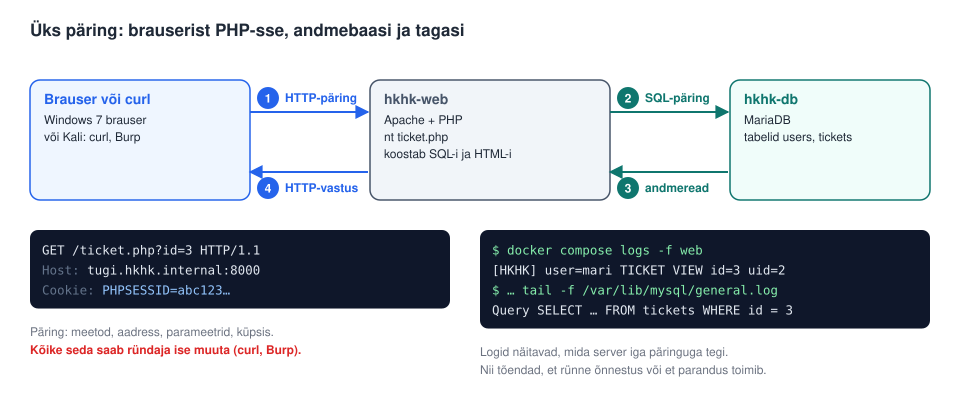
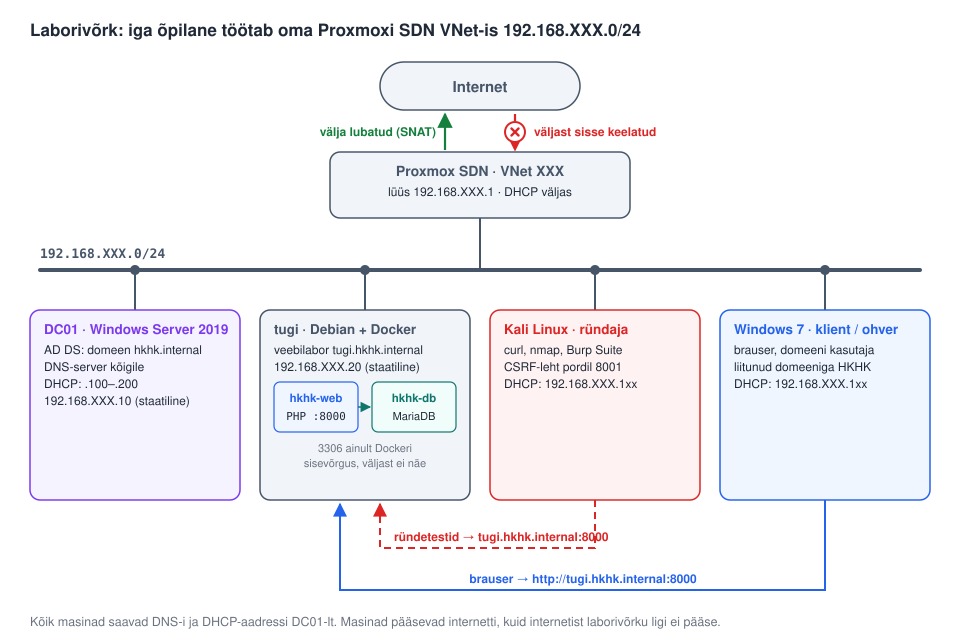
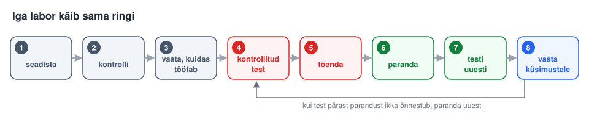
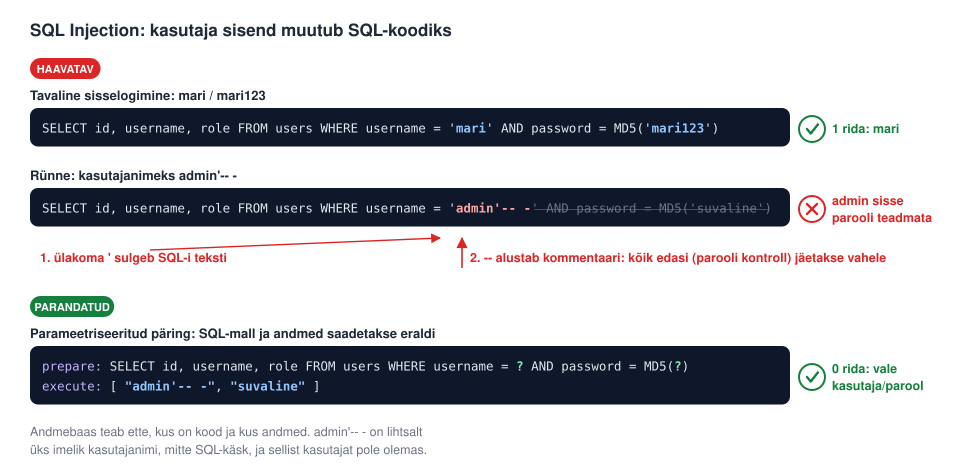
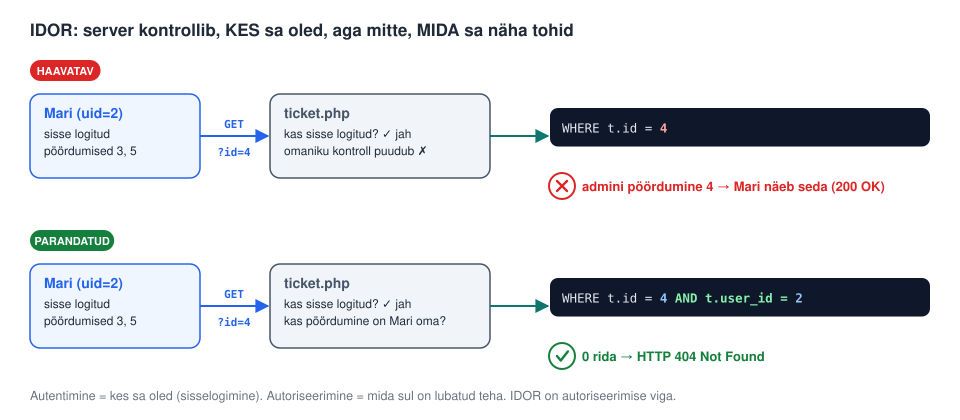
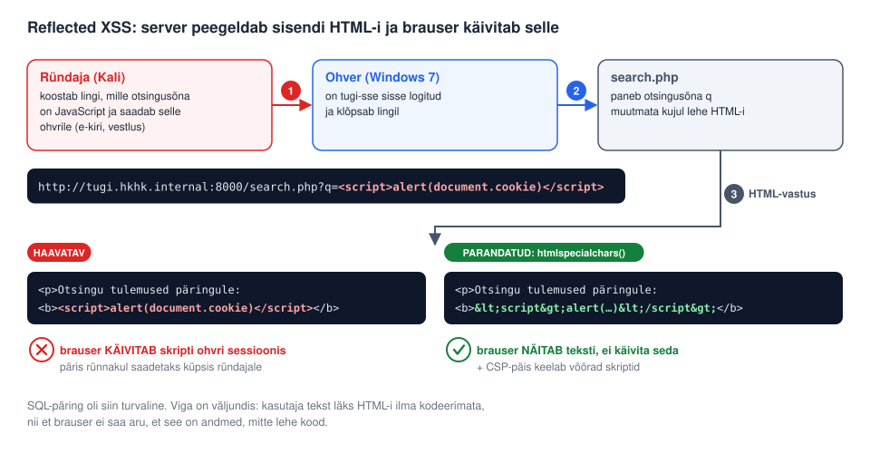
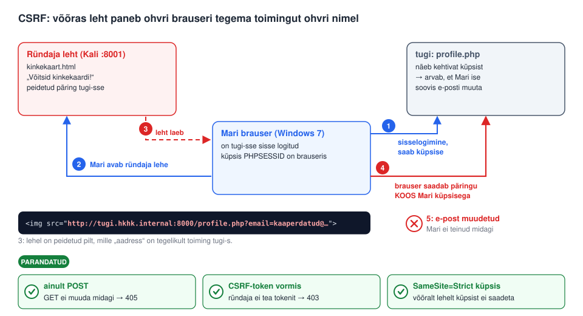
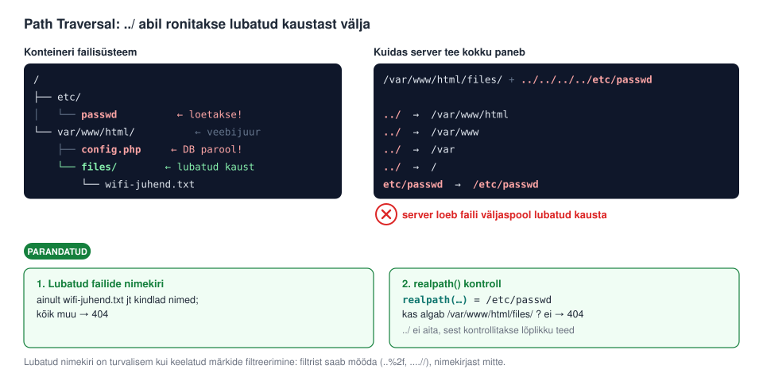
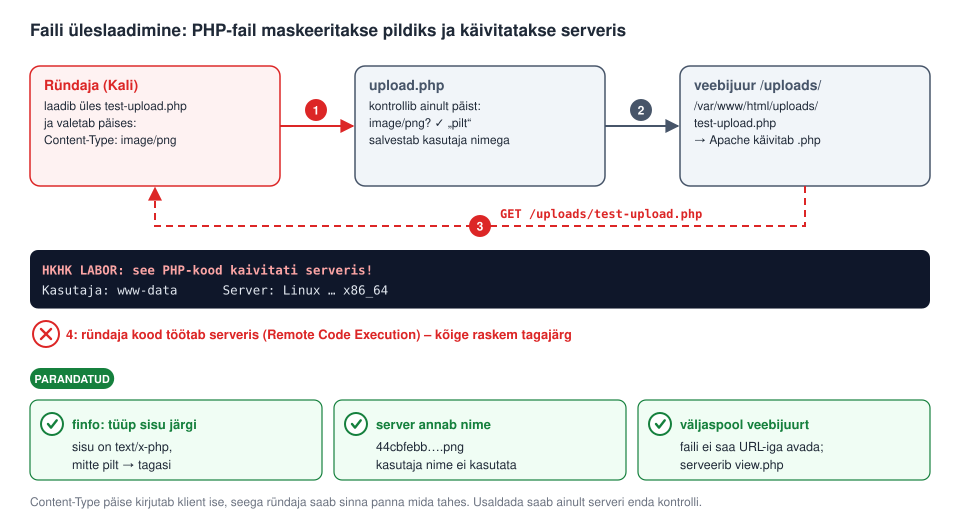

# HKHK veebiturbe labor – PHP/MySQL praktikum

## Samm-sammuline juhend koos päris logiväljunditega

See labor täiendab OWASP Juice Shopi ja WebGoati laboreid ühe olulise asjaga:
siin on **sinu enda rakenduse lähtekood**, nii et sa saad vea päriselt
**parandada**, rakenduse uuesti käivitada ja **testi korrata**. Just seda tsüklit
Juice Shop ja WebGoat ei võimalda.

Rakendus on väljamõeldud kasutajatoe süsteem „HKHK Tugi“. Selles on **kuus
tahtlikku turvaviga**:

| # | Haavatavus | Fail | OWASP Top 10 | Lühidalt |
|---|-----------|------|--------------|----------|
| A | SQL Injection | `login.php` | A03 Injection | Sisend muutub SQL-koodiks, sisselogimine ilma paroolita |
| B | Broken Access Control (IDOR) | `ticket.php` | A01 | ID-d muutes näed teiste kasutajate andmeid |
| C | Reflected XSS | `search.php` | A03 | Sinu JavaScript käivitub teise kasutaja brauseris |
| D | CSRF | `profile.php` | A01 / varasem A08 | Võõras leht teeb toimingu ohvri nimel |
| E | Path Traversal | `download.php` | A01 | `../` abil loed faile väljaspool lubatud kausta |
| F | Unrestricted File Upload | `upload.php` | A04 / A05 | Laadid üles PHP-faili ja käivitad selle serveris |

> ⚠️ **Hoiatus.** Rakendus on *tahtlikult katki*. Käivita see **ainult
> isoleeritud laborivõrgus**. Ära ava seda kunagi internetti ega kooli
> tootmisvõrku.

> ⚖️ **Seadus ja eetika.** Kõiki selles juhendis kirjeldatud võtteid tohid
> kasutada **ainult selles laboris**. Võõrale süsteemile loata ligipääs ja
> selle ründamine on Eestis kuritegu (Karistusseadustik § 206, § 217).
> Turvaspetsialist testib ainult siis, kui omanik on selleks loa andnud.

---

# 0. Põhimõisted enne alustamist

Enne rünnakute juurde minekut pead teadma, kuidas veebirakendus töötab. Iga
haavatavus selles laboris on lihtsalt viga mõnes allpool kirjeldatud sammus.



1. **Brauser** (või `curl`) saadab serverile **HTTP-päringu**.
2. **PHP-kood** (`hkhk-web` konteiner) loeb päringust parameetrid ja koostab
   nende põhjal **SQL-päringu**.
3. **Andmebaas** (`hkhk-db`, MariaDB) tagastab andmeread.
4. PHP paneb andmed **HTML-lehe** sisse ja saadab selle **HTTP-vastusena**
   tagasi brauserile.

Kõik, mis tuleb päringuga brauserist, on **kasutaja sisend**: URL-i
parameetrid, vormiväljad, küpsised, päised ja üleslaaditud failid. Ründaja
saab neid kõiki ise vabalt muuta. Turvalise rakenduse põhireegel on:
**ära kunagi usalda kasutaja sisendit.**

## Sõnastik

| Termin | Selgitus |
|--------|----------|
| **HTTP-päring / -vastus** | Brauseri ja serveri suhtlus. Päringus on meetod (GET, POST), aadress, päised ja vahel sisu; vastuses on olekukood (200, 302, 404…), päised ja sisu (nt HTML). |
| **GET** | Päring, mille parameetrid on URL-is (`?id=3`). Mõeldud andmete **lugemiseks**. |
| **POST** | Päring, mille andmed on päringu sisus (nt vorm). Mõeldud andmete **muutmiseks**. |
| **Olekukood** | `200 OK` – õnnestus; `302 Found` – ümbersuunamine; `403 Forbidden` – keelatud; `404 Not Found` – ei leitud; `405 Method Not Allowed` – vale meetod. |
| **Küpsis (cookie)** | Väike andmetükk, mille server annab brauserile ja mille brauser saadab iga järgmise päringuga tagasi. |
| **Sessioon** | Serveri „mälu“ sisselogitud kasutaja kohta. Brauseris hoiab seda küpsis `PHPSESSID`. Kes teab küpsist, on serveri jaoks see kasutaja. |
| **SQL** | Keel andmebaasist andmete küsimiseks (`SELECT … FROM … WHERE …`). |
| **HTML / JavaScript** | HTML kirjeldab lehe sisu; JavaScript on kood, mida **brauser** lehel käivitab. |
| **Veebijuur** | Serveri kaust (`/var/www/html`), mille failid on URL-i kaudu kättesaadavad. `.php` failid seal **käivitatakse**. |
| **Haavatavus** | Viga rakenduses, mida saab ära kasutada. |
| **Kontrollitud test** | Rünnak, mida teed teadlikult oma laboris, et tõendada haavatavuse olemasolu. |
| **Tõendus** | Päring, vastus ja logirida, mis näitavad, et rünnak õnnestus. |
| **OWASP Top 10** | Veebirakenduste kümme levinumat riskiklassi ([owasp.org](https://owasp.org/www-project-top-ten/)). |

## Tööriistad

| Tööriist | Kus | Milleks |
|----------|-----|---------|
| `curl` | Kali | Saadab HTTP-päringu käsurealt; näed täpselt, mida saatsid ja mis tuli vastu. `-i` näitab vastuse päiseid, `-b`/`-c` loeb või salvestab küpsiseid, `--data-urlencode` saadab vormi välja. |
| **Burp Suite** | Kali | Vahendaja brauseri ja serveri vahel: saad päringut enne saatmist pealt kuulata ja muuta. |
| `nmap` | Kali | Näitab, millised pordid serveril on avatud. |
| **Developer Tools (F12)** | brauser | Vahekaart *Network* näitab päringuid ja vastuseid, *Application/Storage* küpsiseid. |
| `docker compose logs -f web` | tugi | Rakenduse logi: mida PHP iga päringuga tegi. |
| `general.log` | tugi | Andmebaasi logi: iga SQL-päring, mis tegelikult käivitati. |

---

# 1. Eeldused

Laborivõrk peab olema seadistatud juhendi [VORK.md](VORK.md) järgi:



| Masin | Aadress | Roll selles laboris |
|-------|---------|---------------------|
| **tugi** (Debian + Docker) | `192.168.XXX.20`, nimi `tugi.hkhk.internal` | Haavatav veebirakendus pordil 8000 |
| **Kali Linux** | DHCP | Ründaja: `curl`, `nmap`, Burp Suite, CSRF-leht pordil 8001 |
| **Windows 7** | DHCP | Ohvri brauser (XSS, CSRF) |
| **DC01** (Windows Server 2019) | `192.168.XXX.10` | DNS: tänu sellele töötab nimi `tugi.hkhk.internal` |

**XXX** on sinu SDN VNet-i number. Juhendi käsud kasutavad nime
`tugi.hkhk.internal`, nii et neid ei pea muutma. Kui DNS mingil põhjusel ei
tööta, asenda nimi Debiani IP-aadressiga `192.168.XXX.20`.

Kontrolli Debianil, et Docker on paigaldatud:

```bash
docker --version
docker compose version
```

> Kui sinu kasutaja ei ole `docker` grupis, lisa igale `docker` käsule ette
> `sudo`.

---

# 2. Rakenduse käivitamine

Paki kaust `hkhk-veebilabor` Debiani masinasse lahti ja mine sinna sisse:

```bash
cd hkhk-veebilabor
```

Tee seadistusfail näidisfailist ja pane sinna Debiani laborivõrgu IP:

```bash
cp .env.example .env
nano .env
```

```text
LAB_IP=192.168.XXX.20
```

**Miks see oluline on?** Docker avab pordi 8000 **ainult sellel aadressil**.
Nii on haavatav rakendus nähtav ainult sinu laborivõrgus. Andmebaasi port
3306 ei ole üldse väljapoole avatud.

Ehita ja käivita konteinerid:

```bash
docker compose up -d --build
```

Kontrolli, et mõlemad konteinerid töötavad:

```bash
docker compose ps
```

Oodatav väljund:

```text
NAME       IMAGE               STATUS                   PORTS
hkhk-db    mariadb:11          Up (healthy)
hkhk-web   hkhk-veebilabor-web Up                       192.168.XXX.20:8000->80/tcp
```

Ava Windows 7 või Kali brauseris:

```text
http://tugi.hkhk.internal:8000/
```

Laborikontod (kõik paroolid on väljamõeldud):

| Kasutaja | Parool | Roll |
|----------|--------|------|
| `mari` | `mari123` | tavakasutaja |
| `juri` | `juri123` | tavakasutaja |
| `admin` | `Adm1n!Labor#2026` | administraator |

## Sisselogitud sessioon curl-i jaoks

Mitu testi vajab Mari sisselogitud sessiooni. Logi Kalil Mari nimel sisse ja
salvesta küpsis faili `mari.jar`:

```bash
curl -s -i -c mari.jar \
  --data-urlencode "username=mari" --data-urlencode "password=mari123" \
  http://tugi.hkhk.internal:8000/login.php
```

Edaspidi annab `-b mari.jar` iga päringuga kaasa Mari küpsise, nii et server
peab sind Mariks. Täpselt nii töötab ka brauser.

## Logide jälgimine

Hoia Debianil **teises terminalis** kogu labori vältel avatuna rakenduse
logi. Siin näed, mida server iga päringuga teeb:

```bash
docker compose logs -f web
```

Andmebaasi tegelikke SQL-päringuid näed nii:

```bash
docker compose exec db tail -f /var/lib/mysql/general.log
```

> Kõik allpool toodud logiread on **päris väljund** selle rakenduse
> käivitamisest. Sinu logis on ajatemplid ja protsessi-ID-d teised, aga sisu
> peab olema sama.

---

# 3. Õppetsükkel

Iga labor järgib sama mustrit:



1. **Seadista ja kontrolli**, et rakendus töötab.
2. **Vaata, kuidas süsteem töötab**: tee tavaline toiming ja loe logist, mida
   server tegi.
3. **Kontrollitud test**: saada päring, mis kasutab viga ära.
4. **Tõenda**: salvesta päring, vastus ja logirida.
5. **Paranda**: asenda haavatav fail parandatud versiooniga.
6. **Testi uuesti** täpselt sama päringuga ja näita, et rünnak enam ei toimi.
7. **Vasta küsimustele**.

**Parandamine** käib nii: parandatud failid on kaustas `lahendused/`. Kui
juhend ütleb „paranda“, kopeeri vastav fail `src/`-i ja taaskäivita
veebikonteiner:

```bash
cp lahendused/login.php src/login.php
docker compose restart web
```

Kaust `src/` on konteinerisse otse ühendatud (*bind mount*), seega konteinerit
pole vaja uuesti ehitada. Piisab taaskäivitusest.

Enne kopeerimist **ava mõlemad failid ja võrdle neid**, näiteks
`diff src/login.php lahendused/login.php`. Õppimise mõte on mõista, **milline
rida** viga parandab, mitte faili kopeerimine.

---

# LABOR A – SQL Injection (`login.php`)

## Mis see on?

**SQL Injection** (SQL-süst) tekib siis, kui rakendus paneb kasutaja sisendi
**otse SQL-lause teksti sisse**. Andmebaas saab kätte ühe pika teksti ega tea,
milline osa on programmeerija kirjutatud kood ja milline osa kasutaja
sisestatud andmed. Kui sisendis on SQL-i erimärke, näiteks ülakoma `'` või
kommentaar `--`, muudavad need päringu tähendust.

Tagajärg: ründaja saab sisse logida ilma paroolita, lugeda kõiki tabeleid või
andmeid muuta ja kustutada.



**Mida sa selles laboris teed:** kõigepealt lõhud ühe ülakomaga päringu ära
(tõend, et sisend jõuab SQL-ini). Seejärel logid sisse administraatorina
parooli teadmata ja lõpuks parandad koodi parameetriseeritud päringuga.

## A.1. Vaata, kuidas süsteem töötab

Logi sisse tavakasutajana `mari` / `mari123`. Vaata logis, millise
SQL-päringu server koostas:

```text
[HKHK] user=- LOGIN SQL: SELECT id, username, role FROM users WHERE username = 'mari' AND password = MD5('mari123')
[HKHK] user=mari LOGIN OK uid=2
```

Näed kohe probleemi: kasutajanimi `mari` on pandud **otse** SQL-lause sisse
ülakomade vahele. Server ei erista kasutaja sisendit SQL-koodist.

## A.2. Kontrollitud test – katkesta päring

Logi välja. Proovi kasutajanimeks panna üks ülakoma:

* Kasutajanimi: `mari'`
* Parool: `x`

Kali terminalist (sama asja saab teha ka brauseris):

```bash
curl -s -i --data-urlencode "username=mari'" --data-urlencode "password=x" \
  http://tugi.hkhk.internal:8000/login.php
```

Server annab vea (sest `display_errors` on sees – see on omaette
turvaviga, *security misconfiguration*):

```text
Fatal error:  Uncaught PDOException: SQLSTATE[42000]: Syntax error or access
violation: 1064 You have an error in your SQL syntax; ... near 'x')' at line 1
in /var/www/html/login.php:13
```

**Mis juhtus?** Sinu ülakoma sulges SQL-is kasutajanime teksti liiga vara.
Ülejäänud lause jäi „katki“ ja andmebaas ei saanud sellest aru. See
**tõendab**, et sinu sisend jõudis muutmata kujul SQL-mootorini. Logis:

```text
[HKHK] user=- LOGIN SQL: SELECT id, username, role FROM users WHERE username = 'mari'' AND password = MD5('x')
PHP Fatal error:  Uncaught PDOException: SQLSTATE[42000]: ... near 'x')' at line 1
```

Pane tähele ka seda, et veateade näitab ründajale faili asukohta
(`/var/www/html/login.php`) ja reanumbrit. Ka see info aitab ründajat.

## A.3. Kontrollitud test – möödu autentimisest

Nüüd kasuta ülakoma ja kommentaari, et parooli kontroll „ära lõigata“.
Kasutajanimeks:

```text
admin'-- -
```

Parooliks ükskõik mis. Serverile saadetud päring:

```bash
curl -s -i -c admin.jar \
  --data-urlencode "username=admin'-- -" \
  --data-urlencode "password=suvaline" \
  http://tugi.hkhk.internal:8000/login.php
```

Server koostab sellise lause (näed logist):

```text
[HKHK] user=- LOGIN SQL: SELECT id, username, role FROM users WHERE username = 'admin'-- -' AND password = MD5('suvaline')
[HKHK] user=admin LOGIN OK uid=1
```

Loe lauset osade kaupa:

| Osa | Mida andmebaas sellest arvab |
|-----|------------------------------|
| `username = 'admin'` | Otsi kasutajat nimega `admin`. Ülakoma sulges teksti. |
| `-- ` | Siit algab kommentaar: kõike edasi ignoreeritakse. |
| `-' AND password = MD5('suvaline')` | Kommentaar – **parooli ei kontrollita üldse**. |

MariaDB-s peab `--` järel olema tühik. Lõpus olev `-` hoiab tühiku alles ka
siis, kui brauser või vorm rea lõpust tühikud ära kärbib.

Server logib sind sisse **administraatorina, parooli teadmata**. Vastuses
näed ümbersuunamist:

```text
HTTP/1.1 302 Found
Location: tickets.php
```

Küpsisega `admin.jar` pääsed nüüd admin-vaatesse:

```bash
curl -s -b admin.jar http://tugi.hkhk.internal:8000/admin.php
```

**Tõendus:** salvesta ekraanitõmmis admin-lehest + see logirida `LOGIN OK uid=1`.

## A.4. Paranda

```bash
cp lahendused/login.php src/login.php
docker compose restart web
```

Parandus kasutab **parameetriseeritud päringut** (*prepared statement*):

```php
$st = $pdo->prepare('SELECT id, username, role FROM users WHERE username = ? AND password = MD5(?)');
$st->execute([$u, $p]);
```

**Miks see aitab?** Päring saadetakse andmebaasile kahes osas:

1. `prepare` – SQL-mall, kus andmete kohal on küsimärgid `?`. Andmebaas
   analüüsib selle lause ära **enne**, kui ta näeb kasutaja sisendit.
2. `execute` – kasutaja andmed eraldi. Need lähevad küsimärkide kohale
   **alati andmetena** ega saa enam lause struktuuri muuta.

Nii on `admin'-- -` lihtsalt üks imelik kasutajanimi, mitte SQL-käsk.

## A.5. Testi uuesti

Proovi sama rünnakut `admin'-- -`:

```bash
curl -s -i --data-urlencode "username=admin'-- -" --data-urlencode "password=suvaline" \
  http://tugi.hkhk.internal:8000/login.php
```

Nüüd:

```text
HTTP/1.1 200 OK
...
<p class="err">Vale kasutajanimi või parool.</p>
```

Andmebaasi logis näed, et päring on nüüd **ette valmistatud** ja ründeköis
läheb sisse ühe tükina andmetena (pane tähele `\'` – ülakoma on turvaliselt
varjestatud):

```text
51 Prepare   SELECT id, username, role FROM users WHERE username = ? AND password = MD5(?)
51 Execute   SELECT id, username, role FROM users WHERE username = 'mari' AND password = MD5('mari123')
53 Execute   SELECT id, username, role FROM users WHERE username = 'admin\'-- -' AND password = MD5('suvaline')
```

Rakenduse logis:

```text
[HKHK] user=- LOGIN prepared statement, username=admin'-- -
[HKHK] user=- LOGIN FAIL username=admin'-- -
```

> **Lisatähelepanek.** Paroole hoitakse siin MD5-räsina. MD5 on paroolide
> jaoks liiga kiire ja ilma soolata räsisid on lihtne murda. Päris rakenduses
> kasuta PHP funktsioone `password_hash()` ja `password_verify()`.

## A.6. Küsimused

1. Miks ei peatanud ülakoma varjestamine (escaping) üksinda probleemi, vaid
   lahenduseks on parameetriseeritud päring?
2. Mida teeb `-- -` SQL-päringus?
3. Miks on `display_errors=On` tootmisserveris omaette turvarisk?

---

# LABOR B – Broken Access Control / IDOR (`ticket.php`)

## Mis see on?

**Juurdepääsukontroll** (*access control*) otsustab, mida sisselogitud
kasutaja tohib näha ja teha. Siin on kaks erinevat mõistet:

* **Autentimine** – *kes sa oled?* (sisselogimine kasutajanime ja parooliga)
* **Autoriseerimine** – *mida sul on lubatud teha?* (kas see pöördumine on sinu oma)

**IDOR** (*Insecure Direct Object Reference*, ebaturvaline otseviide
objektile) tekib siis, kui URL-is on objekti number (`?id=3`) ja server annab
objekti välja lihtsalt numbri järgi, kontrollimata, kas see kuulub
päringu tegijale. Ründaja muudab numbrit ja näeb teiste kasutajate andmeid.

See on OWASP Top 10 nimekirja **esimene** risk (A01), sest viga on lihtne
teha ja lihtne ära kasutada: piisab brauseri aadressiribal ühe numbri
muutmisest.



**Mida sa selles laboris teed:** Marina logituna avad pöördumise, mis kuulub
administraatorile, lihtsalt URL-is ID-d muutes. Seejärel lisad päringusse
omaniku kontrolli.

## B.1. Vaata, kuidas süsteem töötab

Logi sisse kui `mari`. Ava „Minu pöördumised“ ja vajuta ühele pöördumisele.
URL on kujul:

```text
http://tugi.hkhk.internal:8000/ticket.php?id=3
```

Number `id` on **otsene viide objektile**: andmebaasi tabeli `tickets` rea
number.

## B.2. Kontrollitud test

Mari pöördumised on ID 3 ja 5. Proovi käsitsi avada ID 4, mis **ei kuulu
Marile** (see on admini konfidentsiaalne pöördumine):

```bash
# mari.jar = Mari sisselogitud sessioon (vt peatükk 2)
curl -s -b mari.jar "http://tugi.hkhk.internal:8000/ticket.php?id=4"
```

Server tagastab Marile võõra pöördumise sisu:

```text
HTTP/1.1 200 OK
  Pealkiri: KONFIDENTSIAALNE: VPN
  Omanik: admin
  Sisu: Ajutine VPN-i võti serveriruumi jaoks: LABOR-VPN-7731 (väljamõeldud).
```

Logis näed, et server **ei kontrollinud omanikku**, vaid ainult seda, et
keegi on sisse loginud. Mari uid on 2, aga pöördumine 4 kuulub adminile (uid=1):

```text
[HKHK] user=mari TICKET VIEW id=4 uid=2
```

Proovi ka teisi numbreid. Nii käib ka päris rünnak: ründaja
proovib automaatselt läbi kõik ID-d (*enumeration*).

**Tõendus:** ekraanitõmmis võõra pöördumise sisust + logirida.

## B.3. Paranda ja testi uuesti

```bash
cp lahendused/ticket.php src/ticket.php
docker compose restart web
```

Parandus lisab omaniku kontrolli **SQL-päringusse endasse**:

```php
WHERE t.id = ? AND t.user_id = ?
```

Teise küsimärgi väärtus tuleb **serveri sessioonist** (sisselogitud kasutaja
uid), mitte päringust. Kasutaja ei saa seda ise muuta.

Korda testi:

```bash
curl -s -i -b mari.jar "http://tugi.hkhk.internal:8000/ticket.php?id=4"
```

Nüüd:

```text
HTTP/1.1 404 Not Found
```
```text
[HKHK] user=mari TICKET DENIED id=4 uid=2
```

> Pane tähele: tagastatakse **404**, mitte 403. Nii ei saa ründaja teada,
> kas sellise ID-ga pöördumine üldse olemas on.

## B.4. Küsimused

1. Mille poolest erineb autentimine autoriseerimisest selles laboris?
2. Miks ei piisa admin-nupu peitmisest kasutajaliideses?
3. Miks tagastab parandus 404, mitte 403?

---

# LABOR C – Reflected XSS (`search.php`)

## Mis see on?

**XSS** (*Cross-Site Scripting*, saidiülene skriptimine) tekib siis, kui
rakendus paneb kasutaja sisendi **HTML-lehe sisse ilma kodeerimata**. Kui
sisendis on `<script>` silt, ei saa brauser aru, et see on andmed. Ta peab
seda lehe koodiks ja **käivitab selle**.

Oluline on mõista, **kelle** arvutis kood käivitub: mitte serveris, vaid
**teise kasutaja brauseris**, tema sisselogitud sessioonis. Nii saab ründaja
näiteks varastada ohvri sessiooniküpsise ja logida tema nimel sisse, muuta
lehe sisu või saata ohvri nimel päringuid.

* **Reflected** (peegeldatud) XSS – skript on lingis ja server „peegeldab“
  selle kohe vastusesse tagasi. Ohver peab lingil klõpsama.
* **Stored** (salvestatud) XSS – skript salvestatakse andmebaasi (nt
  kommentaari) ja käivitub igaühel, kes lehte vaatab.



**Mida sa selles laboris teed:** paned otsingusõnaks JavaScripti ja näed, et
brauser käivitab selle. Seejärel parandad väljundi kodeerimisega.

## C.1. Vaata, kuidas süsteem töötab

Logi sisse. Ava „Otsing“ ja otsi sõna `test`. Otsingusõna kuvatakse tagasi
lehel: *„Otsingu tulemused päringule: test“*.

Oluline: SQL-päring ise on siin **turvaline** (parameetriseeritud). Probleem
on **väljundis** – otsingusõna pannakse HTML-i kodeerimata.

## C.2. Kontrollitud test

Otsi järgmist teksti (brauseris otsingukasti, või URL-iga):

```text
<script>alert(document.cookie)</script>
```

```bash
curl -s -b mari.jar \
  "http://tugi.hkhk.internal:8000/search.php?q=%3Cscript%3Ealert(document.cookie)%3C/script%3E"
```

URL-is on `<` kodeeritud kujul `%3C` ja `>` kujul `%3E`, sest need märgid ei
tohi URL-is olla muutmata kujul. Server dekodeerib need tagasi.

Serveri vastuses on sinu skript **muutmata HTML-ina**:

```text
<p>Otsingu tulemused päringule: <b><script>alert(document.cookie)</script></b></p>
```

Ava sama link **Windows 7 brauseris**, kus Mari on sisse logitud. Käivitub
`alert`, mis näitab sessiooniküpsist. See **tõendab**, et ründaja kirjutatud
JavaScript jookseb ohvri brauseris. Päris rünnakus ei näidataks küpsist
aknas, vaid saadetaks see vaikselt ründaja serverisse.

Logis näed, et SQL-pool oli korras (kasutati `LIKE ?`), aga server peegeldas
sisendi tagasi:

```text
[HKHK] user=mari SEARCH q=<script>alert(document.cookie)</script>
```

## C.3. Paranda ja testi uuesti

```bash
cp lahendused/search.php src/search.php
docker compose restart web
```

Parandus kodeerib väljundi (`htmlspecialchars`, abifunktsioon `e()`) ja lisab
**Content-Security-Policy** (CSP) päise.

* **Väljundi kodeerimine** muudab HTML-i erimärgid ohutuks: `<` → `&lt;`,
  `>` → `&gt;`, `"` → `&quot;`. Brauser näitab neid ekraanil märkidena, aga ei
  tõlgenda neid koodina.
* **CSP** on teine kaitsekiht: päis ütleb brauserile, et lehel tohib käivitada
  ainult lubatud skripte. Kui kodeerimine kuskil ununeb, ei käivita brauser
  sisse süstitud skripti ikkagi.

Korda testi:

```bash
curl -s -b mari.jar \
  "http://tugi.hkhk.internal:8000/search.php?q=%3Cscript%3Ealert(document.cookie)%3C/script%3E"
```

Nüüd on `<` muudetud ohutuks tekstiks:

```text
<p>Otsingu tulemused päringule: <b>&lt;script&gt;alert(document.cookie)&lt;/script&gt;</b></p>
```

Brauser kuvab teksti, aga **ei käivita** seda skriptina.

## C.4. Küsimused

1. Miks ei olnud see SQL Injection, kuigi sisend läks andmebaasi?
2. Mis on kontekstipõhine väljundi kodeerimine?
3. Kuidas aitab `HttpOnly` küpsis XSS-i mõju vähendada?

---

# LABOR D – CSRF (`profile.php`)

## Mis see on?

**CSRF** (*Cross-Site Request Forgery*, saidiülese päringu võltsimine) kasutab
ära seda, et **brauser saadab küpsised automaatselt kaasa** igale päringule,
mis läheb vastavale serverile – ka siis, kui päringu algatas hoopis teine
veebileht.

Rünnaku käik:

1. Mari logib sisse rakendusse `tugi` ja tema brauserisse jääb sessiooniküpsis.
2. Mari avab samas brauseris ründaja lehe, näiteks „Võitsid kinkekaardi!“.
3. Ründaja lehel on peidetud element (pilt, vorm), mis teeb päringu `tugi`
   serverisse, näiteks „muuda e-posti aadress“.
4. Brauser saadab selle päringu **koos Mari küpsisega**.
5. Server näeb kehtivat sessiooni ja arvab, et Mari ise soovis muudatust.

Ründaja ei näe kunagi Mari küpsist ega vastust. Ta paneb lihtsalt Mari
brauseri tema nimel toimingu tegema.



**Mida sa selles laboris teed:** käivitad Kalil ründaja lehe, avad selle
Windows 7 brauseris, kus Mari on sisse logitud, ja näed, kuidas Mari e-post
muutub ilma tema teadmata. Seejärel lisad kolm kaitset.

## D.1. Vaata, kuidas süsteem töötab

Logi sisse kui `mari`. Ava „Profiil“ ja muuda e-posti aadressi. Toiming
muudab serveris olekut (andmebaasi kirjet).

Selles versioonis on **kolm viga**:

1. toiming aktsepteerib **GET**-päringut (muutus käib lihtsalt lingi avamisega);
2. vormis puudub **CSRF-token** (server ei kontrolli, kas päring tuli tema enda vormist);
3. küpsisel puudub **SameSite** (brauser saadab küpsise ka võõralt lehelt algatatud päringutega).

## D.2. Kontrollitud test

Kaustas `rundaja/` on fail `kinkekaart.html` – pahatahtlik leht, mis saadab
Mari brauseri kaudu vaikselt päringu. Simuleeri seda päringut kõigepealt
`curl`-iga (`-e` lisab võõra Referer-päise, nagu tuleks päring teiselt saidilt;
asenda `<KALI_IP>` Kali aadressiga, vt `ip -4 addr`):

```bash
curl -s -i -b mari.jar \
  -e "http://<KALI_IP>:8001/kinkekaart.html" \
  "http://tugi.hkhk.internal:8000/profile.php?email=kaaperdatud@kurjam.labor"
```

Server muudab e-posti aadressi ära:

```text
HTTP/1.1 200 OK
  E-post: kaaperdatud@kurjam.labor
  E-posti aadress muudetud.
```

Logis on näha, et toiming tehti **GET-meetodiga teiselt saidilt**:

```text
[HKHK] user=mari PROFILE EMAIL CHANGE method=GET new=kaaperdatud@kurjam.labor referer=http://<KALI_IP>:8001/kinkekaart.html
```

**Päris rünnak ohvri brauseri kaudu:**

1. Kalil käivita ründaja leht:
   ```bash
   cd rundaja && python3 -m http.server 8001
   ```
2. Windows 7 brauseris logi sisse kui `mari` aadressil
   `http://tugi.hkhk.internal:8000`.
3. Ava **samas brauseris** uus vahekaart `http://<KALI_IP>:8001/kinkekaart.html`.
4. Mine tagasi Mari profiilile ja vaata, et e-post on muutunud – Mari ei
   vajutanud midagi.

## D.3. Paranda ja testi uuesti

```bash
cp lahendused/config.php  src/config.php
cp lahendused/profile.php src/profile.php
docker compose restart web
```

Parandusel on kolm kihti:

| Kaitse | Kuidas see toimib |
|--------|-------------------|
| **Ainult POST** | Olekut muutvat toimingut ei saa teha lingi või pildi aadressiga. |
| **CSRF-token** | Server paneb igasse vormi juhusliku salajase väärtuse ja kontrollib seda. Ründaja leht ei tea tokenit, seega tema päring lükatakse tagasi. |
| **`SameSite=Strict` küpsis** | Brauser ei saada küpsist kaasa päringutega, mis algatati teiselt saidilt. Server ei näe siis Mari sessiooni üldse. |

**Test 1 – GET lükatakse tagasi:**

```bash
curl -s -i -b mari.jar "http://tugi.hkhk.internal:8000/profile.php?email=x@x.labor"
```
```text
HTTP/1.1 405 Method Not Allowed
[HKHK] user=mari PROFILE EMAIL CHANGE REJECTED method=GET
```

**Test 2 – POST ilma tokenita lükatakse tagasi:**

```bash
curl -s -i -b mari.jar -d "email=x@x.labor" "http://tugi.hkhk.internal:8000/profile.php"
```
```text
HTTP/1.1 403 Forbidden
[HKHK] user=mari PROFILE CSRF TOKEN INVALID referer=...
```

**Test 3 – päris vorm kehtiva tokeniga töötab:**

```text
[HKHK] user=mari PROFILE EMAIL CHANGE method=POST new=mari.uus@hkhk.labor
```

Pane ka tähele, et sisselogimisel on küpsisel nüüd kaitse (logi uuesti sisse,
et saada uus küpsis):

```text
Set-Cookie: PHPSESSID=...; path=/; HttpOnly; SameSite=Strict
```

Korda ka päris rünnakut Windows 7 brauseris: kinkekaardi leht ei suuda enam
e-posti muuta.

## D.4. Küsimused

1. Miks on olekut muutva toimingu lubamine GET-meetodiga ohtlik?
2. Kuidas CSRF-token takistab võõralt saidilt tulnud päringut?
3. Mida teeb `SameSite=Strict` küpsis?

---

# LABOR E – Path Traversal (`download.php`)

## Mis see on?

**Path Traversal** (kataloogist väljumine, ka *directory traversal*) tekib
siis, kui rakendus paneb kasutaja antud failinime **otse failitee sisse**.
Failiteedes tähendab `..` „üks kaust ülespoole“. Mitu `../` järjest viivad
lubatud kaustast välja kuni failisüsteemi juureni `/`, kust saab minna mis
tahes faili juurde.

Tagajärg: ründaja loeb faile, mida ta kunagi näha ei tohiks – süsteemifaile,
rakenduse lähtekoodi, seadistusfaile koos andmebaasi paroolidega.



**Mida sa selles laboris teed:** loed juhendite allalaadimise kaudu serveri
faili `/etc/passwd` ja rakenduse seadistusfaili. Seejärel piirad allalaadimise
lubatud failidega.

## E.1. Vaata, kuidas süsteem töötab

Logi sisse. Ava „Juhendid“. Faile laaditakse alla URL-iga:

```text
http://tugi.hkhk.internal:8000/download.php?file=wifi-juhend.txt
```

Server liidab failinime otse kataloogiteele: `files/ + wifi-juhend.txt`.

## E.2. Kontrollitud test

Proovi „välja ronida“ lubatud kaustast `../` abil ja lugeda süsteemifaili:

```bash
curl -s -i -b mari.jar \
  "http://tugi.hkhk.internal:8000/download.php?file=../../../../etc/passwd"
```

Server tagastab konteineri kasutajate faili sisu:

```text
HTTP/1.1 200 OK
Content-Type: text/plain; charset=utf-8

root:x:0:0:root:/root:/bin/bash
daemon:x:1:1:daemon:/usr/sbin:/usr/sbin/nologin
...
```

Fail `/etc/passwd` on klassikaline tõendusfail, sest see on igas Linuxis
olemas. Paroole seal tänapäeval pole, kuid on kasutajate nimekiri.

Sama meetodiga saab lugeda ka rakenduse enda seadistust koos andmebaasi
parooliga. See on päris rünnakul palju väärtuslikum saak:

```bash
curl -s -b mari.jar "http://tugi.hkhk.internal:8000/download.php?file=../config.php"
```

Logis on näha, kuhu tee tegelikult osutab:

```text
[HKHK] user=mari DOWNLOAD path=/var/www/html/files/../../../../etc/passwd
```

**Tõendus:** ekraanitõmmis `/etc/passwd` sisust brauseris + logirida.

## E.3. Paranda ja testi uuesti

```bash
cp lahendused/download.php src/download.php
docker compose restart web
```

Parandusel on kaks kihti:

1. **Lubatud failide nimekiri** (*allowlist*) – allalaadida saab ainult
   kindlaksmääratud faile. Kõik muu annab vastuse 404.
2. **`realpath()` kontroll** – funktsioon arvutab välja faili tegeliku
   lõpliku tee (kõik `../` on lahti kirjutatud). Seejärel kontrollitakse,
   kas see tee algab lubatud kaustaga `/var/www/html/files/`.

Korda testi:

```bash
curl -s -i -b mari.jar "http://tugi.hkhk.internal:8000/download.php?file=../../../../etc/passwd"
```
```text
HTTP/1.1 404 Not Found
Faili ei leitud.
```
```text
[HKHK] user=mari DOWNLOAD DENIED file=../../../../etc/passwd
```

Lubatud fail töötab endiselt:

```text
[HKHK] user=mari DOWNLOAD path=/var/www/html/files/wifi-juhend.txt
```

## E.4. Küsimused

1. Mida tähendab `../` failiteel?
2. Miks on lubatud failide nimekiri turvalisem kui „keelatud märkide“
   filtreerimine?
3. Mida teeb `realpath()` ja miks see aitab?

---

# LABOR F – Faili üleslaadimine (`upload.php`)

## Mis see on?

**Piiramata faili üleslaadimine** (*unrestricted file upload*) tekib siis, kui
rakendus lubab üles laadida faile, kontrollimata korralikult, **mis fail see
tegelikult on**, ja salvestab selle kohta, kust veebiserver saab seda
käivitada.

Selles rakenduses on kolm viga korraga:

1. tüüpi kontrollitakse ainult **kliendi saadetud** `Content-Type` päise järgi
   (selle kirjutab klient ise ja võib valetada);
2. fail salvestatakse **veebijuure alla** (`/var/www/html/uploads/`), kus
   Apache käivitab iga `.php` faili;
3. failinimi on **kasutaja antud** (`test-upload.php`).

Tagajärg on kõige raskem võimalik: **koodi kaugkäivitamine** (*Remote Code
Execution*, RCE). Ründaja saab serveris käivitada mis tahes käske.



**Mida sa selles laboris teed:** laadid üles PHP-skripti, valetad päises, et
see on PNG-pilt, ja käivitad skripti serveris. Seejärel lisad sisu järgi
tüübi kontrolli ja salvestad failid väljaspool veebijuurt.

## F.1. Vaata, kuidas süsteem töötab

Logi sisse. Ava „Üleslaadimine“. Server kontrollib ainult **kliendi
saadetud** Content-Type päist ja salvestab faili veebijuure alla
kasutaja antud nimega.

## F.2. Kontrollitud test

Kaustas `rundaja/` on fail `test-upload.php` – kahjutu PHP-skript, mis
prindib serveri info. See **tõendab koodi käivitamist**, kui ta serveris
jookseb.

Esiteks näita, et aus üleslaadimine blokeeritakse (`curl` saadab PHP-faili
õige tüübiga):

```bash
curl -s -b mari.jar -F "f=@rundaja/test-upload.php" \
  http://tugi.hkhk.internal:8000/upload.php
```
```text
<p class='err'>Lubatud on ainult pildifailid (PNG, JPEG, GIF).</p>
```

Nüüd **võltsi** Content-Type päis väärtuseks `image/png` (Burp Suite'is
muudad päringut enne saatmist; `curl`-iga paned tüübi failinime järele):

```bash
curl -s -b mari.jar -F "f=@rundaja/test-upload.php;type=image/png" \
  http://tugi.hkhk.internal:8000/upload.php
```
```text
<p class='ok'>Fail salvestatud: <a href='uploads/test-upload.php'>uploads/test-upload.php</a></p>
```

Server uskus kliendi valet. Ava üleslaaditud fail – **PHP käivitub serveris**:

```bash
curl -s http://tugi.hkhk.internal:8000/uploads/test-upload.php
```
```text
HKHK LABOR: see PHP-kood kaivitati serveris!
Kasutaja: www-data
Server: Linux ... x86_64
```

Pane tähele: viimane päring tehti **ilma küpsiseta**. Kui fail on üles
laaditud, saab seda käivitada igaüks, kes teab aadressi.

Logis:

```text
[HKHK] user=mari UPLOAD name=test-upload.php type=image/png size=290
```

**Tõendus:** ekraanitõmmis serveris käivitunud skripti väljundist. See on
kõige raskem tagajärg – ründaja saab serveris oma koodi käivitada. Kasutaja
`www-data` näitab, et kood jookseb veebiserveri õigustes.

## F.3. Paranda ja testi uuesti

```bash
cp lahendused/config.php src/config.php
cp lahendused/upload.php src/upload.php
cp lahendused/view.php   src/view.php
docker compose restart web
```

Parandusel on kolm kihti:

| Kaitse | Kuidas see toimib |
|--------|-------------------|
| **Tüüp sisu järgi** (`finfo`) | Server loeb faili esimesed baidid (nn *magic bytes*). PNG-fail algab alati kindla baidijadaga; PHP-skript mitte. Päist ei usaldata. |
| **Server annab failinime** | Fail salvestatakse juhusliku nimega, nt `44cbfebb….png`. Ründaja ei saa valida laiendit `.php` ega ülekirjutada teisi faile. |
| **Väljaspool veebijuurt** | Faile ei saa otse URL-iga avada. Neid näitab `view.php`, mis saadab faili pildina, mitte ei käivita seda. |

Korda võlts-PNG rünnakut:

```bash
curl -s -b mari.jar -F "f=@rundaja/test-upload.php;type=image/png" \
  http://tugi.hkhk.internal:8000/upload.php
```
```text
<p class='err'>Lubatud on ainult pildifailid (PNG, JPEG, GIF).</p>
```
```text
[HKHK] user=mari UPLOAD name=test-upload.php client_type=image/png size=290
[HKHK] user=mari UPLOAD REJECTED real_type=text/x-php
```

Vana rada ei toimi enam (fail pole veebijuures):

```text
GET /uploads/test-upload.php  →  HTTP/1.1 404 Not Found
```

Päris pilt läheb läbi ja salvestatakse turvalise nimega:

```text
[HKHK] user=mari UPLOAD SAVED 44cbfebbcdd63ad0cc7524ac5dad6c01.png real_type=image/png
```

## F.4. Küsimused

1. Miks ei saa usaldada kliendi saadetud Content-Type väärtust?
2. Miks on ohtlik salvestada üleslaaditud fail kausta, kust PHP saab seda
   käivitada?
3. Miks genereerib turvaline rakendus failinime ise?

---

# 4. Kokkuvõte: kuus viga, üks põhjus

Kõigi kuue haavatavuse põhjus on sama: **rakendus usaldas kasutaja sisendit**.

| Labor | Mida usaldati | Õige kaitse |
|-------|---------------|-------------|
| A – SQL Injection | Sisend pandi SQL-i teksti | Parameetriseeritud päring |
| B – IDOR | URL-i `id` | Omaniku kontroll serveris (sessioonist) |
| C – XSS | Sisend pandi HTML-i | Väljundi kodeerimine + CSP |
| D – CSRF | Küpsis üksi tõendab tahet | POST + CSRF-token + SameSite |
| E – Path Traversal | Failinimi pandi teesse | Lubatud nimekiri + `realpath()` |
| F – Upload | Kliendi Content-Type päis | Sisu kontroll, serveri nimi, väljaspool veebijuurt |

---

# 5. Labori lähtestamine ja peatamine

Peata rakendus (andmed jäävad alles):

```bash
docker compose stop
```

Täielik lähtestamine – kustutab andmebaasi ja ehitab puhtalt uuesti (kasulik,
kui tahad labori järgmisele rühmale algseisu viia):

```bash
docker compose down -v
docker compose up -d --build
```

Üks mugav töövoog õppijale: enne iga labori algust tee kõik haavatavad failid
tagasi algseisu `git`-iga (`git checkout -- src/`) või kopeerides
varukoopiast, et saaks „enne ja pärast“ selgelt näidata.

---

# 6. Mida õpetaja hoiab enda käes

Kaust `lahendused/` on **õpetaja lahendusvõti**. Soovitus: anna õppijale ainult
haavatav `src/` ja see juhend ilma `lahendused/` kaustata; parandatud failid
jaga alles pärast seda, kui õppija on rünnaku ise tõendanud ja parandusettepaneku
kirjutanud.

Kui repo on avalik (*public*), hoia `lahendused/` eraldi privaatses repos.

---

# 7. Vastavus hindamismudelile

See labor teeb teostatavaks need kaks kriteeriumi, mis Juice Shopi/WebGoatiga
jäid õhku:

| Kriteerium | Kuidas siin täidetakse |
|-----------|------------------------|
| Parandus (1 p) | Õppija kopeerib/kirjutab parameetriseeritud päringu, `htmlspecialchars`, CSRF-tokeni jne ja taaskäivitab konteineri |
| Paranduse kontroll (1 p) | Õppija kordab täpselt sama `curl`/Burp testi ja näitab, et vastus muutus (nt 200 → 404, või skript → kodeeritud tekst) |

Tõenduseks sobib iga labori puhul kolm asja: ründe HTTP-päring ja -vastus,
vastav logirida, ja sama paar pärast parandust.
