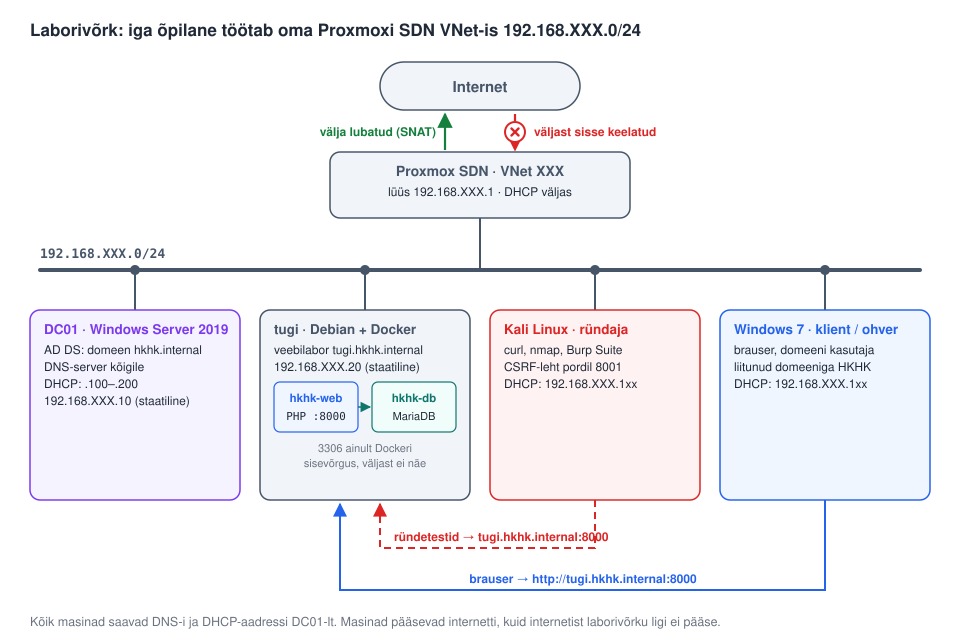

# Laborivõrgu seadistus

Iga õpilane või grupp töötab oma Proxmoxi SDN-i VNet-is `192.168.XXX.0/24`, kus **XXX** on sinu VNet-i number (nt VNet 105 → `192.168.105.0/24`). Võrgus on neli masinat. Windows Server 2019 on domeenikontroller ning jagab võrgus DNS-i ja DHCP-d. Debianil töötab Dockeris haavatav veebirakendus.

Masinad pääsevad Proxmoxi kaudu internetti (SNAT), kuid väljastpoolt neile ligi ei pääse.



## 1. Aadressiplaan

| Masin | Nimi | IP-aadress | Kuidas saab aadressi | Roll |
| --- | --- | --- | --- | --- |
| Proxmoxi lüüs | – | 192.168.XXX.1 | SDN-i alamvõrgu lüüs | Väljapääs internetti (SNAT) |
| Windows Server 2019 | `dc01` | 192.168.XXX.10 | Staatiline | AD DS, DNS, DHCP |
| Debian | `tugi` | 192.168.XXX.20 | Staatiline | Docker, veebilabor port 8000 |
| Kali Linux | – | 192.168.XXX.100–200 | DHCP (DC01) | Ründaja / testija |
| Windows 7 | – | 192.168.XXX.100–200 | DHCP (DC01) | Domeeni klient |

| Seade | Väärtus |
| --- | --- |
| Domeen | `hkhk.internal` |
| NetBIOS-nimi | `HKHK` |
| DNS-server kõigile masinatele | 192.168.XXX.10 |
| DNS-i edastajad (forwarders) | 1.1.1.1, 8.8.8.8 |
| Veebilabori aadress | `http://tugi.hkhk.internal:8000` |

`.internal` on ICANN-i poolt privaatvõrkude jaoks reserveeritud tippdomeen. See ei satu kunagi konflikti päris internetidomeeniga. Ära kasuta `.local` lõppu, mis on reserveeritud mDNS-i jaoks.

## 2. Proxmox SDN: lülita SDN-i DHCP välja

Võrgus tohib olla ainult **üks DHCP-server**. Kui ka Proxmoxi SDN jagab aadresse, saavad kliendid juhuslikult kas DC01 või Proxmoxi aadressi ja DNS-i. Sel juhul ei tööta domeeniga liitumine ega nimelahendus.

1. **Datacenter → SDN → VNets** → vali oma VNet → **Subnets** → ava alamvõrk `192.168.XXX.0/24`.
2. Jäta alles **Gateway** `192.168.XXX.1` ja linnuke **SNAT**. Nende kaudu pääsevad masinad internetti.
3. Kustuta vahekaardilt **DHCP Ranges** kõik vahemikud.
4. Kui tsoonil on sees **automatic DHCP**, lülita see tsooni seadetes välja.
5. Vajuta **SDN → Apply**.

## 3. Windows Server 2019 (DC01)

Käivita käsud **administraatorina avatud PowerShellis**. Asenda igal pool `XXX` oma VNet-i numbriga.

### 3.1 Staatiline IP ja arvuti nimi

```powershell
# Võrguliidese nimi: Get-NetAdapter
New-NetIPAddress -InterfaceAlias "Ethernet" -IPAddress 192.168.XXX.10 -PrefixLength 24 -DefaultGateway 192.168.XXX.1
Set-DnsClientServerAddress -InterfaceAlias "Ethernet" -ServerAddresses 127.0.0.1
Rename-Computer -NewName DC01 -Restart
```

### 3.2 Rollid ja domeen

```powershell
Install-WindowsFeature AD-Domain-Services, DNS, DHCP -IncludeManagementTools

# Küsib DSRM-i (taastamisrežiimi) parooli; server taaskäivitub ise
Install-ADDSForest -DomainName "hkhk.internal" -DomainNetbiosName "HKHK" -InstallDns
```

### 3.3 DNS: edastajad, pöördtsoon ja veebilabori kirje

Logi pärast taaskäivitust sisse kasutajana `HKHK\Administrator`.

```powershell
# Internetiaadresside lahendamiseks
Add-DnsServerForwarder -IPAddress 1.1.1.1, 8.8.8.8

# Pöördtsoon (IP -> nimi)
Add-DnsServerPrimaryZone -NetworkId "192.168.XXX.0/24" -ReplicationScope Domain

# Veebilabori nimi Debiani masinale
Add-DnsServerResourceRecordA -ZoneName "hkhk.internal" -Name "tugi" -IPv4Address 192.168.XXX.20 -CreatePtr
```

### 3.4 DHCP

```powershell
# DHCP turvagrupid ja teenuse taaskäivitus
netsh dhcp add securitygroups
Restart-Service dhcpserver

# DHCP-serveri volitamine AD-s
Add-DhcpServerInDC -DnsName "dc01.hkhk.internal" -IPAddress 192.168.XXX.10

# Aadressivahemik klientidele
Add-DhcpServerv4Scope -Name "Labor" -StartRange 192.168.XXX.100 -EndRange 192.168.XXX.200 -SubnetMask 255.255.255.0 -State Active

# Lüüs, DNS-server ja domeeninimi klientidele
Set-DhcpServerv4OptionValue -ScopeId 192.168.XXX.0 -Router 192.168.XXX.1 -DnsServer 192.168.XXX.10 -DnsDomain "hkhk.internal"

# Server Manageri hoiatus "Complete DHCP configuration" kaob
Set-ItemProperty -Path "HKLM:\SOFTWARE\Microsoft\ServerManager\Roles\12" -Name ConfigurationState -Value 2
```

### 3.5 Kontroll

```powershell
Get-ADDomain | Select-Object DNSRoot, NetBIOSName
Get-DhcpServerv4Scope
Resolve-DnsName tugi.hkhk.internal
Resolve-DnsName www.google.com
```

## 4. Debian (veebilabor)

Seadista Debian **pärast DC01-e**, sest Debian kasutab DNS-i jaoks DC01-e.

### 4.1 Staatiline IP

Proxmoxi virtio võrguliidese nimi on tavaliselt `ens18`. Kontrolli seda käsuga `ip -br link`.

Fail `/etc/network/interfaces`:

```
auto lo
iface lo inet loopback

auto ens18
iface ens18 inet static
    address 192.168.XXX.20/24
    gateway 192.168.XXX.1
```

Fail `/etc/resolv.conf`:

```
search hkhk.internal
nameserver 192.168.XXX.10
```

```bash
sudo hostnamectl set-hostname tugi
sudo systemctl restart networking
ip -4 addr show ens18              # peab olema 192.168.XXX.20
ping -c 2 dc01.hkhk.internal       # DNS ja DC töötavad
ping -c 2 deb.debian.org           # internet töötab
```

Kui Debian on paigaldatud graafilise töölauaga ja võrku haldab NetworkManager, seadista sama asi käsuga `nmtui` (Edit a connection → IPv4 Manual).

### 4.2 Veebilabori käivitamine

Docker paigalda ametlikust Dockeri repost (vt labori README).

```bash
cp .env.example .env
nano .env                          # LAB_IP=192.168.XXX.20
docker compose up -d --build
docker compose ps                  # mõlemad konteinerid: running / healthy
```

Rakendus kuulab ainult aadressil `192.168.XXX.20:8000`, ehk ainult sinu laborivõrgus.

## 5. Kali Linux

Kali saab aadressi, lüüsi ja DNS-i automaatselt DC01-lt (DHCP). Kontrolli:

```bash
ip -4 addr                         # aadress vahemikus 192.168.XXX.100–200
cat /etc/resolv.conf               # nameserver 192.168.XXX.10
nslookup tugi.hkhk.internal        # 192.168.XXX.20
curl -I http://tugi.hkhk.internal:8000
```

Kui aadress on vale (nt eelmisest laborist), uuenda DHCP-renti:

```bash
sudo nmcli connection down "Wired connection 1" && sudo nmcli connection up "Wired connection 1"
```

## 6. Windows 7 klient ja domeeniga liitumine

Domeeniga saab liituda ainult **Windows 7 Professional, Enterprise või Ultimate**, Home-versioon seda ei võimalda.

1. Kontrolli käsureal, et klient sai aadressi DC01-lt:
   ```
   ipconfig /all
   ```
   DNS Servers peab olema `192.168.XXX.10` ja Connection-specific DNS Suffix `hkhk.internal`.
2. Kontrolli nimelahendust: `nslookup dc01.hkhk.internal`.
3. **Start → paremklõps Computer → Properties → Change settings → Change…**
4. Vali **Domain**, kirjuta `hkhk.internal` ja kinnita.
5. Sisesta domeeni administraatori kasutajanimi ja parool, oota teadet „Welcome to the hkhk.internal domain“ ja taaskäivita arvuti.
6. Logi sisse domeeni kasutajana (`HKHK\kasutaja`).

Windows 7 ei saa enam turvauuendusi. Laboris on ta tahtlik sihtmärk, kuid ära kasuta temaga internetis sirvimist ega failide allalaadimist.

## 7. Lõppkontroll

| Kust | Käsk | Oodatav tulemus |
| --- | --- | --- |
| Kali | `nslookup tugi.hkhk.internal` | 192.168.XXX.20 |
| Kali | `curl -I http://tugi.hkhk.internal:8000` | `HTTP/1.1 200 OK` |
| Kali | `nmap -sV 192.168.XXX.20` | Avatud 8000 (HTTP) ja 22 (SSH), kui see on paigaldatud; MariaDB 3306 **ei ole** näha |
| Windows 7 | Brauseris `http://tugi.hkhk.internal:8000` | Veebilabori avaleht |
| Windows 7 | `echo %USERDOMAIN%` | `HKHK` |
| Debian | `docker compose ps` | `hkhk-web` running, `hkhk-db` healthy |

## 8. Levinud probleemid

| Probleem | Põhjus | Lahendus |
| --- | --- | --- |
| Klient saab aadressi, kuid DNS on vale | Proxmoxi SDN-i DHCP on sees | Kustuta SDN-i DHCP vahemikud (punkt 2) |
| `docker compose up` annab vea `cannot assign requested address` | `LAB_IP` ei vasta Debiani aadressile | Kontrolli `ip -4 addr` ja `.env` faili |
| Debian ei leia `deb.debian.org` | DC01 ei tööta või DNS-i edastajad puuduvad | Käivita DC01, kontrolli `Get-DnsServerForwarder` |
| Windows 7 ei leia domeeni | Klient kasutab vale DNS-i | `ipconfig /release` ja `ipconfig /renew`, kontrolli DNS-serverit |
| `tugi.hkhk.internal` ei lahene | A-kirje puudub | Käivita DC01-s punkt 3.3 viimane käsk |
