# Küberhügieeni 12 põhimõtet – õppematerjal näidete ja analüüsiga

4. november 2026 · Valdo

## Sissejuhatus

Küberhügieen on igapäevaste turvaharjumuste kogum, mis hoiab ära suurema osa rünnetest enne, kui need jõuavad kalliks intsidendiks kasvada. Peaaegu iga suur küberjuhtum viimase 15 aasta jooksul taandub ühe või mitme siin kirjeldatud põhimõtte eiramisele.

**Sihtrühm:** IT-taustaga täiskasvanud õppijad, kes tunnevad E-ITS-i põhimõtteid ja soovivad näha, kuidas need päriselus töötavad või ebaõnnestuvad.

**Iga teema ülesehitus:**

1. **Sisu selgitus** – mida põhimõte tähendab ja millised on põhimõisted.
2. **Miks see on oluline** – milline oht ilma selleta realiseerub.
3. **Praktilised meetmed** – kontrollnimekiri, mida organisatsioonis üle vaadata.
4. **Kolm päriselulist näidet** – iga näide on analüüsitud sama skeemi järgi:
   - **Mis juhtus** – juhtumi lühikirjeldus;
   - **Miks see juhtus** – juurpõhjus ja kaasa aidanud tegurid;
   - **Mis oleks aidanud** – meetmed, mis oleksid juhtumi ära hoidnud või kahju vähendanud;
   - **Õppetund** – üldistus, mida saab üle kanda oma organisatsiooni.
5. **Arutelu küsimused** – tunnis või iseseisvaks tööks.

**Märkus näidete kohta:** juhtumid põhinevad avalikel aruannetel, ametlikel teadaannetel ja meediakajastusel. Arvud on ümardatud. Mitu juhtumit illustreerib korraga mitut põhimõtet – see on teadlik valik, sest päriselus ei ebaõnnestu kunagi ainult üks kaitsekiht.

## Põhimõisted algajale

Enne põhimõtete juurde minekut tasub selgeks teha mõned mõisted, mis korduvad peaaegu igas teemas. Kui mõni hilisem näide tundub keeruline, tule siia tagasi.

### Varad ja varade haldus

**Vara** (*asset*) on kõik, millel on organisatsiooni jaoks väärtus ja mida tuleb kaitsta. IT-s on varad näiteks:

- **riistvara** – arvutid, serverid, telefonid, printerid, võrguseadmed, tulemüürid;
- **tarkvara** – operatsioonisüsteemid, rakendused, pilveteenused ja nende versioonid;
- **andmed** – klientide andmed, raamatupidamine, lähtekood, lepingud;
- **kontod ja identiteedid** – kasutajakontod, teenusekontod, administraatorikontod;
- **teenused** – e-post, veebileht, e-pood, VPN.

**Varade haldus** tähendab, et organisatsioon teab, **millised varad tal on, kus need asuvad, kes on nende omanik ja kui olulised need on**. Tavaliselt hoitakse seda infot varade registris või **CMDB**-s (*Configuration Management Database*, konfiguratsiooniandmebaas). Ühe serveri kirje võib sisaldada näiteks nime, IP-aadressi, operatsioonisüsteemi versiooni, paigaldatud tarkvara, asukohta, vastutajat ja seda, milliseid andmeid see hoiab.

**Miks see on turvalisuse alus?** Sa ei saa kaitsta seda, millest sa ei tea. Kui keegi on kunagi püsti pannud testserveri ja selle unustanud, ei paigata seda keegi, keegi ei jälgi selle logisid ja keegi ei märka, kui sinna sisse murtakse. Paljudes selle materjali näidetes (Equifax, Microsoft, Colonial Pipeline) oli rünnaku alguspunkt just mõni unustatud süsteem või konto.

**Igapäevaelu võrdlus:** varade register on nagu korteri inventuurinimekiri kindlustuse jaoks. Kui varga külastuse järel ei tea, mis sul kodus oli, ei tea sa ka, mis kadunud on.

### Muud põhimõisted

| Mõiste | Selgitus | Võrdlus igapäevaeluga |
| --- | --- | --- |
| **Haavatavus** | Viga või nõrkus tarkvaras, seadistuses või protsessis, mida saab ära kasutada. | Aken, mille lukk ei sulgu korralikult. |
| **Oht** | Keegi või miski, kes võib haavatavust ära kasutada (ründaja, pahavara, tulekahju, inimlik viga). | Vargad, kes käivad mööda tänavat ja katsuvad aknaid. |
| **Risk** | Kui tõenäoline on, et oht kasutab haavatavust ära, ja kui suur oleks kahju. | Kui suur on tõenäosus, et just sinu aknast sisse tullakse, ja mida sealt viia saab. |
| **Turvameede** | Tegevus või tehnoloogia, mis vähendab riski (paik, MFA, varundus, koolitus). | Uus aknalukk või signalisatsioon. |
| **Paik** (*patch*) | Tootja parandus, mis sulgeb haavatavuse. | Lukusepp, kes vahetab vigase luku. |
| **Ärakasutamine** (*exploit*) | Kood või meetod, mis kasutab haavatavust ära. | Tööriist, millega vigane lukk lahti tehakse. |
| **Pahavara** (*malware*) | Kahjulik tarkvara: viirus, uss, troojalane, lunavara, nuhkvara. | Sissetungija, kes tuleb kaasa koos postipakiga. |
| **Lunavara** (*ransomware*) | Pahavara, mis krüpteerib andmed ja nõuab nende tagastamise eest raha. Sageli varastatakse andmed ka ja ähvardatakse need avalikustada. | Keegi paneb su kapile oma luku ja müüb sulle võtit. |
| **Andmepüük** (*phishing*) | Võltssõnum, mis meelitab sind parooli sisestama, faili avama või raha üle kandma. | Võltsitud kiri „pangalt“, mis palub PIN-koodi. |
| **Konto ja õigused** | Konto on kasutaja digitaalne identiteet; õigused määravad, mida konto tohib teha. | Töötaja kaart, mis avab ainult teatud uksi. |
| **Administraator** | Konto, millel on süsteemis väga laiad või kõik õigused. | Majahoidja, kellel on kõigi uste võtmed. |
| **Active Directory (AD)** ja **domeen** | Microsofti süsteem, mis haldab organisatsiooni kasutajaid, arvuteid ja õigusi ühest kohast. Domeenikontroller on server, kus see info asub. | Ettevõtte valvelaud, kus on kõigi töötajate ja võtmete nimekiri. |
| **Server** | Arvuti, mis pakub teenust teistele arvutitele (failid, e-post, andmebaas, veebileht). | Köök restoranis – külastajad seda ei näe, aga kõik tuleb sealt. |
| **Port** | Number, mille kaudu teenus võrgus suhtleb (nt 443 veebiliiklus, 3389 kaugtöölaud). | Maja uksed: igal teenusel oma uks. |
| **Krüpteerimine** | Andmete muutmine loetamatuks kõigile, kellel ei ole võtit. | Kiri, mis on kirjutatud salakeeles. |
| **Räsi** (*hash*) | Ühesuunaline „sõrmejälg“ andmetest. Paroole hoitakse räsina, et neid ei saaks otse lugeda. | Hakklihast ei saa tagasi tükki liha teha. |
| **Logi** | Süsteemi kirje sellest, mis juhtus (kes logis sisse, mida muudeti). | Valvekaamera salvestis. |
| **Pilveteenus** | Teenus, mis töötab teenusepakkuja (nt Microsoft, Amazon, Google) serverites, mitte sinu omas. | Pangaseif võrreldes kodus oleva seifiga. |
| **Kernel** | Operatsioonisüsteemi tuum, millel on kõige suuremad õigused. | Hoone vundament ja kandvad seinad. |
| **Intsident** | Sündmus, mis kahjustab või ohustab andmete või teenuste turvalisust. | Sissemurdmine, mis juba toimus või toimumas on. |

### Raskemad terminid näidete varal

Allpool on mõisted, mis tulevad näidetes ette ja võivad esimesel lugemisel segaseks jääda. Iga mõiste juures on lihtne selgitus ja näide.

#### Pahavara ja selle tuvastamine

**Signatuur.** Signatuur on pahavara „sõrmejälg“: kindel baitide jada või failist arvutatud räsi, mille järgi viirusetõrje teab, et tegu on konkreetse pahavaraga. Viirusetõrje firmad koguvad neid sõrmejälgi andmebaasi ja sinu arvuti viirusetõrje laadib selle andmebaasi iga päev alla. *Näide:* politseil on tagaotsitavate fotod. Kui keegi neist tuleb poodi, tunneb valvur ta ära. Kui aga tuleb täiesti uus varas, keda andmebaasis pole, laseb valvur ta sisse. Täpselt nii jääb signatuuripõhisele viirusetõrjele märkamata uus pahavara.

**Käitumispõhine tuvastus.** Selle asemel, et vaadata, *kes* fail on, vaadatakse, *mida* programm teeb. Kui Wordi dokument hakkab käivitama PowerShelli ja alla laadima faile internetist, on see kahtlane, olenemata sellest, kas faili sõrmejälg on teada. *Näide:* valvur ei vaata enam ainult nägusid, vaid märkab, kui keegi hakkab kassaaparaati lahti kangutama.

**Polümorfne pahavara.** Pahavara, mis muudab iga levikuga veidi oma koodi, nii et selle sõrmejälg on iga kord erinev. Sisu ja eesmärk jäävad samaks. *Näide:* varas, kes vahetab iga päev parukat ja prille, et fotode järgi teda ära ei tuntaks.

**Uss, troojalane, lunavara, botnet.**

- **Uss** levib ise arvutist arvutisse, ilma et keegi midagi klõpsaks (nt WannaCry). Nagu gripp klassis: piisab, kui istud nakatunu kõrval.
- **Troojalane** näeb välja nagu kasulik programm või dokument, kuid sees on pahavara. Nimi tuleb Trooja hobusest.
- **Lunavara** krüpteerib failid ja nõuab nende avamise eest raha.
- **Botnet** on tuhandetest nakatunud arvutitest koosnev „armee“, mida ründaja juhib kaugelt. Arvutite omanikud ei pruugi sellest midagi teada. Emotet oli selline botnet.

**Tagauks** (*backdoor*). Salajane sissepääs, mille ründaja jätab endale süsteemi, et sinna hiljem tagasi tulla. Nagu varuvõti, mille varas laseb endale teha.

**Makro.** Väike programm Wordi või Exceli faili sees, mis automatiseerib tegevusi. Raamatupidajale kasulik, aga ründaja saab makro abil panna dokumendi avamisel arvuti pahavara alla laadima.

**Draiver.** Programm, mis aitab operatsioonisüsteemil seadmega suhelda, nt printeri või videokaardiga. Draiverid töötavad süsteemi kõige sügavamal tasemel (kernelis), nii et neil on väga suured õigused. Seetõttu on haavatav draiver ründaja jaoks väärtuslik.

**EDR-agent.** Turvaprogramm, mis töötab igas arvutis taustal, jälgib toimuvat ja saadab info keskserverisse. Kui agent ootamatult vaikib, võib see tähendada, et ründaja lülitas selle välja.

#### Haavatavused ja paigad

**Ründepind** (*attack surface*). Kõik kohad, kust ründaja võiks sisse pääseda: avatud pordid, kasutajakontod, veebilehed, e-post, USB-pesad. *Näide:* majal, millel on 2 ust ja 4 akent, on väiksem ründepind kui majal, millel on 5 ust ja 20 akent. Iga kasutamata ukse sulgemine vähendab ründepinda.

**Nullpäeva haavatavus** (*zero-day*). Viga, millest tootja veel ei tea või mille parandamiseks pole tal olnud ühtegi päeva. Paika veel ei ole.

**CVE.** Iga avalikult teatava haavatavuse ametlik number, nt CVE-2017-5638. Nagu auto registreerimisnumber: kõik räägivad samast asjast.

**Skaneerimine.** Automaatne kontroll, mis otsib võrgust avatud porte või süsteemidest teadaolevaid haavatavusi. Ründajad skaneerivad kogu internetti pidevalt, seepärast peavad ka kaitsjad oma süsteeme skaneerima.

#### Kontod, sisselogimine ja õigused

**Sessioon ja sessioonitoken.** Kui oled veebilehele sisse loginud, annab server sinu brauserile tokeni ehk ajutise „pääsme“. Edaspidi näitab brauser iga päringuga seda pääset ja parooli enam ei küsita. Kui ründaja varastab tokeni, on ta sinu nimel sisse logitud ilma parooli ja MFA-ta. *Näide:* kontserdil saad käepaela. Turvamees vaatab edaspidi ainult käepaela, mitte piletit. Kes su käepaela endale saab, pääseb sisse.

**Sool** (*salt*). Juhuslik lisatekst, mis lisatakse paroolile enne räsi arvutamist. Nii annab kahe inimese sama parool erineva räsi. *Näide:* kui kõigi „Kevad2024“ paroolide räsid oleksid ühesugused, piisaks ründajal ühe lahtimurdmisest. Soolaga peab ta iga parooli eraldi murdma.

**Entroopia.** Mõõt, kui raske on parooli ära arvata. Mida pikem ja juhuslikum parool, seda suurem entroopia. Neljakohaline PIN-kood: 10 000 varianti. 12-tähemärgiline juhuslik parool: triljoneid kordi rohkem.

**Teenusekonto.** Konto, mida ei kasuta inimene, vaid programm, nt varundustarkvara, mis logib igal ööl serverisse sisse. Selliseid kontosid unustatakse sageli.

**Token ja API-võti.** Pikk juhuslik tähemärkide jada, millega programm tõestab, et tal on õigus teenust kasutada. Sisuliselt parool programmile. Kui see satub GitHubi või kuhugi mujale avalikku kohta, saab igaüks seda kasutada.

#### Võrk ja pilv

**IP-aadress.** Arvuti aadress võrgus, nt 192.168.1.10. Nagu maja aadress, mille järgi postiljon kirja kohale toob.

**VPN.** Krüpteeritud „tunnel“ internetis, mille kaudu kodust töötav inimene ühendub turvaliselt firma sisevõrku. Kes VPN-i kaudu sisse pääseb, on sisuliselt kontoris sees. Seepärast on VPN-i parool ilma MFA-ta nii ohtlik.

**VLAN ja segment.** Ühe füüsilise võrgu jagamine mitmeks loogiliseks võrguks. Kontoriarvutid, serverid ja külaliste Wi-Fi on eraldi, kuigi kasutavad samu kaableid ja võrguseadmeid. *Näide:* koolimajas on õpetajate tuba ja õpilaste ruumid samas hoones, aga õpilaste võtmekaart õpetajate tuppa ei pääse.

**IoT** (*Internet of Things*, asjade internet). Internetti ühendatud tavalised seadmed: nutitermostaat, valvekaamera, nutikõlar, printer, isegi akvaariumi termomeeter.

**DDoS** (teenusetõkestusrünnak). Tuhanded arvutid (sageli botnet) saadavad korraga ühele veebilehele nii palju päringuid, et see ei jõua neid töödelda ja jääb kättesaamatuks. *Näide:* tuhat inimest helistab korraga pitsakohta, nii et päris kliendid ei saa läbi.

**Pilv ja AWS / Azure.** Pilveteenus tähendab, et kasutad suure ettevõtte (Amazon Web Services, Microsoft Azure, Google Cloud) andmekeskuste servereid ja maksad selle eest, mida kasutad. Kõiki servereid ja andmeid juhitakse ühest halduskonsoolist, seega on konsooli parool väga väärtuslik.

#### Intsidendid ja tagajärjed

**Andmeleke.** Olukord, kus andmed jõuavad kellenigi, kes neid nägema ei peaks: varastatakse, saadetakse kogemata välja või jäetakse avalikult kättesaadavaks.

**Väljaviimine** (*exfiltration*). Andmete salajane kopeerimine organisatsioonist välja ründaja serverisse. Sageli tehakse seda väikeste osade kaupa, et keegi ei märkaks.

**Tarnija ja tarneahel.** Ettevõtted, kellelt sinu organisatsioon teenuseid või tooteid ostab: IT-partner, tarkvaratootja, hooldusfirma. Kui tarnija on nõrk, saab ründaja tema kaudu sinuni jõuda (vt Target, NotPetya, ROCA).

**Järelevalveasutus ja trahv.** Riigiasutus, mis kontrollib, kas ettevõtted järgivad seadusi, nt Eestis Andmekaitse Inspektsioon (AKI). Suurbritannias on selleks ICO, USA-s pankade puhul OCC ja börsiettevõtete puhul SEC.

### Kolm küsimust, mida iga näite juures küsida

1. **Kust ründaja sisse sai?** (sisenemispunkt)
2. **Mis võimaldas tal edasi liikuda või kahju teha?** (puuduvad kaitsekihid)
3. **Mis oleks teda kõige varem peatanud?** (kõige tõhusam meede)

## 1. Tarkvara uuendamine (Patch Management)

> **Lihtsalt öeldes:** paik on nagu lukusepa parandus. Kui tootja teatab, et su ukse lukk on vigane, ja saadab uue, kuid sa seda ei paigalda, siis teavad nüüd ka vargad, millist ust katsuda.

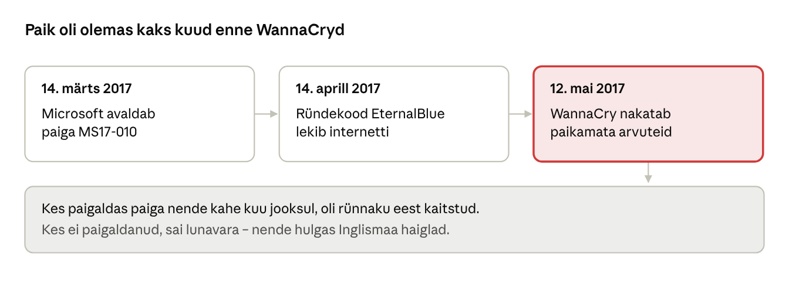

Paik ja ründekood olid mõlemad olemas enne rünnakut. Otsustav oli, kas organisatsioon jõudis paiga paigaldada.

**Sisu selgitus.** Paigahaldus on protsess, mille käigus organisatsioon saab teada uutest haavatavustest, hindab nende mõju, testib parandused ja paigaldab need kõikidesse süsteemidesse. Protsess eeldab ajakohast **varade nimekirja** – kui sa ei tea, et server on olemas, ei paiga sa seda ka.

Põhimõisted:

- **CVE** – avalikult teadaoleva haavatavuse unikaalne tunnus (nt CVE-2017-5638).
- **CVSS** – haavatavuse tõsiduse hinnang skaalal 0–10.
- **KEV-nimekiri** (CISA Known Exploited Vulnerabilities) – haavatavused, mida rünnetes **päriselt kasutatakse**; need paigatakse esimesena.
- **Nullpäeva haavatavus** (zero-day) – haavatavus, millele parandust veel ei ole.
- **N-päeva haavatavus** – parandus on olemas, aga paigaldamata. Enamik edukaid rünnakuid kasutab just neid.

**Miks see on oluline.** Turvapaiga avaldamine on ka ründajale vihje: paika võrreldes vana versiooniga leitakse haavatav koht sageli mõne päevaga. Aeg paiga ilmumisest esimeste massrünnakuteni on viimastel aastatel lühenenud nädalatelt päevadele. Internetist ligipääsetavad süsteemid (VPN, tulemüürid, veebiserverid, failiedastus) on kõige suurema riskiga.

**Praktilised meetmed:**

- [ ] Varade nimekiri (CMDB) on ajakohane ja sisaldab ka tarkvaraversioone.
- [ ] Kriitilistele ja aktiivselt ärakasutatud haavatavustele on kokku lepitud tähtaeg (nt internetis avatud süsteemidel 24–72 tundi).
- [ ] Paigad testitakse kõigepealt piloodigrupis, seejärel juurutatakse laiemalt.
- [ ] Haavatavuste skaneerimine kinnitab, et paik on päriselt paigaldatud.
- [ ] Toetuse lõppenud tarkvara (EOL) on kaardistatud ja sellel on asendusplaan või isoleerimine.
- [ ] Pärast kriitilise paiga paigaldamist kontrollitakse, kas süsteemi jõuti enne paigaldamist kompromiteerida.

**Seos E-ITS-iga:** OPS.1.1.3 Paiga- ja muudatusehaldus.

### Näide 1: WannaCry lunavara (2017)

**Kes said kannatada?** WannaCry ei rünnanud ühte kindlat ettevõtet, vaid kõiki paikamata Windowsi arvuteid. Kõige rohkem kannatas Inglismaa riiklik tervishoiusüsteem **NHS** (*National Health Service*) – riigi haiglate ja perearstide võrk, mis on umbes nagu Eesti Haigekassa ja kõik riigihaiglad kokku. Pihta said ka automaker Renault, Hispaania telekomifirma Telefónica (nagu meie Telia) ja Saksa raudtee Deutsche Bahn.

**Mis juhtus.** Mais 2017 levis WannaCry mõne päevaga üle 200 000 arvutisse vähemalt 100 riigis. Inglismaa tervishoiusüsteemis (NHS) oli häiritud vähemalt kolmandik haiglaid haldavatest asutustest, ära jäi ligi 7000 vastuvõttu ja osa patsiente suunati teistesse haiglatesse. Riigikontrolli (NAO) hinnangul oleks rünnaku saanud ära hoida IT-turbe põhitõdesid järgides. Kahjustatud olid ka Renault, Telefónica ja Deutsche Bahn.

**Miks see juhtus.** Lunavara kasutas Windowsi failijagamise protokolli SMBv1 haavatavust EternalBlue, mille parandus (MS17-010) oli välja antud juba märtsis – kaks kuud enne rünnakut. Paljudes organisatsioonides oli paik paigaldamata ja kasutusel oli ka toetuse lõppenud Windows XP. WannaCry oli **uss**: see levis ise masinast masinasse ilma kasutaja tegevuseta. Lisaks oli SMB port 445 paljudes kohtades internetist kättesaadav.

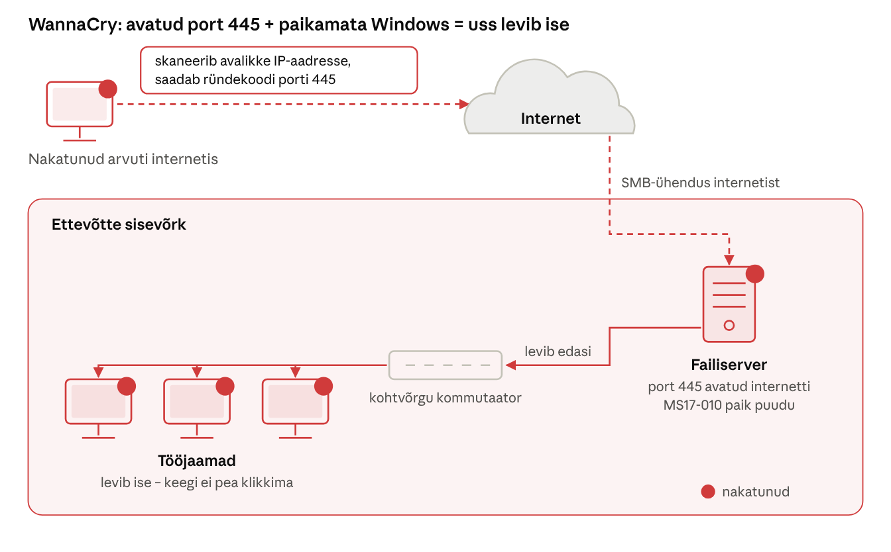

WannaCry otsis internetist masinaid, mille port 445 oli lahti. Kui see leidis paikamata Windowsi, levis see sisevõrgus ise edasi kõigisse teistesse paikamata arvutitesse.

**Mis oleks aidanud.** MS17-010 paigaldamine; SMBv1 väljalülitamine; pordi 445 blokeerimine perimeetril; võrgu segmenteerimine, mis oleks levikut piiranud; EOL-süsteemide isoleerimine.

**Õppetund.** Paigata jäetud kriitiline haavatavus ja lame võrk on koos ussile ideaalne keskkond. Paigahaldus ja segmenteerimine täiendavad teineteist.

### Näide 2: Equifax (2017)

**Kes nad on?** **Equifax** on üks kolmest suurest USA krediidiinfo ettevõttest. Ta kogub infot selle kohta, kuidas inimesed oma laene ja arveid maksavad, ning pangad küsivad temalt enne laenu andmist, kas inimene on usaldusväärne. Eestis teeb sarnast tööd Creditinfo. Equifaxil olid andmed peaaegu poole USA elanikkonna kohta.

**Mis juhtus.** USA krediidiinfo ettevõttest Equifax varastati umbes 147 miljoni inimese isikuandmed, sh sotsiaalkindlustusnumbrid. Ründajad olid süsteemis umbes 2,5 kuud, enne kui neid märgati. Kokkulepped ja trahvid ulatusid kuni 700 miljoni dollarini.

**Miks see juhtus.** Veebiraamistiku Apache Struts (Java-põhine tööriist veebirakenduste ehitamiseks) haavatavusele (CVE-2017-5638) avaldati parandus 7. märtsil 2017. Equifaxi sisemine teavitus jõudis küll IT-ni, kuid vastutus ei olnud selge ja üks vaidlusportaal jäi paikamata. Haavatavuse skaneerimine ei leidnud seda, sest skaneerimine oli valesti seadistatud. Lisaks oli liikluse inspekteerimise seadmel 19 kuud aegunud sertifikaat, mistõttu andmete väljaviimist ei nähtud.

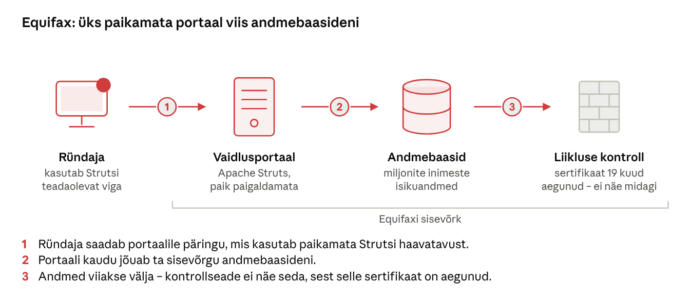

**Mis oleks aidanud.** Täielik ülevaade sellest, millistes rakendustes Struts kasutusel on; nimeline vastutaja iga süsteemi paikamise eest; skaneerimise tulemuste kontroll; sertifikaatide aegumise jälgimine.

**Õppetund.** Paik on olemas alles siis, kui see on paigaldatud **igasse** süsteemi. Selleks on vaja varade nimekirja ja selget vastutust, mitte ainult teadet, et paik on saadaval.

### Näide 3: Citrix Bleed (2023)

**Kes nad on?** **Citrix** on USA tarkvaraettevõte, mille tooteid kasutavad suurfirmad ja asutused selleks, et töötajad saaksid kodust turvaliselt tööprogramme kasutada. NetScaler on seade, mis seisab interneti ja firma sisevõrgu vahel nagu valvelaud. **Boeing** on üks maailma suurimaid lennukitootjaid ja **ICBC** on maailma suurim pank (Hiina riigipank), mille USA tütarettevõte tegeleb muu hulgas riigivõlakirjade kauplemisega.

**Mis juhtus.** Oktoobris 2023 avaldas Citrix paranduse NetScaler ADC ja Gateway seadmete (kaugligipääsu seadmed interneti ja sisevõrgu piiril) haavatavusele CVE-2023-4966. Lunavaragrupp LockBit kasutas seda muu hulgas Boeingu ja Hiina panga ICBC USA tütarettevõtte ründamiseks; viimase tõttu häirus osa USA riigivõlakirjade arveldustest.

**Miks see juhtus.** Haavatavus lekitas seadme mälust **sessioonitokeneid**. Sessioonitoken on nagu peo käepael: kui oled korra sisse lastud, ei küsita sinult enam piletit. Ründaja sai nendega üle võtta juba sisseloginud kasutaja sessiooni, ka MFA-ga kaitstud. Paljud organisatsioonid paigaldasid paiga, aga ei katkestanud olemasolevaid sessioone, mistõttu varastatud tokenid jäid kehtima ka pärast paikamist.

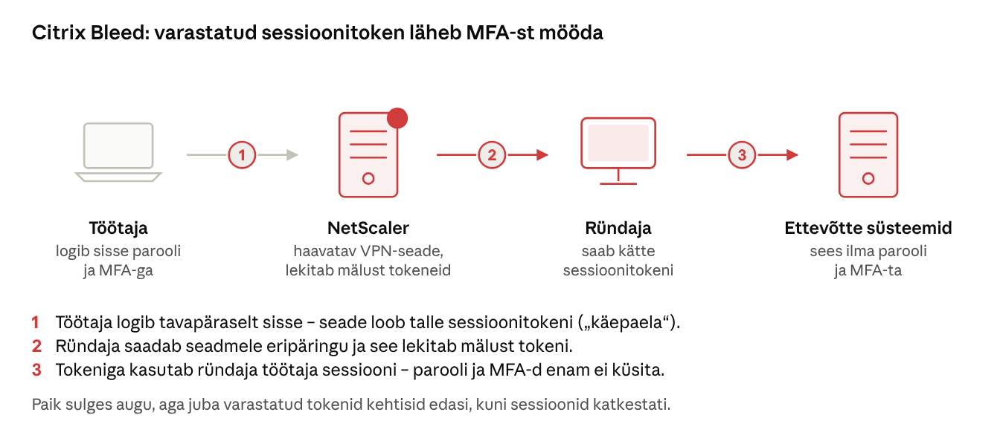

**Mis oleks aidanud.** Kiire paikamine (internetis avatud seade!); pärast paikamist kõikide aktiivsete sessioonide lõpetamine, nagu tootja soovitas; logide ülevaatus kompromiteerimise tunnuste leidmiseks.

**Õppetund.** Paikamine sulgeb ukse, aga ei vii välja seda, kes on juba sees. Kriitilise haavatavuse puhul tuleb alati küsida: kas meid jõuti enne paikamist rünnata?

**Arutelu küsimused:**

1. Kuidas teie organisatsioon teada saab, et mõnes tootes on kriitiline haavatavus? Kes otsustab, kui kiiresti see paigatakse?
2. Mida teha süsteemiga, mida ei saa paigata (nt tööstusseade või vana meditsiiniseade)?
3. Miks on paigahalduse jaoks vaja varade nimekirja? Too näide oma kogemusest.

## 2. Viirusetõrje ja pahavaratõrje (Antivirus, EDR)

> **Lihtsalt öeldes:** traditsiooniline viirusetõrje on nagu valvur, kes võrdleb külastajaid tagaotsitavate fotodega. EDR on valvur, kes jälgib ka seda, mida inimesed majas teevad – ka siis, kui nende nägu ei ole kellelegi tuttav.

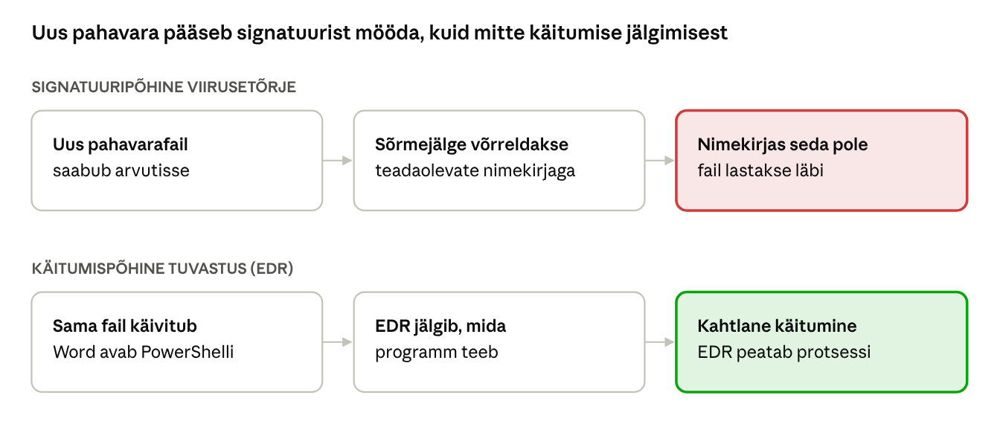

Signatuur tunneb ära ainult juba teadaoleva pahavara. EDR ei vaata, mis fail see on, vaid mida see teeb – seetõttu tabab see ka täiesti uue pahavara.

**Sisu selgitus.** Traditsiooniline viirusetõrje võrdleb faile teadaolevate pahavara **signatuuridega**. Kaasaegne lõpp-punkti kaitse ehk **EDR** (*Endpoint Detection and Response*) jälgib lisaks protsesside käitumist: milliseid faile protsess avab, milliseid võrguühendusi loob, kas see püüab lugeda paroolide mälu (LSASS – Windowsi protsess, mis hoiab sisseloginud kasutajate autentimisandmeid) või kustutada varikoopiaid. **XDR** laiendab sama loogikat ka võrgule, e-postile ja pilvele.

Põhimõisted:

- **Signatuuripõhine tuvastus** – tunneb ära ainult juba teadaoleva pahavara.
- **Käitumispõhine tuvastus** – tunneb ära kahtlase tegevuse ka siis, kui fail on uus.
- **Polümorfne pahavara** – muudab iga levikuga oma kuju, et signatuurist mööda pääseda.
- **Tamper protection** – kaitse, mis takistab ründajal turvatarkvara välja lülitamast.
- **Living off the land** – ründaja kasutab süsteemi enda tööriistu (PowerShell, WMI), mitte eraldi pahavara.

**Miks see on oluline.** Pahavara on enamiku rünnakute tööriist: see varastab paroole, avab tagaukse või krüpteerib andmed. Kaasaegsed ründajad teavad, et EDR on nende suurim takistus, ning esimese asjana püüavad nad selle välja lülitada. Seetõttu ei piisa toote olemasolust – oluline on, kas see on igal seadmel, kas keegi vaatab selle hoiatusi ja kas seda saab välja lülitada.

**Praktilised meetmed:**

- [ ] EDR on paigaldatud **kõigile** lõppseadmetele ja serveritele; katvust kontrollitakse varade nimekirja vastu.
- [ ] Tamper protection on sisse lülitatud; EDR-i eemaldamine nõuab eraldi parooli või tsentraalset luba.
- [ ] Hoiatustele reageerib keegi ööpäevaringselt (oma meeskond või teenusepakkuja, nt MDR – teenus, kus väline meeskond jälgib hoiatusi ja reageerib sinu eest).
- [ ] Internetist pärit dokumentide makrod on blokeeritud.
- [ ] Rakenduste lubatud nimekiri (nt AppLocker, WDAC – Windowsi tööriistad, mis lubavad käivitada ainult heakskiidetud programme) piirab, mida kasutaja saab käivitada.
- [ ] Haavatavate draiverite blokeerimisnimekiri on kasutusel.
- [ ] Turvatarkvara uuendusi juurutatakse etapiviisiliselt, mitte kõigile korraga.

**Seos E-ITS-iga:** OPS.1.1.4 Kaitse kahjurprogrammide eest; DER.1 Turvasündmuste tuvastamine.

### Näide 1: Emotet (2014–2021)

**Mis see on?** **Emotet** ei ole ettevõte, vaid pahavara nimi. Selle taga oli kurjategijate grupp, kes rentis nakatunud arvuteid edasi teistele kurjategijatele, umbes nagu „ligipääs rendiks“. **Europol** on Euroopa Liidu politseikoostöö amet, mis koordineerib eri riikide politsei ühisoperatsioone.

**Mis juhtus.** Emotet alustas pangatroojana ja kasvas maailma ohtlikumaks pahavara levitamise platvormiks. See saatis nakatunud postkastidest edasi kirju, mis olid vastused päris kirjavahetusele, ning lisas makrodega Wordi-faile. Nakatunud masinasse laaditi edasi TrickBot ja seejärel sageli Ryuki lunavara. Europol ja mitme riigi politsei võtsid Emoteti taristu üle jaanuaris 2021.

**Miks see juhtus.** Emotet muutis oma kuju pidevalt, nii et signatuuripõhine viirusetõrje jäi maha. Kirjad nägid usaldusväärsed välja, sest tulid päris kontaktidelt. Paljudes organisatsioonides said kasutajad makrosid vabalt lubada.

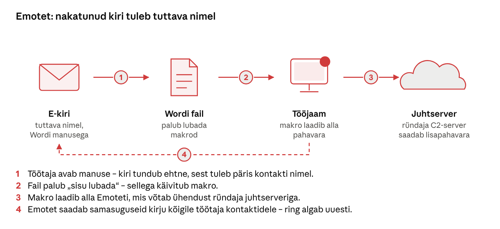

**Mis oleks aidanud.** Makrode blokeerimine internetist tulnud failides (Microsoft muutis selle 2022. aastal vaikimisi seadeks); käitumispõhine EDR, mis tuvastab, kui Word käivitab PowerShelli; e-posti manuste liivakast.

**Õppetund.** Signatuuripõhisest kaitsest üksi ei piisa. Kõige tõhusam on **vähendada ründepinda** – kui makrod ei käivitu, ei käivitu ka Emotet.

### Näide 2: EDR-i väljalülitamine haavatava draiveriga (BYOVD, 2022–2024)

**Kes nad on?** Siin ei ole üht ohvrit, vaid mitu lunavaragruppi, kes kasutasid sama nippi. **Sophos** on Briti küberturbeettevõte, mis teeb viirusetõrje- ja EDR-tooteid ning uurib rünnakuid. Selle uurijad avastasid ja kirjeldasid AuKill-tööriista.

**Mis juhtus.** Mitmed lunavaragrupid hakkasid enne krüpteerimist kasutama spetsiaalseid tööriistu (nt AuKill, Terminator), mis lülitavad EDR-i välja. Turvaettevõtted, sh Sophos, kirjeldasid juhtumeid, kus EDR oli küll paigaldatud, aga ründaja lülitas selle mõne minutiga välja ja krüpteeris seejärel serverid.

**Miks see juhtus.** Tehnika nimi on **Bring Your Own Vulnerable Driver**: ründaja paigaldab legitiimse, digitaalselt allkirjastatud, kuid haavatava draiveri. Draiver töötab kerneli tasemel ja sellega saab lõpetada ka turvatarkvara protsesse. Selleks vajab ründaja administraatoriõigusi, mis olid tavaliselt saadud varasemas rünnaku faasis.

**Mis oleks aidanud.** Haavatavate draiverite blokeerimisnimekiri (Microsofti Vulnerable Driver Blocklist); tamper protection; hoiatus, kui mõne seadme EDR-agent lakkab ootamatult raporteerimast; administraatoriõiguste piiramine.

**Õppetund.** EDR on ründaja **sihtmärk**, mitte ainult takistus. Turvatööriista vaikimine on juba iseenesest hoiatusmärk.

### Näide 3: CrowdStrike'i vigane uuendus (juuli 2024)

**Kes nad on?** **CrowdStrike** on USA küberturbeettevõte, mille EDR-toodet Falcon kasutavad tuhanded suurettevõtted, haiglad, pangad ja lennufirmad üle maailma. Toode uuendab end automaatselt mitu korda päevas, et tunda ära uusimaid rünnakuid.

**Mis juhtus.** 19. juulil 2024 levitas CrowdStrike Falconi agendile vigase sisuuuenduse. Umbes 8,5 miljonit Windowsi arvutit jooksis kokku ja jäi taaskäivitustsüklisse. Seiskusid lennufirmad, haiglad, pangad ja meediaettevõtted. Tegu ei olnud rünnakuga, vaid veaga turvatarkvaras endas.

**Miks see juhtus.** Turvatarkvara töötab kerneli tasemel, mistõttu viga seal kukutab kogu operatsioonisüsteemi. Sisuuuendus jõudis kõigi klientideni peaaegu samal ajal, ilma etapiviisilise juurutuseta. Parandamiseks tuli paljud masinad käsitsi turvarežiimis käivitada; BitLockeriga masinatel oli vaja ka taastevõtit.

**Mis oleks aidanud.** Tootja poolel: etapiviisiline juurutus ja parem testimine. Kliendi poolel: BitLockeri taastevõtmete kättesaadavus ka siis, kui domeenikontroller on maas; varem harjutatud taasteplaan suure hulga seadmete käsitsi parandamiseks.

**Õppetund.** Iga tööriist, millel on süsteemis kõrgeimad õigused, on ka **riski allikas**. Tarnija risk ja taasteplaan kuuluvad pahavaratõrje juurde.

**Arutelu küsimused:**

1. Mille poolest erineb signatuuripõhine ja käitumispõhine tuvastus? Miks on vaja mõlemat?
2. Kes teie organisatsioonis näeb EDR-i hoiatust kell 3 öösel? Mis juhtub siis?
3. Kuidas tasakaalustada kiiret turvauuendust ja etapiviisilist juurutust?

## 3. Tulemüüride kasutamine (Firewall Usage)

> **Lihtsalt öeldes:** tulemüür on nagu hoone valvelaud. See otsustab, kes millise ukse kaudu sisse ja välja pääseb. Kõik uksed, mida ei kasutata, on lukus.

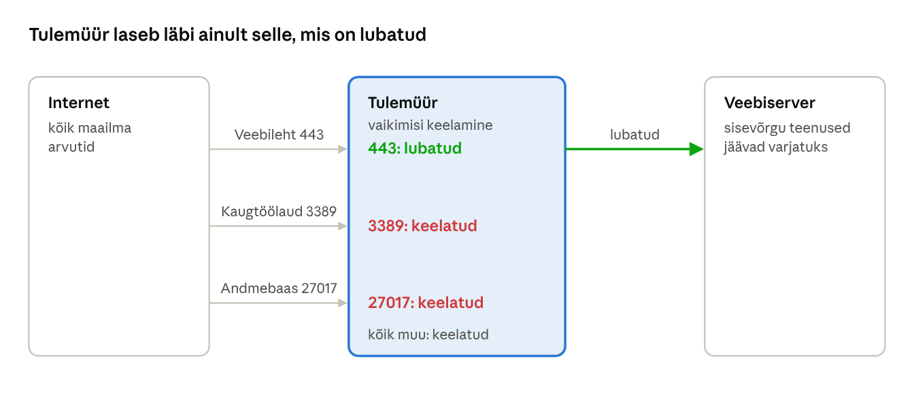

Igal teenusel on oma port nagu majal oma uks. Tulemüür avab ainult ukse 443 (veebileht). Kaugtöölaud ja andmebaas jäävad internetist kinni. MongoDB juhtumis oli just andmebaasi port 27017 avatud.

**Sisu selgitus.** Tulemüür lubab või keelab liiklust reeglite alusel. Põhiprintsiip on **vaikimisi keelamine** (*default deny*): lubatud on ainult see, mis on selgelt vajalik. Tulemüüre on mitut tüüpi:

- **Perimeetri tulemüür** – organisatsiooni võrgu ja interneti vahel.
- **Sisetulemüür** – võrgusegmentide vahel (nt kontor ↔ serverid).
- **Hostipõhine tulemüür** – iga arvuti või serveri enda tulemüür (nt Windows Defender Firewall).
- **NGFW** (*Next-Generation Firewall*) – tunneb ära rakendusi ja kasutajaid, mitte ainult porte.
- **WAF** (*Web Application Firewall*) – kaitseb veebirakendusi rünnete eest nagu SQL-süst või SSRF.

**Miks see on oluline.** Iga internetti avatud port on potentsiaalne sissepääs. Ründajad skaneerivad kogu internetti pidevalt – avatud RDP, andmebaas või haldusliides leitakse mõne tunniga. Samas on tulemüür ise ka internetti avatud seade: kui tulemüüri tarkvara on haavatav, saab ründaja ligipääsu otse turvataristu südamesse.

**Praktilised meetmed:**

- [ ] Väljast on avatud ainult dokumenteeritud ja põhjendatud teenused; ülejäänu on keelatud.
- [ ] RDP, SSH, andmebaasid ja haldusliidesed ei ole otse internetist kättesaadavad (kasuta VPN-i või bastion-hosti ehk hästi kaitstud vaheserverit, mille kaudu tehakse kõik haldusühendused).
- [ ] Tulemüüri reegleid vaadatakse üle vähemalt kord aastas; ajutised reeglid kustutatakse.
- [ ] Ka **väljuv** liiklus on piiratud – serverid ei pea saama suhelda suvalise internetiaadressiga.
- [ ] Tulemüüri püsivara on ajakohane; haldusliides on kättesaadav ainult haldusvõrgust.
- [ ] Välise ründepinna skaneerimine (nt Shodan või Censys – otsingumootorid, mis näitavad internetis avatud seadmeid – või oma skanner) toimub regulaarselt.

**Seos E-ITS-iga:** NET.3.2 Tulemüür; NET.1.1 Võrgu arhitektuur ja lahendus.

### Näide 1: Capital One (2019)

**Kes nad on?** **Capital One** on üks USA suurimaid panku, mis on tuntud eriti krediitkaartide poolest. Pank viis suure osa oma süsteemidest Amazoni pilve (AWS), et mitte pidada ise andmekeskusi.

**Mis juhtus.** Ründaja sai Capital One'i AWS-i pilvekeskkonnast kätte umbes 106 miljoni USA ja Kanada kliendi andmed. Ettevõtet trahviti 80 miljoni dollariga.

**Miks see juhtus.** Veebirakenduse tulemüür (WAF) oli **valesti seadistatud**. Ründaja kasutas SSRF-rünnet (*Server-Side Request Forgery*): ta pani WAF-i esitama päringu AWS-i sisemisele metaandmeteenusele (teenus, mis annab pilveserverile infot tema enda seadistuse ja õiguste kohta). Sealt sai ta ajutised ligipääsuvõtmed rollile, millel olid liiga laiad õigused S3-andmehoidlatele (Amazoni pilve failihoidlad).

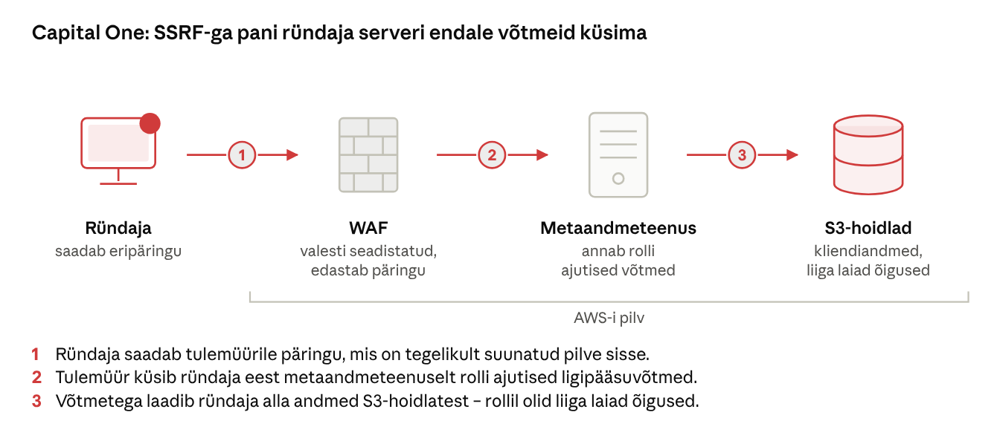

**Mis oleks aidanud.** WAF-i korrektne seadistus ja testimine; metaandmeteenuse kaitstud versioon (IMDSv2, mis ei vasta ilma eraldi tokenita); WAF-i rolli õiguste piiramine vähima privileegi järgi; anomaalse andmeliikluse jälgimine.

**Õppetund.** Turvaseade, mis on valesti seadistatud, võib saada ründaja tööriistaks. Seadistus on sama oluline kui seadme olemasolu.

### Näide 2: Internetti avatud MongoDB andmebaasid (2017)

**Mis see on?** **MongoDB** on populaarne andmebaasitarkvara, mida kasutavad paljud veebilehed ja rakendused andmete hoidmiseks. Ohvreid oli tuhandeid: väikefirmad, idufirmad, haiglad ja üksikud arendajad, kes olid andmebaasi pilveserverisse paigaldanud.

**Mis juhtus.** Jaanuaris 2017 kustutasid ründajad kümnetest tuhandetest internetist ligipääsetavatest MongoDB andmebaasidest andmed ja jätsid asemele lunarahanõude. Paljudel ohvritel varukoopiat ei olnud; mõnel juhul ei olnud ründajal andmeid isegi alles.

**Miks see juhtus.** Toonased MongoDB vaikeseaded ei nõudnud autentimist ja andmebaas võis kuulata kõiki võrguliideseid. Arendajad paigaldasid andmebaasi pilveserverisse ja unustasid tulemüüri reegli. Port 27017 oli otse internetist kättesaadav – ründajal piisas skriptist.

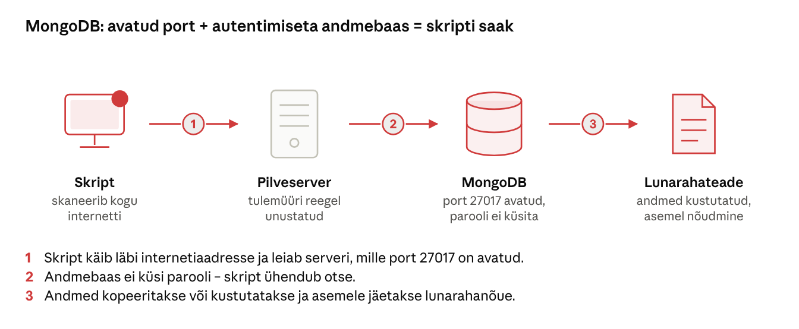

**Mis oleks aidanud.** Andmebaasi port suletud hosti- ja võrgutulemüüriga; autentimine sisse lülitatud; andmebaas seotud ainult sisevõrgu aadressiga; välise ründepinna regulaarne skaneerimine.

**Õppetund.** Andmebaas ei kuulu kunagi otse internetti. Vaikeseadetele ei saa loota – tulemüür peab olema kaitse ka siis, kui keegi teeb seadistusvea.

### Näide 3: FortiGate'i seadistuste leke (2022 → 2025)

**Kes nad on?** **Fortinet** on üks maailma suurimaid tulemüüride tootjaid. Selle FortiGate'i seadmeid kasutatakse ka paljudes Eesti ettevõtetes, koolides ja asutustes. **Belsen** on 2025. aastal esile kerkinud kurjategijate grupp, mis müüb varastatud ligipääsu teiste ettevõtete võrkudesse.

**Mis juhtus.** Jaanuaris 2025 avaldas ründajate grupp Belsen tasuta üle 15 000 FortiGate'i tulemüüri seadistused, sh IP-aadressid, VPN-kasutajate paroolid ja tulemüüri reeglid. Uurimine näitas, et andmed olid kogutud juba 2022. aastal.

**Miks see juhtus.** 2022. aastal avastati FortiOS-i haldusliidese autentimisest möödahiilimise haavatavus (CVE-2022-40684). Paljudel seadmetel oli haldusliides internetist kättesaadav ja need jõuti ära kasutada enne paikamist. Paik sulges augu, aga juba varastatud seadistused ja paroolid jäid ründajate kätte. Paljud organisatsioonid ei vahetanud pärast paikamist paroole ega vaadanud reegleid üle.

**Mis oleks aidanud.** Haldusliides kättesaadav ainult haldusvõrgust või kindlatelt IP-aadressidelt; kiire paikamine; pärast kriitilist haavatavust kõigi seadmes hoitud paroolide ja võtmete vahetamine; MFA VPN-i kasutajatele.

**Õppetund.** Tulemüür on kõige väärtuslikum sihtmärk, sest seal on kogu võrgu kaart ja ligipääsuandmed. Selle haldusliides ei tohi olla internetis.

**Arutelu küsimused:**

1. Kuidas teha kindlaks, millised teie organisatsiooni teenused on internetist nähtavad? Proovi Shodani või Censyse otsingut oma avaliku IP-aadressiga.
2. Miks on väljuva liikluse piiramine sama oluline kui sissetuleva liikluse piiramine?
3. Mida teha, kui leiad tulemüürist 5 aastat vana reegli, mille otstarvet keegi ei tea?

## 4. Paroolide haldus (Password Management)

> **Lihtsalt öeldes:** parool on võti. Kui sama võti avab su kodu, auto ja kontori, siis ühe võtme kaotamine avab kõik kolm.

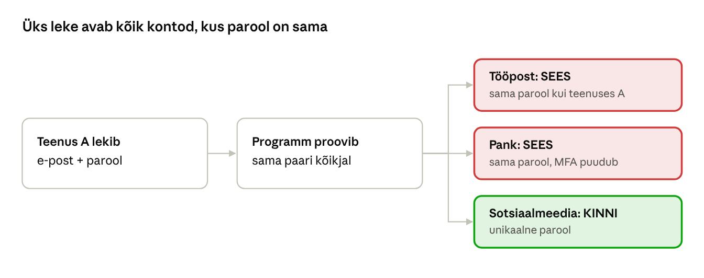

Ründaja ei pea ühtegi parooli ära arvama: lekkinud paari proovib automaatne programm sadades teenustes. Kinni jääb ainult konto, kus parool on unikaalne või kus nõutakse MFA-d.

**Sisu selgitus.** Hea parool on **pikk, unikaalne ja juhuslik**. Tänapäevane soovitus (nt NIST SP 800-63B) eelistab pikkust keerukusele: parool või paroolifraas vähemalt 12–15 märki, ilma sunnitud perioodilise vahetuseta, kuid kohustusliku vahetusega lekke korral. Unikaalsuse tagab praktikas ainult **paroolihaldur**.

Põhimõisted:

- **Credential stuffing** – lekkinud kasutajanime-parooli paaride automaatne proovimine teistes teenustes.
- **Password spraying** – üksikute levinud paroolide (nt „Talv2025!“) proovimine paljude kontode peal, et vältida konto lukustumist.
- **Räsi** (*hash*) – parooli ühesuunaline teisendus; hea salvestus kasutab aeglast räsifunktsiooni ja soola (bcrypt, Argon2).
- **Infovaras** (*infostealer*) – pahavara, mis varastab brauserisse salvestatud paroolid ja sessiooniküpsised.
- **Pääsuvõti** (*passkey*) – paroolita, andmepüügikindel sisselogimine FIDO2 standardi alusel.

**Miks see on oluline.** Inimesed kasutavad paroole korduvalt. Kui üks teenus lekib, proovitakse samu andmeid kohe sadades teistes teenustes. Ründaja ei pea midagi murdma – ta logib lihtsalt sisse.

**Praktilised meetmed:**

- [ ] Organisatsioonis on kasutusel paroolihaldur ja selle kasutamist õpetatakse.
- [ ] Paroolipoliitika nõuab pikkust (≥ 12–15 märki), keelab levinud ja lekkinud paroolid (nt Entra ID Password Protection, Have I Been Pwned andmebaas).
- [ ] Tööparoole ei kasutata isiklikes teenustes ja vastupidi.
- [ ] Teenuse- ja administraatorikontode paroolid on pikad, juhuslikud ja hoitud PAM-lahenduses (administraatoriparoolide jaoks mõeldud turvaline hoidla, vt teema 8).
- [ ] Lekete jälgimine: organisatsiooni domeeni kontode ilmumist lekkebaasidesse jälgitakse.
- [ ] Paroolide salvestamine brauserisse on tööarvutites keelatud või kontrollitud.

**Seos E-ITS-iga:** ORP.4 Identiteedi- ja õiguste haldus.

### Näide 1: Dropbox (2012)

**Kes nad on?** **Dropbox** on pilvesalvestusteenus, kuhu inimesed hoiavad oma faile, umbes nagu Google Drive või OneDrive. **LinkedIn** on tööalane sotsiaalvõrgustik, kus inimesed avaldavad oma CV ja otsivad tööd.

**Mis juhtus.** 2012. aastal pääses ründaja Dropboxi töötaja kontole ja sealt dokumendini, mis sisaldas kasutajate e-posti aadresse. 2016. aastal selgus, et samas rünnakus varastati umbes 68 miljoni kasutaja kontoandmed koos paroolide räsidega.

**Miks see juhtus.** Töötaja kasutas Dropboxi tööülesannetes sama parooli, mis tal oli LinkedInis. LinkedIn oli 2012. aastal ise lekkinud ja paroolid olid seal salvestatud nõrga räsiga (soolamata SHA-1 ehk ilma juhusliku lisandita räsi, mistõttu sama parool annab alati sama räsi ja seda saab otsida valmis tabelitest), mistõttu need murti kiiresti lahti.

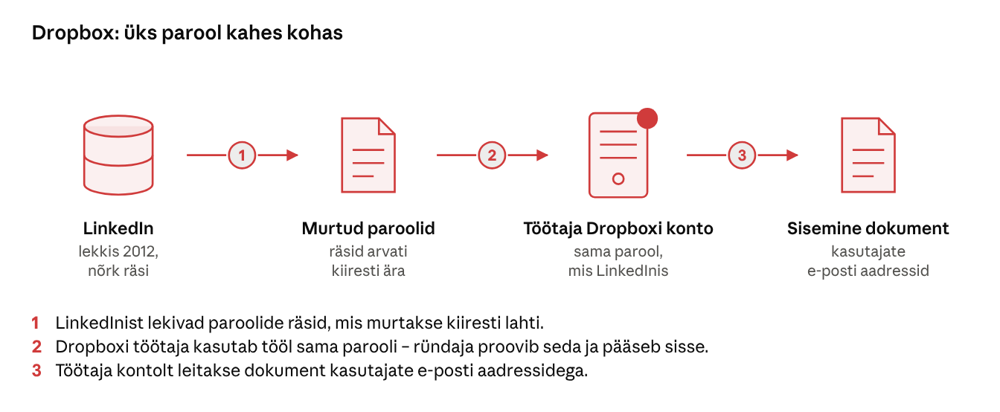

**Mis oleks aidanud.** Unikaalne parool igas teenuses; MFA töökontodel; lekkinud paroolide automaatne blokeerimine.

**Õppetund.** Sinu organisatsiooni turvalisus sõltub ka teiste teenuste turvalisusest, kui töötajad kasutavad paroole korduvalt. Ühe teenuse leke võib avada ukse teise ettevõtte süsteemidesse.

### Näide 2: 23andMe (2023)

**Kes nad on?** **23andMe** on USA ettevõte, mis müüs koduseid DNA-teste: klient saatis süljeproovi ja sai teada oma päritolu ning sai leida sugulasi, kes olid samuti testi teinud. Eestis kogub inimeste geeniandmeid näiteks Geenivaramu, kuid see on teadusasutus, mitte kommertsteenus.

**Mis juhtus.** Geenitestide ettevõte 23andMe teatas 2023. aastal lekkest, mis puudutas umbes 6,9 miljonit kasutajat. Ründajad müüsid andmeid, sh info inimeste päritolu kohta. Ettevõte jõudis hiljem pankrotini.

**Miks see juhtus.** Ründajad kasutasid **credential stuffingut**: proovisid teistest leketest pärit paroole ja pääsesid sisse umbes 14 000 kontole. Need kontod olid seotud funktsiooniga „DNA Relatives“, mis näitas info sugulaste kohta. Seetõttu andis 14 000 kontot ligipääsu miljonite inimeste andmetele. MFA ei olnud kohustuslik ja massilisi sisselogimiskatseid ei tõkestatud piisavalt.

**Mis oleks aidanud.** Kohustuslik MFA; lekkinud paroolide kontroll sisselogimisel; sisselogimiskatsete kiiruse piiramine ja anomaaliate tuvastamine; andmete jagamise funktsiooni ohtude hindamine.

**Õppetund.** Kasutajate parooliharjumused on teenusepakkuja probleem. Kui ühe konto kaudu näeb teiste inimeste andmeid, korrutab iga nõrk parool kahju.

### Näide 3: LastPass (2022)

**Kes nad on?** **LastPass** on paroolihaldur – programm, mis hoiab kõiki sinu paroole krüpteeritud „seifis“ ja täidab need ise sisselogimisel. Sarnased tooted on Bitwarden ja 1Password. Seifi avamiseks on vaja ühte ülemparooli.

**Mis juhtus.** Paroolihaldurit LastPass tabas 2022. aastal kaks seotud rünnakut. Teises varastati klientide krüpteeritud paroolihoidlate varukoopiad. Hiljem seostasid uurijad mitmeid krüptovaluutade vargusi hoidlatega, mille ülemparool oli nõrk.

**Miks see juhtus.** Ründaja kompromiteeris ühe DevOps-inseneri **koduarvuti**, kasutades sellel olnud haavatavat meediatarkvara, ja paigaldas klahvilogija. Sealt sai ta inseneri ülemparooli ja ligipääsu pilvesalvestusele. Hoidlad olid krüpteeritud, aga nõrga ülemparooliga hoidla sai ründaja ise lahti murda. Vanematel kontodel oli ka madal PBKDF2 iteratsioonide arv (mitu korda räsimist korratakse – mida vähem kordi, seda kiiremini saab parooli ära arvata).

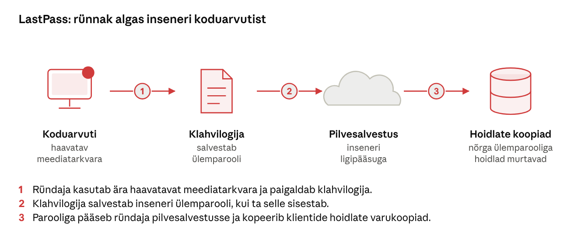

**Mis oleks aidanud.** Kõrgete õigustega töö ainult hallatud tööseadmest; pikk ja unikaalne ülemparool; MFA; tootja poolt iteratsioonide arvu automaatne tõstmine vanadel kontodel.

**Õppetund.** Paroolihaldur on endiselt parim lahendus, kuid selle **ülemparool on kõige olulisem parool**. Krüpteeritud andmete turvalisus sõltub võtme tugevusest.

**Arutelu küsimused:**

1. Miks on 4-sõnaline paroolifraas sageli turvalisem kui 8-märgiline keeruline parool? Arvuta mõlema ligikaudne entroopia.
2. Kontrolli oma e-posti aadressi lehel haveibeenpwned.com. Millistes leketes see esineb ja mida see tähendab?
3. Kas paroolihaldur on „kõik munad ühes korvis“? Too argumendid poolt ja vastu.

## 5. Mitmeastmeline autentimine (MFA)

> **Lihtsalt öeldes:** MFA tähendab, et lisaks võtmele on vaja ka kaarti või sõrmejälge. Varastatud võtmest üksi ei piisa.

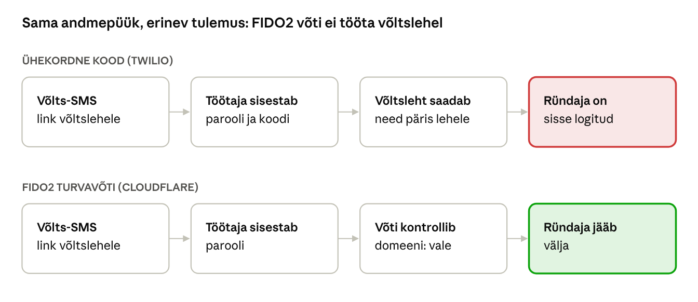

Koodi saab inimene võltslehele sisestada ja võltsleht saadab selle kohe edasi. FIDO2 võti kontrollib ise, millisel aadressil ta on, ega anna võltslehele midagi – seda ei saa inimene kogemata „ära anda“.

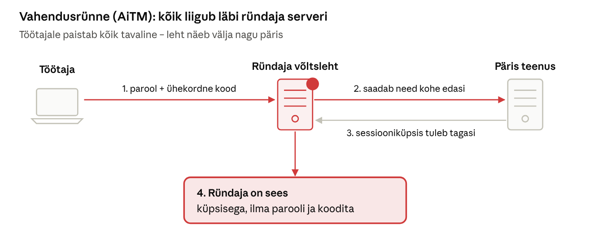

Sama rünnak võrgujoonisena: ründaja server on töötaja ja päris teenuse vahel ning edastab kõik, mida töötaja sisestab. Lõpuks saab ründaja endale **sessiooniküpsise** – „pileti“, mis hoiab teda sisselogituna.

**Sisu selgitus.** MFA nõuab sisselogimisel vähemalt kahte eri tüüpi tõendit: **midagi, mida tead** (parool), **midagi, mis sul on** (telefon, turvavõti, ID-kaart) või **midagi, mis sa oled** (sõrmejälg). Kõik MFA meetodid ei ole võrdselt tugevad:

| Meetod | Tugevus | Peamine nõrkus |
| --- | --- | --- |
| SMS-kood | Nõrk | SIM-kaardi vahetus, andmepüük |
| Rakenduse TOTP-kood | Keskmine | Koodi saab andmepüügilehele sisestada |
| Push-teavitus | Keskmine | MFA-väsimus (*push bombing*) |
| Push + numbri sobitamine (sh Smart-ID kontrollkood) | Hea | Vähendab väsimusrünnet, ei välista andmepüüki |
| FIDO2 turvavõti / pääsuvõti, ID-kaart | Väga hea | Seotud õige domeeniga või kvalifitseeritud seadmega |

Põhimõisted:

- **MFA-väsimus** (*MFA fatigue*) – ründaja saadab kümneid kinnituspäringuid, kuni kasutaja ühe tüdimusest kinnitab.
- **AiTM** (*Adversary-in-the-Middle*) – andmepüügileht vahendab päris sisselogimist ja varastab sessiooniküpsise.
- **Andmepüügikindel MFA** – meetod, mis ei tööta võltsdomeenil (FIDO2/WebAuthn).

**Miks see on oluline.** Microsofti andmetel peatab MFA üle 99% automaatsetest kontode ülevõtmise katsetest. Kuid sihitud ründajad on kohanenud: nad kasutavad MFA-väsimust, AiTM-andmepüüki ja helistavad kasutajatele, esinedes IT-toena. Seetõttu on oluline nii MFA olemasolu kui ka selle tüüp.

**Praktilised meetmed:**

- [ ] MFA on kohustuslik kõigil välistel ligipääsudel: VPN, e-post, pilveteenused, kaugtöölaud.
- [ ] Administraatoritel on andmepüügikindel MFA (FIDO2 võti, ID-kaart).
- [ ] Push-teavitustel on numbri sobitamine ja asukoha kuvamine.
- [ ] Vanad autentimisprotokollid, mis MFA-st mööda lähevad (nt Basic Auth, legacy-protokollid), on keelatud.
- [ ] Erandid (nt teenusekontod) on dokumenteeritud ja kaitstud muul viisil (IP-piirang, tingimuslik ligipääs).
- [ ] Kasutajad teavad: ootamatut MFA-päringut ei kinnitata kunagi, sellest teatatakse.

**Seos E-ITS-iga:** ORP.4 Identiteedi- ja õiguste haldus.

### Näide 1: Colonial Pipeline (mai 2021)

**Kes nad on?** **Colonial Pipeline** on USA ettevõte, mis haldab umbes 8800 km pikkust torujuhet, mida mööda veetakse bensiini, diislit ja lennukikütust Texasest kuni New Yorgini. Kui toru seisab, jääb tanklates kütusest puudu. **DarkSide** oli lunavaragrupp, mis rentis oma lunavara teistele kurjategijatele.

**Mis juhtus.** USA suurima kütusetoru operaator Colonial Pipeline peatas lunavararünnaku tõttu 6 päevaks torujuhtme, mis veab umbes 45% USA idaranniku kütusest. Tanklates tekkisid järjekorrad ja kütusepuudus. Ettevõte maksis umbes 4,4 miljoni dollari suuruse lunaraha; osa sellest sai FBI hiljem tagasi.

**Miks see juhtus.** Ründajad (DarkSide) logisid sisse VPN-i kaudu, kasutades **vana VPN-kontot**, mis ei olnud enam kasutusel, kuid oli endiselt aktiivne. Ettevõtte IT-osakond ei teadnudki, et see VPN-profiil on alles – see ei ilmunud ühessegi skaneeringusse. Tegevjuhi sõnul oli parool keeruline, kuid ilmselt lekkinud. VPN-il ei olnud MFA-d.

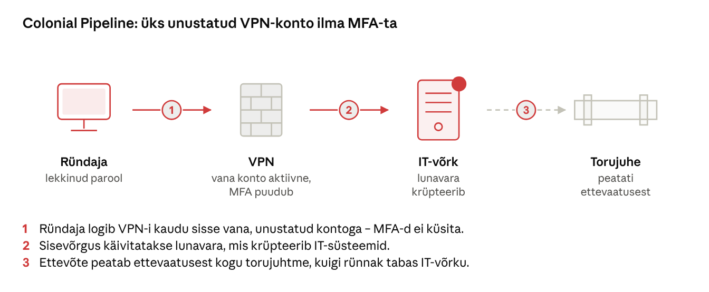

**Mis oleks aidanud.** MFA VPN-il; kasutamata kontode regulaarne deaktiveerimine; lekkinud paroolide jälgimine. Ükskõik milline neist oleks rünnaku tõenäoliselt peatanud.

**Õppetund.** Üks unustatud konto ilma MFA-ta võib seisata kriitilise taristu. MFA peab katma **kõik** kontod, mitte ainult aktiivselt kasutatavad.

### Näide 2: Uber ja MFA-väsimus (september 2022)

**Kes nad on?** **Uber** on taksoäpp, sarnane Eestis kasutatava Boltiga. **Lapsus$** oli peamiselt teismelistest koosnev häkkerite grupp, mis murdis 2022. aastal sisse mitmesse suurfirmasse (Microsoft, Nvidia, Samsung, Okta) – mitte keerukate tööriistade, vaid peamiselt inimeste petmise abil.

**Mis juhtus.** Noor ründaja, keda seostati grupiga Lapsus$, pääses Uberi sisevõrku, Slacki, pilvekeskkondadesse ja turvatööriistadesse. Ta teatas sellest ise Uberi Slackis.

**Miks see juhtus.** Ründaja ostis välise töövõtja parooli, mis oli tõenäoliselt varastatud infovaraga. MFA nõudis push-kinnitust. Ründaja saatis järjest kinnituspäringuid ja kirjutas enda väitel töövõtjale WhatsAppis, esinedes Uberi IT-toena, et päringud lõpevad alles siis, kui ta ühe kinnitab. Töövõtja kinnitaski. Sisevõrgus leidis ründaja võrgukettalt PowerShelli skripti, milles oli PAM-süsteemi administraatori parool selgetekstina.

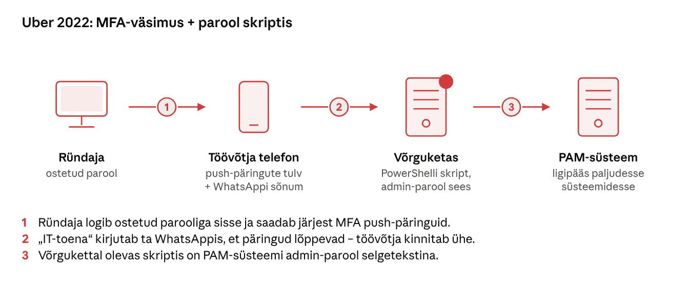

**Mis oleks aidanud.** Numbri sobitamisega või FIDO2-põhine MFA; kinnituspäringute arvu piiramine ja hoiatus massiliste päringute korral; töövõtjate koolitus; paroolide hoidmine PAM-is, mitte skriptides.

**Õppetund.** MFA, mida saab „ära tüüdata“, ei ole piisav. Lisaks näitab juhtum, et üks selgetekstiline parool skriptis võib anda ründajale kogu kuningriigi võtmed.

### Näide 3: Twilio ja Cloudflare – sama rünnak, erinev tulemus (august 2022)

**Kes nad on?** **Twilio** on USA ettevõte, mille kaudu teised firmad saadavad SMS-e ja helistavad automaatselt – näiteks saadab Twilio paljude äppide sisselogimiskoode. **Cloudflare** on ettevõte, mis kaitseb ja kiirendab miljoneid veebilehti, nii et osa kogu maailma internetiliiklusest läbib selle servereid.

**Mis juhtus.** Kampaania „0ktapus“ saatis sadade ettevõtete töötajatele SMS-e, mis viisid võltssisselogimislehele. Twilios sisestasid mitu töötajat paroolid ja ühekordsed koodid ning ründajad said ligipääsu klientide andmetele. Ka Cloudflare'is langes kolm töötajat lõksu ja sisestas oma parooli – kuid ründajad ei pääsenud sisse.

**Miks see juhtus nii erinevalt.** Twilio kasutas ühekordseid koode, mida ründaja leht sai reaalajas edasi saata päris süsteemi. Cloudflare'i kõigil töötajatel olid **FIDO2 riistvaralised turvavõtmed**, mis kontrollivad saidi domeeni ega tööta võltslehel. Varastatud paroolist üksi ei piisanud.

**Mis oleks aidanud (Twilio).** Andmepüügikindel MFA; võltsdomeenide jälgimine ja blokeerimine; kiire teavituskanal töötajatele kahtlastest sõnumitest.

**Õppetund.** See on harv näide, kus kaks ettevõtet said täpselt sama rünnaku ja tulemus erines ainult MFA tüübi tõttu. Andmepüügikindel MFA muudab parooli varguse mõttetuks.

**Arutelu küsimused:**

1. Millised MFA meetodid on Eestis levinud (ID-kaart, Mobiil-ID, Smart-ID)? Kuidas need võrdlevad FIDO2-ga andmepüügi vastu?
2. Miks ei kaitse ühekordne SMS-kood AiTM-andmepüügi eest?
3. Kuidas kaitsta teenusekontosid, millele ei saa MFA-d lisada?

## 6. Andmete varundamine (Data Backup)

> **Lihtsalt öeldes:** varukoopia on nagu fotoalbumi koopia, mida hoiad sõbra juures. Kui kodus on tulekahju, on pildid alles – aga ainult siis, kui koopia ei olnud samas toas.

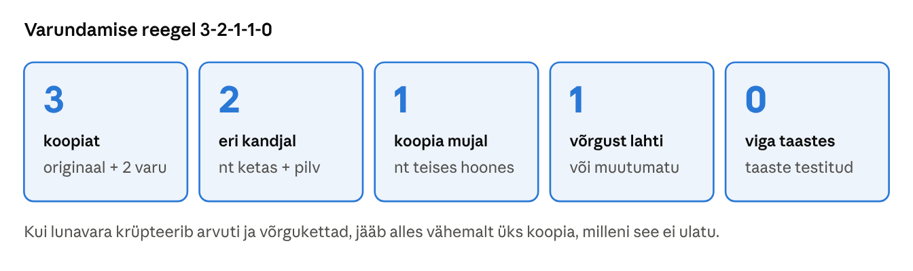

Iga number kaitseb erineva ohu eest: kaks kandjat – kandja rikke eest, teine asukoht – tulekahju või varguse eest, võrgust lahti koopia – lunavara eest, null viga – selle eest, et varukoopia osutub hädahätta kasutuks.

**Sisu selgitus.** Varundus on organisatsiooni viimane kaitseliin lunavara, riistvararikete, kustutamisvigade ja looduskatastroofide vastu. Klassikaline **3-2-1 reegel** on tänapäeval laienenud **3-2-1-1-0 reegliks**:

- **3** koopiat andmetest;
- **2** erinevat andmekandjat või süsteemi;
- **1** koopia teises asukohas;
- **1** koopia võrgust lahti (*offline*) või muutumatu (*immutable*);
- **0** viga taastetestis.

Põhimõisted:

- **RPO** (*Recovery Point Objective*) – kui palju andmeid tohib kaotada (nt viimased 4 tundi).
- **RTO** (*Recovery Time Objective*) – kui kiiresti peab teenus taastuma.
- **Muutumatu varukoopia** – koopia, mida ei saa kindla aja jooksul muuta ega kustutada isegi administraatoriõigustega.
- **Varundustõmmis** – terve süsteemi (nt virtuaalmasina) seisu koopia, millest saab süsteemi tervikuna taastada.

**Miks see on oluline.** Kaasaegne lunavara otsib esimese asjana üles varundussüsteemid ja kustutab või krüpteerib need, alles seejärel käivitatakse krüpteerimine. Kui varukoopia on samas domeenis ja samade administraatoriõigustega kättesaadav, hävib see koos tootmisandmetega. Testimata varukoopia on aga lihtsalt lootus.

**Praktilised meetmed:**

- [ ] Vähemalt üks koopia on muutumatu või võrgust lahti ühendatud.
- [ ] Varundussüsteem on eraldi autentimisega (ei ole domeeni liige), MFA-ga ja eraldi võrgusegmendis.
- [ ] Taastamist testitakse regulaarselt (nt kord kvartalis), sh terve süsteemi taastamist, mitte ainult üksikfaili.
- [ ] RPO ja RTO on iga kriitilise süsteemi jaoks kokku lepitud ja varundus vastab neile.
- [ ] Varundatud on ka konfiguratsioonid: AD, tulemüürid, võrguseadmed, pilvekeskkonnad.
- [ ] Varundustööde ebaõnnestumisest saadetakse hoiatus ja sellele reageeritakse.

**Seos E-ITS-iga:** CON.3 Andmevarundus; DER.4 Talitluspidevuse haldus.

### Näide 1: Code Spaces (2014)

**Kes nad on?** **Code Spaces** oli väike ettevõte, mis pakkus programmeerijatele kohta lähtekoodi hoidmiseks ja koos töötamiseks, umbes nagu GitHub. Kogu teenus töötas Amazoni pilves (AWS).

**Mis juhtus.** Koodihoidla teenusepakkuja Code Spaces lõpetas tegevuse 12 tunni jooksul pärast rünnakut. Ettevõte ei suutnud klientide andmeid taastada.

**Miks see juhtus.** Ründaja sai ligipääsu Code Spacesi AWS-i halduskonsoolile ja nõudis lunaraha. Kui ettevõte püüdis kontrolli tagasi võtta, kustutas ründaja masinad, andmehoidlad ja **ka varukoopiad**. Varukoopiad asusid samas AWS-i kontos ja olid kättesaadavad samade õigustega.

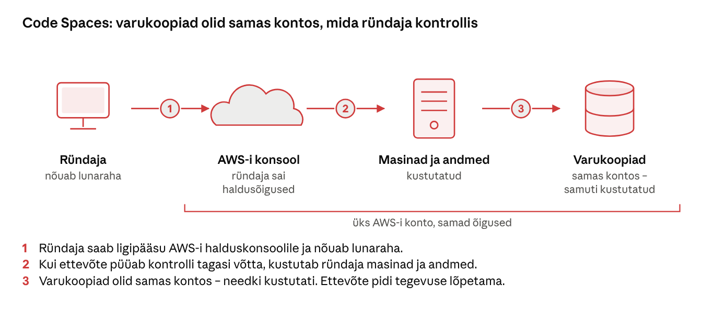

**Mis oleks aidanud.** Varukoopiad teises kontos või teise teenusepakkuja juures; MFA halduskonsoolil; kustutamise kaitse (nt objektide lukustus); juurkonto eraldamine igapäevatööst.

**Õppetund.** Varukoopia, mida saab hävitada samade õigustega kui tootmisandmeid, ei ole varukoopia. Varundus peab olema **eraldatud nii asukoha kui ka õiguste poolest**.

### Näide 2: GitLab.com andmebaasi kustutamine (jaanuar 2017)

**Kes nad on?** **GitLab** on platvorm, kus programmeerijad hoiavad koodi ja töötavad koos, GitHubi konkurent. GitLab.com on selle pilveteenus, mida kasutasid juba siis sajad tuhanded arendajad.

**Mis juhtus.** GitLab.com-i administraator kustutas ekslikult tootmisandmebaasi, mõeldes, et töötab varuserveris. Kaotsi läks umbes 6 tunni andmed, sh projektid, kommentaarid ja kasutajakontod.

**Miks see juhtus.** Väsinud administraator käivitas käsu valel serveril. Seejärel selgus, et **viiest varundusmeetodist ei töötanud korralikult ükski**: automaatne varundus oli vaikselt ebaõnnestunud (veateated jäid kohale jõudmata), replikatsioon oli katki ja pilvevarundus ei olnud sisse lülitatud. Andmed taastati LVM-hetktõmmisest, mille üks insener oli juhuslikult 6 tundi varem testkeskkonna jaoks teinud. GitLab dokumenteeris taastamise avalikult ja otseülekandes.

**Mis oleks aidanud.** Taastamise regulaarne testimine; varundustööde jälgimine ja hoiatused; serverite selgelt eristatav nimetamine ja tootmiskeskkonnas kinnitusnõue ohtlike käskude puhul.

**Õppetund.** Varundust ei ole olemas enne, kui sellest on edukalt taastatud. Lisaks näitab GitLab, et avatus intsidendi ajal võib säilitada klientide usalduse.

### Näide 3: Norsk Hydro ja LockerGoga (märts 2019)

**Kes nad on?** **Norsk Hydro** on üks maailma suurimaid alumiiniumitootjaid, Norra ettevõte, millel on umbes 35 000 töötajat ja tehased kümnetes riikides. Selle alumiiniumi kasutatakse autodes, akendes ja ehituses.

**Mis juhtus.** Norra alumiiniumitootjat tabas lunavara LockerGoga, mis halvas suure osa ettevõtte IT-süsteemidest üle maailma. Mitmed tehased läksid üle käsitsi juhtimisele.

**Miks see lõppes paremini kui teistel.** Norsk Hydro otsustas lunaraha **mitte maksta**. Neil olid toimivad varukoopiad, mistõttu süsteemid sai taastada. Töötajad jätkasid paberil ja käsitsi. Ettevõte teavitas avalikkust igapäevaselt. Ainuüksi esimese kvartali kulu oli ettevõtte hinnangul kuni 450 miljonit Norra krooni (umbes 52 miljonit dollarit), kuid ettevõte jäi ellu ja tema mainekahju jäi väikeseks.

**Mis oleks aidanud veel rohkem.** Võrgu parem segmenteerimine, mis oleks piiranud levikut; kiirem taastamine, kui varundus oleks olnud kogu ulatuses testitud.

**Õppetund.** Toimiv varundus annab **valikuvabaduse**: organisatsioon saab keelduda lunaraha maksmisest. Varundus koos käsitsi töö plaaniga (talitluspidevus) on parim vastus lunavarale.

**Arutelu küsimused:**

1. Mis on teie organisatsiooni kõige kriitilisema süsteemi RPO ja RTO? Kas varundus neid päriselt täidab?
2. Kas teie varundusserver on domeeni liige? Mis juhtub, kui ründaja saab domeeni administraatoriõigused?
3. Millal viimati taastasite terve serveri varukoopiast? Kui kaua see aega võttis?

## 7. Turvateadlikkuse tõstmine (Security Awareness Training)

> **Lihtsalt öeldes:** kõige parem lukk ei aita, kui keegi avab ukse võõrale, kes ütleb end olevat elektrik.

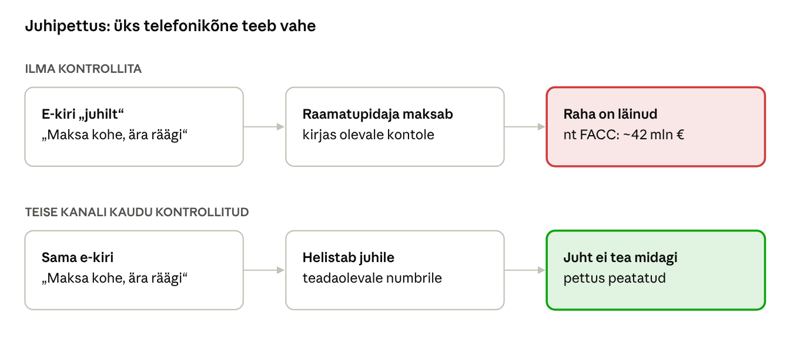

Kontrolli **teise kanali** kaudu: helista numbrile, mille tead juba ette (mitte kirjas olevale). Kui kiri on võltsitud, ei saa petis seda kõne vastu võtta.

**Sisu selgitus.** Turvateadlikkuse eesmärk ei ole teha igast töötajast turvaeksperti, vaid kujundada mõned kindlad harjumused: kahtlase sõnumi äratundmine, **kontrollimine teise kanali kaudu** ja kiire teatamine. Tõhus programm on regulaarne, lühike, rollipõhine (raamatupidajatele teised teemad kui arendajatele) ja kasutab simulatsioone.

Põhimõisted:

- **Andmepüük** (*phishing*) – võltssõnum, mis meelitab sisestama andmeid või avama faili; **sihitud andmepüük** (*spear phishing*) on suunatud konkreetsele inimesele.
- **Häälõngitsus** (*vishing*) – telefonikõne kaudu manipuleerimine.
- **BEC** (*Business Email Compromise*) ehk **juhipettus** – ründaja esineb juhi või partnerina ja palub raha üle kanda.
- **Süvavõltsing** (*deepfake*) – tehisintellektiga loodud võlts hääl või video.
- **Sotsiaalne manipulatsioon** – kiirustamise, autoriteedi, hirmu või abivalmiduse ärakasutamine.

**Miks see on oluline.** Enamik rünnakuid sisaldab inimfaktorit. Tehnilised kaitsed peatavad suurema osa massandmepüügist, kuid hästi ettevalmistatud sihitud rünnak jõuab inimeseni. Juhipettus ei vaja üldse pahavara – piisab ühest veenvast kirjast või kõnest. Tehisintellekt on muutnud võltsingud palju veenvamaks ja eesti keeles kirjutatud andmepüügikirjad on muutunud grammatiliselt korrektseks.

**Praktilised meetmed:**

- [ ] Kõik töötajad läbivad lühikese koolituse liitumisel ja vähemalt kord aastas; kõrge riskiga rollid sagedamini.
- [ ] Andmepüügi simulatsioonid toimuvad regulaarselt; tulemusi kasutatakse õppimiseks, mitte karistamiseks.
- [ ] Kahtlasest sõnumist teatamine on lihtne (nt üks nupp e-postis) ja teatajat tänatakse.
- [ ] Maksete ja pangarekvisiitide muutmisel kehtib **kohustuslik kontroll teise kanali kaudu** (helistatakse teadaolevale numbrile).
- [ ] Suurtel maksetel on nelja silma põhimõte.
- [ ] IT-tugi ei küsi kunagi parooli ega MFA-koodi; see on kõigile teada.

**Seos E-ITS-iga:** ORP.3 Teadlikkus ja koolitus.

### Näide 1: FACC juhipettus (2016)

**Kes nad on?** **FACC** on Austria ettevõte, mis toodab lennukite osi (nt salongi sisustust ja tiivaosi) Airbusile ja Boeingule. 50 miljonit eurot oli umbes kümnendik ettevõtte aastasest käibest.

**Mis juhtus.** Austria lennukiosade tootja FACC kandis jaanuaris 2016 petturitele üle umbes 50 miljonit eurot. Ligi 11 miljonit õnnestus kinni pidada, kahju jäi umbes 42 miljoni euro suuruseks. Pärast juhtumit vallandati nii finantsjuht kui ka 17 aastat ettevõtet juhtinud tegevjuht.

**Miks see juhtus.** Raamatupidamise töötaja sai e-kirja, mis näis tulevat tegevjuhilt. Kirjas räägiti salajasest ettevõtte ostust ja paluti teha kiireloomuline makse ning juhtumist mitte kellelegi rääkida. Petturid kasutasid **autoriteeti, kiirustamist ja salastatust** – kolme klassikalist manipulatsioonivõtet. Ettevõttes puudus nõue suuri makseid teise kanali kaudu kontrollida.

**Mis oleks aidanud.** Maksete kinnitamise protseduur (nelja silma põhimõte, tagasihelistamine); töötajate koolitus juhipettuse tunnuste kohta; kultuur, kus juhi palvet võib ja tuleb kontrollida.

**Õppetund.** Juhipettus ründab protsessi, mitte tehnoloogiat. Kõige tugevam kaitse on reegel, mis ei luba erandeid isegi tegevjuhile.

### Näide 2: Twitteri häälõngitsus (juuli 2020)

**Kes nad on?** **Twitter** (praegu nimega X) on sotsiaalvõrgustik, kus inimesed avaldavad lühikesi postitusi. 2020. aastal oli sellel üle 300 miljoni kasutaja, sh presidendid, kuulsused ja suurfirmad. Ründajad olid kolm noort, kellest peamine oli 17-aastane.

**Mis juhtus.** Ründajad sihtisid umbes 130 Twitteri kontot, sh Barack Obama, Elon Muski, Bill Gatesi ja Apple'i kontod, ning postitasid neilt bitcoini-pettuse. Mõne tunniga koguti üle 118 000 dollari.

**Miks see juhtus.** Ründajad helistasid Twitteri töötajatele, esinedes ettevõtte IT-toena, ja suunasid nad võltsitud VPN-i sisselogimislehele. Nii saadi nelja töötaja paroolid ja MFA-koodid. Seejärel leiti töötajad, kellel oli ligipääs **sisemisele kontohaldustööriistale**. Selle tööriistaga sai muuta ükskõik millise konto e-posti aadressi.

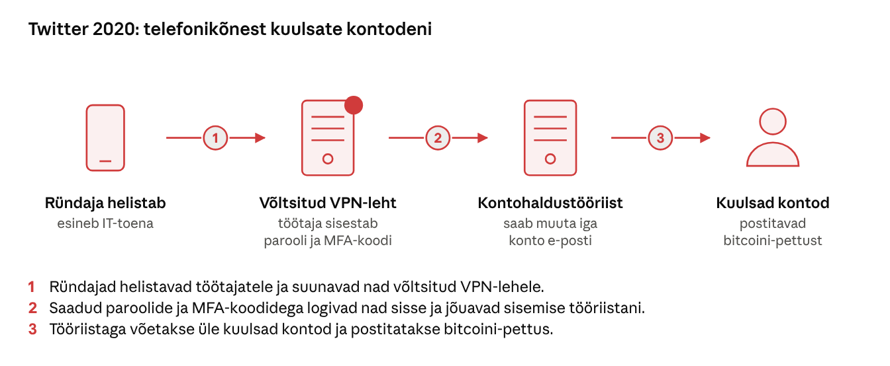

**Mis oleks aidanud.** Töötajate koolitus häälõngitsuse tunnuste kohta; andmepüügikindel MFA; sisemise haldustööriista ligipääsu piiramine vähimale võimalikule arvule töötajatele ja nelja silma kinnitus tundlikele tegevustele.

**Õppetund.** Sotsiaalne manipulatsioon ei toimu ainult e-postis. Helistaja, kes teab sinu nime ja ametit, ei ole seetõttu veel usaldusväärne.

### Näide 3: Arup ja süvavõltsitud videokõne (2024)

**Kes nad on?** **Arup** on Briti inseneri- ja arhitektuuribüroo, mis on projekteerinud näiteks Sydney ooperimaja ja Pekingi olümpiastaadioni. Ettevõttel on üle 18 000 töötaja ja kontorid üle maailma, ka Hongkongis.

**Mis juhtus.** Inseneribüroo Arup Hongkongi kontori töötaja kandis üle umbes 25 miljonit USA dollarit 15 tehinguga. Raha liikus petturitele.

**Miks see juhtus.** Töötaja sai kirja, mis näis tulevat Suurbritannia finantsjuhilt. Esialgu ta kahtles, kuid seejärel kutsuti ta videokõnesse, kus osalesid „finantsjuht“ ja mitu tuttavat kolleegi. Kõik teised osalejad olid **tehisintellektiga loodud süvavõltsingud**, mis põhinesid avalikult kättesaadaval videol. Videokõne kõrvaldas töötaja kahtlused.

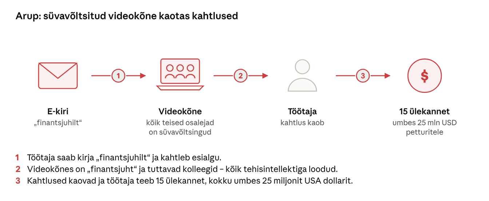

**Mis oleks aidanud.** Tagasihelistamine finantsjuhile teadaoleval numbril; maksete kinnitamine eraldi süsteemis; koolitus, mis selgitab, et ka video ja hääl võivad olla võltsitud; kokkulepitud kontrollküsimus või -sõna.

**Õppetund.** „Ma nägin teda oma silmaga“ ei ole enam usaldusväärne tõend. Kinnitamine peab toimuma kanalis, mille algatad **sina**, mitte see, kes palub.

**Arutelu küsimused:**

1. Milliseid manipulatsioonivõtteid (autoriteet, kiirus, salastatus, hirm) kasutati igas näites?
2. Kuidas kujundada andmepüügi simulatsioonid nii, et töötajad ei tunneks end karistatuna?
3. Koosta lühike juhis raamatupidajale: mida teha, kui tegevjuht palub kiiret ja salajast makset?

## 8. Ligipääsude haldamine (Access Control)

> **Lihtsalt öeldes:** igal töötajal on võtmekaart, mis avab ainult need uksed, mida ta oma tööks vajab. Kui ta vahetab ametit, kaart muudetakse; kui ta lahkub, kaart tühistatakse samal päeval.

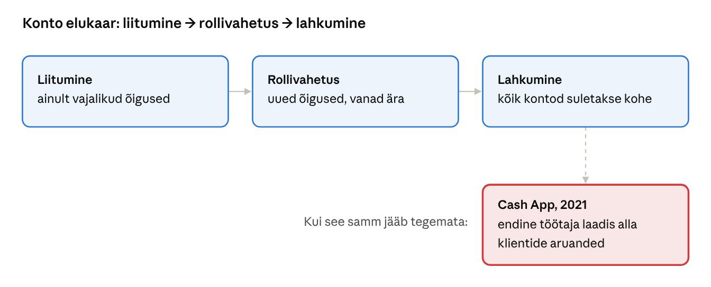

Kõige sagedamini läheb meelest just viimane samm. Endise töötaja konto, mis jäi avatuks, on nagu võti, mida ei küsitud tagasi.

**Sisu selgitus.** Ligipääsude haldus vastab kolmele küsimusele: **kes** on kasutaja (identiteet), **mida** ta tohib teha (õigused) ja **kas** need õigused on endiselt vajalikud (ülevaatus). Põhiprintsiip on **vähima privileegi põhimõte**: igal kontol on ainult need õigused, mida töö päriselt nõuab.

Põhimõisted:

- **RBAC** (*Role-Based Access Control*) – õigused antakse rolli, mitte inimese põhjal.
- **JML-protsess** (*Joiner–Mover–Leaver*) – liitumine, rollivahetus ja lahkumine; igas etapis õigusi lisatakse või eemaldatakse.
- **Õiguste kuhjumine** (*privilege creep*) – rolli vahetades jäävad vanad õigused alles.
- **PAM** (*Privileged Access Management*) – administraatoriõiguste kontroll: eraldi kontod, ajutised õigused (*just-in-time*), sessioonide salvestus.
- **Ülevaatus** (*access review*) – juht kinnitab perioodiliselt, et alluvate õigused on endiselt vajalikud.

**Miks see on oluline.** Ründaja, kes saab ühe konto, pärib kõik selle konto õigused. Mida laiemad õigused, seda suurem kahju. Lisaks tekitavad ohtu siseringi isikud: lahkunud töötajad, kelle konto jäi aktiivseks, või töötajad, kellel on rohkem ligipääsu, kui vaja.

**Praktilised meetmed:**

- [ ] Lahkuva töötaja kontod suletakse automaatselt personalisüsteemi kirje põhjal samal päeval.
- [ ] Rollivahetusel vaadatakse õigused üle ja eemaldatakse vanad.
- [ ] Administraatoritel on eraldi kontod igapäevatöö ja haldustöö jaoks.
- [ ] Õiguste ülevaatus toimub vähemalt kord aastas, kriitilistel süsteemidel sagedamini.
- [ ] Test-, ajutised ja teenusekontod on nimekirjas, neil on omanik ja aegumiskuupäev.
- [ ] Suurte andmemahtude allalaadimine või eksport tekitab hoiatuse.

**Seos E-ITS-iga:** ORP.4 Identiteedi- ja õiguste haldus; ORP.2 Personal.

### Näide 1: Cash App / Block (2021–2022)

**Kes nad on?** **Cash App** on USA mobiilimakse äpp, millega saab sõpradele raha saata ja aktsiaid osta, umbes nagu Revolut. Selle omanik on ettevõte **Block** (endine Square).

**Mis juhtus.** Detsembris 2021 laadis endine töötaja alla aruanded, mis sisaldasid umbes 8,2 miljoni Cash Appi kasutaja andmeid, sh nimesid, kontonumbreid ja investeeringute andmeid. Ettevõte teatas sellest aprillis 2022.

**Miks see juhtus.** Töötajal oli töö ajal aruannetele korrektne ligipääs. Pärast lahkumist ligipääsu **ei eemaldatud**. Suure andmemahu allalaadimine endise töötaja kontolt jäi märkamata.

**Mis oleks aidanud.** Automaatne JML-protsess, mis sulgeb kõik ligipääsud lahkumise päeval; regulaarne õiguste ülevaatus; andmelekete vältimise (DLP) ja anomaalse tegevuse jälgimine.

**Õppetund.** Lahkumise protsess on turvaprotsess. Iga päev, mil lahkunud töötaja konto on aktiivne, on avatud riski päev.

### Näide 2: Microsoft ja Midnight Blizzard (2023–2024)

**Kes nad on?** **Microsoft** on Windowsi, Office'i ja Azure'i pilve tootja. **Midnight Blizzard** on nimi, mille Microsoft andis riikliku taustaga häkkerite grupile (tuntud ka kui APT29 või Cozy Bear), keda seostatakse Venemaa välisluurega.

**Mis juhtus.** Jaanuaris 2024 teatas Microsoft, et riikliku taustaga ründajad (Midnight Blizzard, ka APT29; APT on pikaajaline, hästi rahastatud ründaja, sageli riigi taustaga) pääsesid ligi ettevõtte tippjuhtide ning turva- ja õigusosakonna töötajate e-postile.

**Miks see juhtus.** Ründajad kasutasid **password sprayingut** vana **testkeskkonna** konto vastu, millel ei olnud MFA-d. Sellest testkeskkonnast leidsid nad vana testrakenduse, millel oli kõrgendatud ligipääs Microsofti **ettevõtte põhikeskkonnale**. Rakenduse kaudu said ründajad luua uusi rakendusi ja anda neile õigused postkastide lugemiseks.

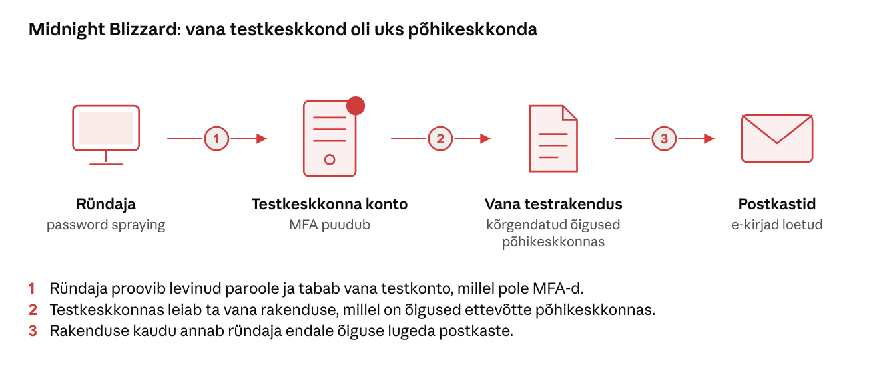

**Mis oleks aidanud.** Testkeskkondade inventuur ja vanade keskkondade sulgemine; MFA kõigil kontodel, ka testkontodel; rakenduste (OAuth – mehhanism, millega rakendusele antakse luba kellegi nimel andmetele ligi pääseda) õiguste regulaarne ülevaatus; testkeskkonna ja tootmiskeskkonna range eraldatus.

**Õppetund.** Unustatud testkonto on reaalne konto. Kui sellel on mingi tee tootmisesse, on see sama ohtlik kui administraatori konto.

### Näide 3: Morgan Stanley siseringi leke (2015)

**Kes nad on?** **Morgan Stanley** on üks suurimaid USA investeerimispanku. Selle varahaldusosakond haldab jõukate klientide raha ja investeeringuid. Finantsnõustaja on töötaja, kes nõustab kliente, kuhu raha paigutada.

**Mis juhtus.** Morgan Stanley finantsnõustaja kopeeris aastatel 2011–2014 umbes 730 000 kliendikonto (ligi 330 000 leibkonna) andmed oma isiklikku serverisse. Hiljem ilmus osa andmetest internetti, tõenäoliselt pärast seda, kui tema server häkiti. USA väärtpaberijärelevalve (SEC) trahvis ettevõtet 1 miljoni dollariga.

**Miks see juhtus.** Nõustaja pidi nägema ainult oma klientide andmeid. Kahe sisemise aruandlusportaali õiguste kontroll oli aga vigane ja võimaldas tal teha päringuid **kõigi klientide** kohta. Ta leidis selle, proovides läbi harukontorite ja töötajagruppide numbreid. Õiguste kontrolli ei olnud aastaid testitud ega auditeeritud. Andmete massilist väljavõtmist ei märgatud.

**Mis oleks aidanud.** Õiguste kontrolli testimine; regulaarne audit, kes millistele andmetele päriselt ligi pääseb; massiliste päringute ja ekspordi jälgimine; isiklikesse seadmetesse kopeerimise tõkestamine.

**Õppetund.** Vähima privileegi põhimõte peab toimima ka tehniliselt, mitte ainult paberil. Õiguste kontrolli tuleb testida samamoodi nagu iga teist turvameedet.

**Arutelu küsimused:**

1. Kirjelda oma organisatsiooni lahkumise protsessi. Mitu süsteemi tuleb käsitsi sulgeda ja kes selle eest vastutab?
2. Kuidas leida Active Directoryst kontod, millega ei ole 90 päeva sisse logitud? Kirjuta vastav PowerShelli käsk.
3. Miks on administraatoril vaja kahte kontot? Mis juhtub, kui ta loeb e-posti domeeni administraatori kontoga?

## 9. Seadmete turvalisus (Device Security)

> **Lihtsalt öeldes:** krüpteeritud sülearvuti kaotamine on nagu lukustatud kohvri kaotamine, mille koodi keegi ei tea. Kahju on ainult kohvrist, mitte selle sisust.

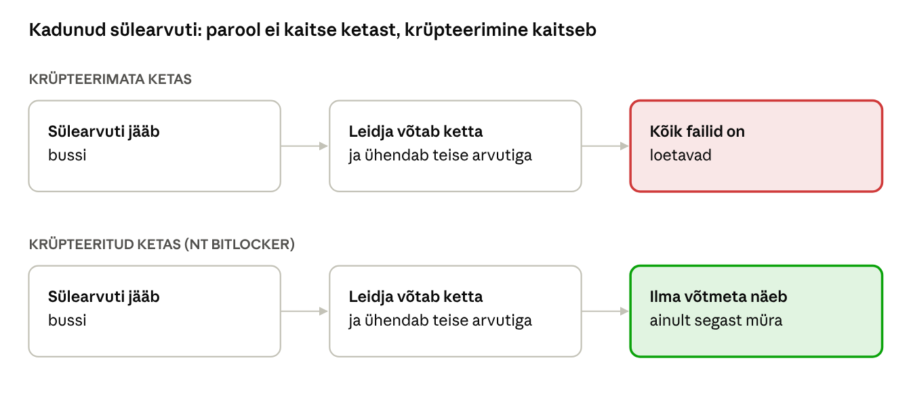

Windowsi sisselogimisparool kaitseb ainult siis, kui arvuti käivitatakse tavapäraselt. Kui ketas välja võetakse, ei küsi keegi parooli – krüpteeritud ketta andmed on aga ilma võtmeta kasutud.

**Sisu selgitus.** Seadmete turvalisus katab seadme kogu elutsükli: soetamine, turvaline seadistus, kasutamine, kaotus või vargus ning lõpuks kasutusest kõrvaldamine. Kõige olulisem tehniline meede on **täisketta krüpteerimine** (BitLocker, FileVault, LUKS), mis muudab kaotatud seadme andmed loetamatuks.

Põhimõisted:

- **Täisketta krüpteerimine** (*Full Disk Encryption*, FDE) – kogu ketas on krüpteeritud; ilma võtmeta on andmed kasutud.
- **MDM** (*Mobile Device Management*, nt Intune) – seadmete tsentraalne haldus: seadistus, nõuete kontroll, kaugkustutus.
- **Turvaline baasseadistus** (*hardening*) – mittevajalikud teenused välja, kohalik administraator piiratud, ekraanilukk sees.
- **Andmete turvaline kustutamine** – kustutamine standardi järgi (nt NIST SP 800-88) või andmekandja füüsiline hävitamine.
- **TPM** – seadme turvakiip, mis hoiab krüpteerimisvõtmeid.

**Miks see on oluline.** Sülearvuteid, telefone ja mälupulki kaotatakse ja varastatakse pidevalt. Krüpteerimata seade on andmeleke; krüpteeritud seade on lihtsalt riistvara kaotus. Sama kehtib vanade seadmete kohta – kõvaketas, mis müüakse edasi kustutamata, on andmeleke viivitusega.

**Praktilised meetmed:**

- [ ] Kõik sülearvutid ja telefonid on krüpteeritud; krüpteerimise olekut kontrollitakse MDM-ist.
- [ ] Krüpteerimise taastevõtmed on turvaliselt tsentraalselt hoitud (nt Entra ID, AD).
- [ ] Kaotatud seadet saab kaugelt lukustada ja kustutada; töötajad teavad, kellele ja kui kiiresti kaotusest teatada.
- [ ] USB-mälupulkade kasutamine on piiratud või lubatud ainult krüpteeritud seadmetega.
- [ ] Kasutusest kõrvaldatavate seadmete andmekandjad kustutatakse või hävitatakse dokumenteeritult; teenusepakkujalt nõutakse hävitamise tõendit.
- [ ] Serveriruumile on füüsiline ligipääsukontroll ja logi.

**Seos E-ITS-iga:** SYS.2.1 Klientarvuti; SYS.3.1 Sülearvuti; CON.6 Andmekustutus ja -hävitus; INF.2 Andmekeskus ja serveriruum.

### Näide 1: USA veteranide ameti sülearvuti vargus (2006)

**Kes nad on?** **VA** (*Department of Veterans Affairs*) on USA ministeerium, mis hoolitseb endiste sõjaväelaste eest: maksab pensione, korraldab tervishoidu ja toetusi. Eestis teeb osa sellest tööd Sotsiaalkindlustusamet.

**Mis juhtus.** USA veteranide asjade ministeeriumi (VA) analüütiku kodust varastati sülearvuti ja väline kõvaketas. Neil olid umbes 26,5 miljoni veterani ja sõjaväelase nimed, sünniajad ja sotsiaalkindlustusnumbrid. Seadmed leiti hiljem ja uurimise järgi andmetele tõenäoliselt ligi ei pääsetud, kuid ministeerium pidi teavitama miljoneid inimesi ja maksis hiljem hagi lahendamiseks 20 miljonit dollarit.

**Miks see juhtus.** Töötaja viis andmed koju ilma loata. Andmed ei olnud krüpteeritud. Asutuses puudus tehniline kontroll, mis oleks takistanud nii suure andmemahu viimist välisele andmekandjale.

**Mis oleks aidanud.** Täisketta krüpteerimine; väliste andmekandjate kasutamise piiramine; isikuandmete kodus töötlemise selge keeld või turvaline kaugligipääs; andmete minimeerimine.

**Õppetund.** Krüpteeringuga oleks see olnud ühe sülearvuti vargus. Ilma krüpteeringuta muutus see üheks suurimaks valitsuse andmeleketeks USA ajaloos.

### Näide 2: HMRC kadunud plaadid (2007)

**Kes nad on?** **HMRC** (*His Majesty's Revenue and Customs*) on Suurbritannia maksu- ja tolliamet, nagu meie Maksu- ja Tolliamet (EMTA). Lisaks maksudele maksab ta välja ka lastetoetusi. **Riigikontroll** (NAO) kontrollib, kas riigiasutused kasutavad raha õigesti.

**Mis juhtus.** Suurbritannia maksuamet HMRC saatis kullerpostiga kaks CD-plaati riigikontrollile. Plaadid kadusid. Neil olid 25 miljoni inimese (umbes 7,25 miljoni pere) lastetoetuse andmed, sh pangakonto andmed. Plaate ei leitud kunagi. Juhtumi tõttu astus tagasi HMRC juht.

**Miks see juhtus.** Andmed olid ainult parooliga kaitstud, mitte korralikult krüpteeritud. Riigikontroll oli palunud anonüümitud andmeid, kuid mugavuse ja kulu tõttu saadeti kogu andmebaas. Pakk saadeti asutuse sisepostiga registreerimata ja jälgimata. Hilisem sõltumatu ülevaatus (Poynter Review) ei süüdistanud üksikut töötajat: juhtum oli täielikult välditav ja põhjused olid asutuse korralduses – segane vastutus ja nõrk andmekäitluse kord.

**Mis oleks aidanud.** Andmete minimeerimine (saata ainult vajalik ja anonüümitult); tugev krüpteerimine; turvaline elektrooniline edastus; suurte andmehulkade väljastamise kinnitusprotsess.

**Õppetund.** Kõige turvalisem andmekandja on see, millel tundlikke andmeid üldse ei ole. Andmete minimeerimine on seadmete turvalisuse osa.

### Näide 3: Morgan Stanley kustutamata kõvakettad (2016)

**Kes nad on?** Sama investeerimispank kui teema 8 näites 3. **Andmekeskus** on hoone, kus on sadu või tuhandeid servereid koos jahutuse, voolu ja turvaga. Kui andmekeskus suletakse, tuleb kõik seadmed ja nende kettad turvaliselt hävitada.

**Mis juhtus.** Morgan Stanley sulges 2016. aastal kaks andmekeskust ja palkas seadmete kõrvaldamiseks teenusepakkuja. Hiljem selgus, et osa kõvakettaid ja servereid, millel olid umbes 15 miljoni kliendi andmed, müüdi edasi **kustutamata**. Mõned kettad jõudsid oksjonisaidile. Järelevalveasutused trahvisid ettevõtet kokku umbes 95 miljoni dollariga. Tegu on teise juhtumiga samast ettevõttest kui eelmise teema näide 3.

**Miks see juhtus.** Tööd tegi kolimis- ja laofirma, millel puudus kogemus andmete hävitamises; see müüs seadmed edasi. Morgan Stanley ei kontrollinud, kas seadmed kustutati. Hilisemal kontoriserverite väljavahetamisel jäi 42 serverit kadunuks – neil oli krüpteerimisvõimekus olemas, kuid seda ei olnud kunagi sisse lülitatud.

**Mis oleks aidanud.** Sertifitseeritud hävitamise teenusepakkuja; hävitamise tõendid (seerianumbrite kaupa); oma kontroll üleandmise hetkel; krüpteerimise oleku regulaarne kontroll.

**Õppetund.** Seadme elutsükkel lõpeb alles siis, kui andmed on tõendatult hävitatud. Krüpteerimine aitab ainult siis, kui see on päriselt sisse lülitatud.

**Arutelu küsimused:**

1. Kuidas kontrollida PowerShelliga, kas arvutis on BitLocker sisse lülitatud? Kuidas kontrollida seda kõigis organisatsiooni arvutites?
2. Mida teete oma organisatsioonis vanade kõvaketaste ja printeritega? Kas printerites on kõvaketas?
3. Töötaja kaotas õhtul telefoni, millel on tööpost. Koosta tegevusplaan esimeseks tunniks.

## 10. Võrgu turvalisus (Network Security)

> **Lihtsalt öeldes:** võrgu segmenteerimine on nagu laeva veekindlad vaheseinad. Kui üks sektsioon lekib, ei upu kogu laev.

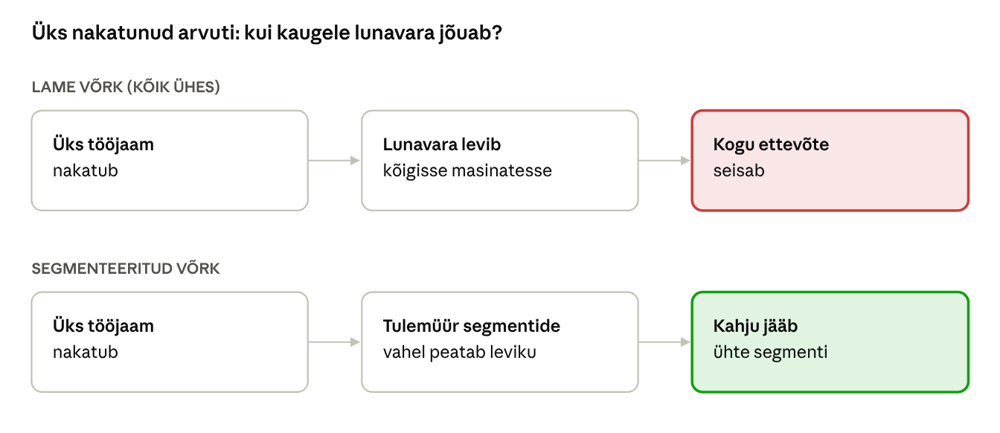

Segmenteerimine on nagu tuleuksed hoones: tulekahju võib alata, aga see ei jõua kõigisse ruumidesse korraga.

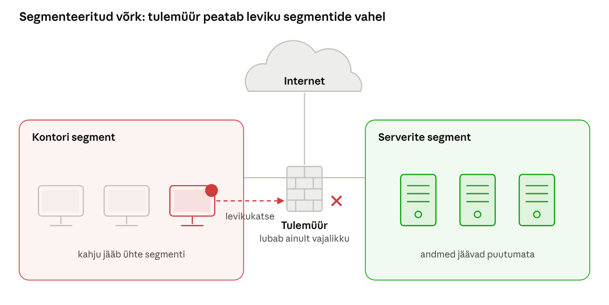

Kontori arvutid ja serverid on eri segmentides ning nende vahel on tulemüür, mis laseb läbi ainult vajaliku liikluse. Nakatunud tööjaam ei jõua serveriteni.

**Sisu selgitus.** Võrgu turvalisus tähendab, et võrk on jagatud **segmentideks** vastavalt usaldustasemele ja funktsioonile ning segmentide vahelist liiklust kontrollitakse ja jälgitakse. Eesmärk on, et ühe seadme kompromiteerimine ei annaks ligipääsu kogu võrgule.

Põhimõisted:

- **Lame võrk** – kõik seadmed on samas võrgus ja näevad üksteist; ründaja jaoks ideaalne.
- **Segmenteerimine** – võrk jagatakse VLAN-ideks või alamvõrkudeks (kontor, serverid, haldus, külalised, IoT, tööstusseadmed), mille vahel on tulemüür.
- **Mikrosegmenteerimine** – reeglid kehtivad isegi sama segmendi masinate vahel.
- **Horisontaalne liikumine** (*lateral movement*) – ründaja liigub ühest kompromiteeritud masinast teistesse.
- **IDS/IPS** – sissetungi tuvastamise ja ennetamise süsteemid; **NDR** jälgib võrguliikluse anomaaliaid.
- **Null-usaldus** (*Zero Trust*) – ühtegi ühendust ei usaldata ainult võrgus asumise tõttu; iga ligipääs kontrollitakse.

**Miks see on oluline.** Ründajad sisenevad tavaliselt kõige nõrgemast kohast – töötaja arvutist, printerist või partneri kontost – ja liiguvad sealt väärtuslike süsteemide poole. Segmenteerimine muudab selle liikumise raskeks, aeglaseks ja nähtavaks. Lames võrgus levib lunavara minutitega.

**Praktilised meetmed:**

- [ ] Võrk on jagatud segmentideks; kriitilised süsteemid, haldusliidesed ja IoT on eraldi.
- [ ] Segmentide vahel on lubatud ainult vajalik liiklus (nt kontoriarvutid ei vaja SMB-ühendust kõigi serveritega).
- [ ] Partnerite ja hoolduse kaugligipääs on eraldi, piiratud vajalike süsteemidega ja MFA-ga.
- [ ] Külaliste Wi-Fi on täielikult eraldatud sisevõrgust.
- [ ] Võrguliiklust jälgitakse (IDS/NDR, voologid) ja hoiatustele reageeritakse.
- [ ] Võrgujoonis on ajakohane.

**Seos E-ITS-iga:** NET.1.1 Võrgu arhitektuur ja lahendus; NET.1.2 Võrguhaldus.

### Näide 1: Target (2013)

**Kes nad on?** **Target** on üks USA suurimaid jaekette – kaubamajad, kust saab nii toitu, riideid kui ka elektroonikat, umbes nagu Prisma või Selver, kuid umbes 1800 kauplusega. **Kassasüsteem** (POS) on poe kassas olev arvuti ja kaardilugeja.

**Mis juhtus.** USA jaeketi Target kassasüsteemidest varastati umbes 40 miljoni maksekaardi andmed ja lisaks umbes 70 miljoni kliendi isikuandmed. Rünnaku kogukulu ulatus sadade miljonite dollariteni ning ametist lahkusid nii IT-juht kui ka tegevjuht.

**Miks see juhtus.** Ründajad varastasid andmepüügiga parooli väikeselt **kütte- ja ventilatsioonifirmalt**, kes oli Targeti tarnija. Tarnijal oli ligipääs Targeti arveldus- ja projektiportaalile. Sealt said ründajad liikuda kassasüsteemideni, sest võrk ei olnud piisavalt segmenteeritud. Targeti turvasüsteem andis küll hoiatusi, kuid neile ei reageeritud.

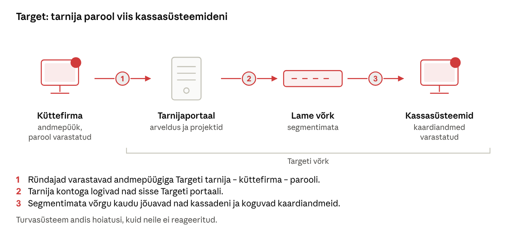

**Mis oleks aidanud.** Tarnijate ligipääsu range eraldamine; kaardimaksete keskkonna isoleerimine (seda nõuab ka maksekaartide andmete kaitse standard PCI DSS); MFA tarnijatele; hoiatustele reageerimise protsess.

**Õppetund.** Ründaja ei pea sisenema sealt, kus on väärtuslikud andmed. Ta siseneb sealt, kus on kõige kergem, ja lame võrk viib ta sihtmärgini.

### Näide 2: Maersk ja NotPetya (juuni 2017)

**Kes nad on?** **Maersk** on Taani ettevõte, maailma üks suurimaid konteinerlaevade operaatoreid. Selle laevad veavad umbes viiendiku kogu maailma konteinerkaubast ning ettevõttele kuuluvad ka sadamaterminalid. **M.E.Doc** on Ukrainas laialt kasutatud raamatupidamistarkvara, nagu meil Merit või Directo.

**Mis juhtus.** Maailma suurim konteinerivedaja Maersk kaotas umbes 7 minutiga suurema osa oma IT-süsteemidest: umbes 45 000 arvutit ja 4000 serverit. Sadamad seiskusid üle maailma. Kahju oli umbes 250–300 miljonit dollarit. Kahjustatud olid ka Merck, FedEx, Mondelez jt.

**Miks see juhtus.** NotPetya levis Ukraina raamatupidamistarkvara M.E.Doc kompromiteeritud uuenduse kaudu. See ei olnud tegelikult lunavara, vaid andmeid hävitav pahavara. Võrgus levis see EternalBlue haavatavuse ja varastatud administraatoriparoolide abil (Mimikatz – tööriist, mis loeb Windowsi mälust paroole ja nende räsisid). Maerski globaalne võrk oli lame ja sama domeeniadministraatori õigused kehtisid kõikjal.

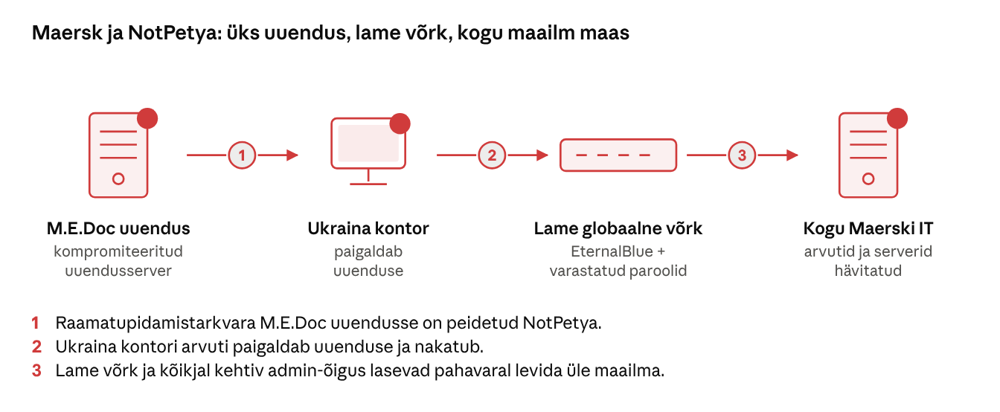

**Kuidas taastuti.** Kõik domeenikontrollerid hävisid – peale ühe Ghanas, mis oli juhuslikult elektrikatkestuse tõttu võrgust väljas. Sellest tehti koopia, mis toimetati Londonisse, ja selle abil taastati kogu Active Directory.

**Mis oleks aidanud.** Segmenteerimine riikide ja funktsioonide vahel; administraatoriõiguste piiramine (tiered admin model: domeeni, serverite ja tööjaamade haldamiseks on eraldi kontod, nii et tööjaamast varastatud parool ei ava domeenikontrollerit); paikamine (MS17-010); AD varukoopia, mis ei sõltu juhusest.

**Õppetund.** Lames võrgus muutub üks kompromiteeritud arvuti kogu ettevõtte probleemiks mõne minutiga. Maersk pääses tänu õnnele, mitte plaanile.

### Näide 3: Kasiino akvaariumi termomeeter (2017)

**Kes nad on?** Kasiino nime ei ole avalikustatud, teada on vaid, et see asus Põhja-Ameerikas. **Darktrace** on Briti küberturbeettevõte, mis jälgib klientide võrguliiklust ja otsib sealt ebatavalist käitumist – nii avastati ka see juhtum.

**Mis juhtus.** Turvafirma Darktrace kirjeldas juhtumit, kus Põhja-Ameerika kasiinost viidi välja umbes 10 GB andmeid, sh kõrge panusega mängijate andmebaas. Andmed liikusid Soome serverisse.

**Miks see juhtus.** Ründajad sisenesid fuajee akvaariumi **internetti ühendatud termomeetri** kaudu. Andur oli samas võrgus muude süsteemidega. IoT-seadmetel on sageli nõrgad vaikeparoolid ja neid ei paigata, kuid neid ei peeta „päris arvutiteks“, mistõttu neid ka ei jälgita.

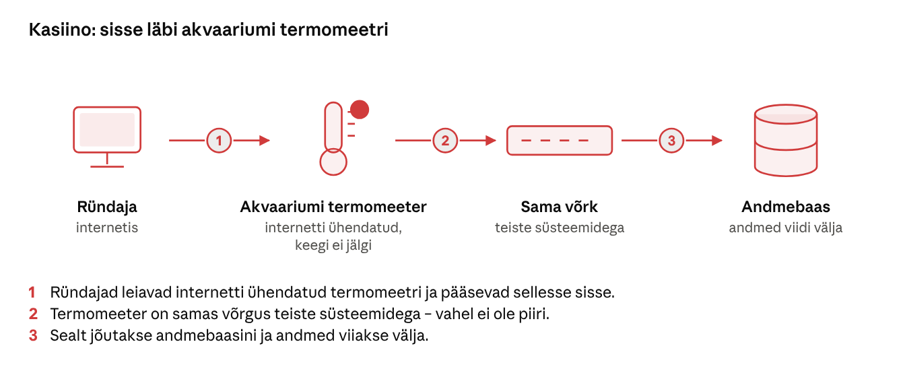

**Mis oleks aidanud.** IoT-seadmed eraldi segmendis, kust ei ole ligipääsu sisevõrku; väljuva liikluse piiramine (termomeeter ei pea saatma gigabaite Soome); võrguliikluse anomaaliate jälgimine.

**Õppetund.** Iga võrku ühendatud seade on arvuti. Kui see ei vaja ligipääsu andmebaasile, ei tohi tal seda olla.

**Arutelu küsimused:**

1. Joonista oma organisatsiooni (või õppeorganisatsiooni) võrgu segmendid. Millised segmendid saavad omavahel suhelda ja miks?
2. Millised IoT-seadmed on teie võrgus (printerid, kaamerad, kliimaseadmed, uksekontrollerid)? Kus need asuvad?
3. Kuidas aitab segmenteerimine intsidendi ajal? Mõtle Maerski näitele.

## 11. Turvapoliitika ja protseduurid (Security Policy and Procedures)

> **Lihtsalt öeldes:** poliitika on maja kodukord – see ütleb, mida tohib ja kes vastutab. Protseduur on kasutusjuhend – see ütleb samm-sammult, kuidas midagi õigesti teha.

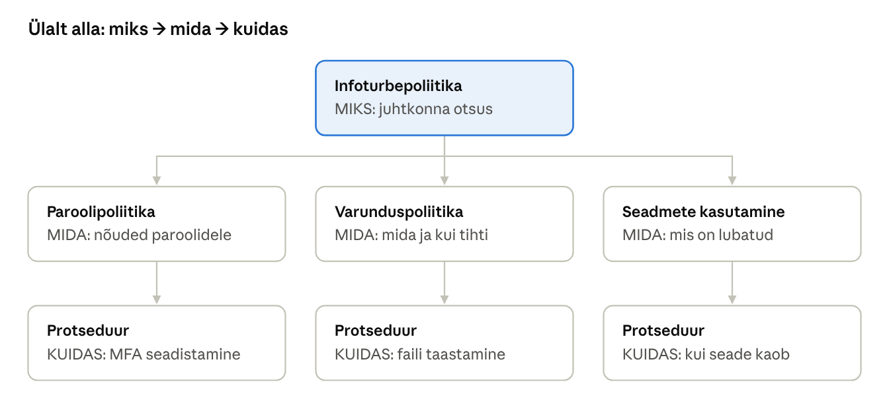

Poliitika ütleb, **miks** ja **mida** tehakse; protseduur ütleb samm-sammult, **kuidas**. Töötaja loeb igapäevaselt enamasti protseduure.

**Sisu selgitus.** Turvapoliitika on juhtkonna kinnitatud dokument, mis ütleb, **mida** organisatsioon nõuab ja **kes** vastutab. Selle all on kitsamad poliitikad (nt andmete klassifitseerimine, lubatud kasutus, kaugtöö) ja protseduurid, mis kirjeldavad, **kuidas** midagi tehakse. Poliitika on kasulik ainult siis, kui see on teada, arusaadav, järgitav ja seda kontrollitakse.

Põhimõisted:

- **Andmete klassifitseerimine** – andmed jaotatakse tasemetesse (nt avalik, sisekasutuseks, konfidentsiaalne, salajane) ja igal tasemel on oma käsitlusreeglid.
- **Lubatud kasutuse poliitika** (*Acceptable Use Policy*) – mida tohib töövahenditega teha, sh tehisintellekti tööriistade kasutamine.
- **Varjatud IT** (*shadow IT*) – teenused ja tööriistad, mida kasutatakse ilma IT teadmata.
- **Tarneahela ja ülevõtmise turvahindamine** – partneri või ostetava ettevõtte turvataseme kontroll enne liitumist.
- **ISMS** – infoturbe juhtimissüsteem, mis hoiab poliitikad, riskid ja meetmed järjepidevalt ajakohasena.

**Miks see on oluline.** Tehnilised meetmed vajavad otsuseid: mida kaitsta, kui palju ja kes vastutab. Ilma poliitikata teeb iga töötaja oma otsused ja tulemus on juhuslik. Uued tehnoloogiad (pilv, tehisintellekt) toovad kaasa uued riskid kiiremini, kui poliitika jõuab neid käsitleda.

**Praktilised meetmed:**

- [ ] Turvapoliitika on juhtkonna kinnitatud ja vaadatakse üle vähemalt kord aastas.
- [ ] Andmete klassifitseerimise skeem on olemas ja töötajad teavad, kuidas igat taset käsitleda.
- [ ] Tehisintellekti tööriistade kasutamise reeglid on kirjas: milliseid andmeid tohib sisestada ja milliseid tööriistu kasutada.
- [ ] Pilveressursside jagamise reeglid on kirjas ja nende täitmist kontrollitakse automaatselt.
- [ ] Tarnijate ja ülevõetavate ettevõtete turvahindamine on protsessi kohustuslik osa.
- [ ] Töötajad kinnitavad poliitikaga tutvumist ja poliitika rikkumisel on selged tagajärjed.

**Seos E-ITS-iga:** ISMS.1 Turbehaldus; ORP.1 Korraldus; CON.2 Andmekaitse.

### Näide 1: Marriott ja Starwoodi ülevõtmine (2016–2018)

**Kes nad on?** **Marriott** on maailma suurim hotelliketi omanik, kellel on tuhandeid hotelle üle maailma. **Starwood** oli teine suur hotelliketi omanik (nt Sheraton ja Westin), mille Marriott 2016. aastal ostis. **ICO** on Suurbritannia andmekaitseasutus, nagu meie Andmekaitse Inspektsioon.

**Mis juhtus.** 2018. aastal avastas Marriott, et hotelliketi Starwood broneerimissüsteemi oli rünnatud juba 2014. aastast. Lekkisid umbes 339 miljoni külalise andmed, sh passinumbrid. Suurbritannia andmekaitseasutus ICO trahvis Marriotti 18,4 miljoni naelaga.

**Miks see juhtus.** Marriott ostis Starwoodi 2016. aastal. Ründaja oli juba 2014. aastal paigaldanud Starwoodi süsteemi veebikesta (web shell – kaugjuhtimist võimaldav skript veebiserveris) ja jäi pärast ülevõtmist märkamata veel kaheks aastaks. ICO leidis, et Marriott ei rakendanud isikuandmete kaitseks piisavaid tehnilisi ja organisatsioonilisi meetmeid. Trahv puudutas ainult perioodi pärast GDPR-i jõustumist mais 2018.

**Mis oleks aidanud.** Poliitika, mis nõuab ülevõetava ettevõtte IT-keskkonna turvahindamist (sh kompromiteerimise tunnuste otsingut); süsteemide kiire integreerimine või väljavahetamine; passinumbrite ja muude tundlike andmete krüpteerimine.

**Õppetund.** Ettevõtte ostmisel ostad ka tema turvaprobleemid – ka need, millest keegi veel ei tea. Turvahindamine peab olema ostuprotsessi kohustuslik osa.

### Näide 2: Samsung ja ChatGPT (2023)

**Kes nad on?** **Samsung** on Lõuna-Korea tehnoloogiaettevõte, mis teeb telefone, telereid ja mälukiipe. Selle pooljuhtide divisjon toodab kiipe, mille valmistamise tehnoloogia on ettevõtte üks väärtuslikumaid saladusi. **ChatGPT** on OpenAI tehisintellekti vestlusrobot.

**Mis juhtus.** Märtsis 2023 lubas Samsungi pooljuhtide divisjon töötajatel kasutada ChatGPT-d. Mõne nädala jooksul toimus vähemalt kolm juhtumit, kus töötajad sisestasid tööriista konfidentsiaalset infot: lähtekoodi vea leidmiseks, testimise koodi optimeerimiseks ja koosoleku salvestise ärakirja kokkuvõtte tegemiseks. Mais 2023 keelas Samsung avalike generatiivse tehisintellekti tööriistade kasutamise tööseadmetes.

**Miks see juhtus.** Tööriist lubati kasutusele enne, kui olid paigas reeglid, milliseid andmeid sinna tohib sisestada. Töötajad soovisid lihtsalt oma tööd kiiremini teha ja ei mõelnud, et sisestatud andmed lahkuvad ettevõttest ja võivad jõuda teenusepakkuja mudeli treenimisse.

**Mis oleks aidanud.** Tehisintellekti kasutamise poliitika enne tööriista kasutuselevõttu; andmete klassifitseerimise skeem, mis ütleb selgelt, et lähtekood on konfidentsiaalne; ettevõtte versioon tööriistast, kus andmeid ei kasutata treenimiseks; DLP-kontroll.

**Õppetund.** Poliitika peab tulema enne uut tehnoloogiat, mitte pärast esimest intsidenti. Töötajad ei riku reegleid pahatahtlikult – neid lihtsalt ei olnud.

### Näide 3: Microsofti tehisintellekti meeskonna 38 TB leke (2023)

**Kes nad on?** Sama Microsoft, mis teema 8 näites 2. Seekord oli tegu ettevõtte enda teadlastega, kes jagasid avalikult tehisintellekti mudeleid. **Wiz** on pilveturbele keskendunud ettevõte, mis otsib internetist valesti seadistatud pilveressursse ja teavitab omanikke.

**Mis juhtus.** Turvafirma Wiz avastas 2023. aastal, et Microsofti tehisintellekti uurimisrühm oli GitHubis jaganud avatud lähtekoodiga mudelite allalaadimislinki, mis tegelikult andis ligipääsu terve Azure'i salvestuskonto 38 TB andmetele. Nende hulgas olid kahe töötaja arvutite varukoopiad, paroolid, võtmed ja üle 30 000 sisemise Teamsi sõnumi.

**Miks see juhtus.** Link oli loodud **SAS-tokeniga** (*Shared Access Signature*), millel olid kogu salvestuskonto **täisõigused** ja väga pikk kehtivusaeg. SAS-token on nagu lisavõti, mille saab kellelegi anda – see võti avas kogu lao, mitte ühte riiulit. Selliseid tokeneid on keeruline jälgida ja need ei ilmu tavalistesse ligipääsude ülevaatustesse. Puudus protseduur, mis oleks nõudnud avaliku jagamise jaoks eraldi salvestuskonto ja piiratud õigustega lingi kasutamist.

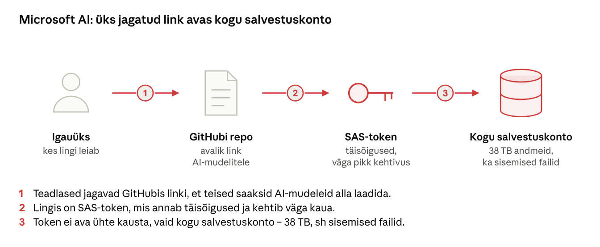

**Mis oleks aidanud.** Pilveressursside jagamise protseduur (avalikud andmed eraldi kontos, ainult lugemisõigus, lühike kehtivusaeg); avalike repositooriumite automaatne skaneerimine saladuste suhtes; jagamislinkide inventuur.

**Õppetund.** Mugavad pilvefunktsioonid vajavad selgeid protseduure. Isegi kõrge kompetentsiga meeskond teeb vigu, kui reeglid ei ütle, kuidas õigesti teha.

**Arutelu küsimused:**

1. Kas teie organisatsioonis on kirjas, milliseid andmeid tohib tehisintellekti tööriistadesse sisestada? Kui ei, koosta 5 reeglist koosnev mustand.
2. Millised on teie andmete klassifitseerimise tasemed ja kuidas töötaja aru saab, millise tasemega dokument on?
3. Kuidas eristada head poliitikat halvast? Too näide poliitikast, mida keegi ei järgi, ja põhjenda, miks.

## 12. Küberintsidentide käsitlemine (Incident Response)

> **Lihtsalt öeldes:** intsidendi käsitlemise plaan on nagu tulekahju evakuatsiooniplaan. Kõik teavad juba enne tulekahju, kuhu minna, kes mida teeb ja kellele helistada.

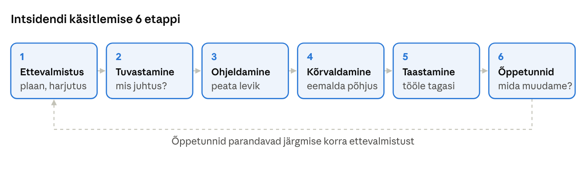

Tähtis on järjekord: enne kui põhjust eemaldad (4), peata levik (3) – muidu levib rünne edasi samal ajal, kui sa koristad.

**Sisu selgitus.** Intsidendi käsitlemise plaan kirjeldab, kuidas organisatsioon reageerib, kui midagi juhtub: kes otsustab, kes teeb tehnilist tööd, kes suhtleb ja kellega. Levinud raamistik (NIST SP 800-61) jagab käsitluse etappideks:

1. **Ettevalmistus** – plaan, rollid, kontaktid, tööriistad, harjutused.
2. **Tuvastamine ja analüüs** – mis juhtus, kui suur on ulatus?
3. **Ohjeldamine** – leviku peatamine (isoleerimine, kontode blokeerimine).
4. **Kõrvaldamine** – ründaja ja tema tööriistade eemaldamine.
5. **Taastamine** – süsteemide turvaline tagasi töösse viimine.
6. **Õppetunnid** – mis läks hästi, mis halvasti, mida muuta.

Põhimõisted:

- **Laudharjutus** (*tabletop exercise*) – meeskond arutab läbi väljamõeldud stsenaariumi ilma tehniliste süsteemideta.
- **Teavituskohustus** – GDPR-i järgi tuleb isikuandmete rikkumisest teavitada Andmekaitse Inspektsiooni 72 tunni jooksul; küberturvalisuse seaduse ja NIS2 alusel on teenuseosutajatel kohustus teavitada RIA-t (CERT-EE).
- **Kriisikommunikatsioon** – avalikkuse, klientide ja töötajate õigeaegne ja aus teavitamine.
- **Tõendite säilitamine** – logid, mälutõmmised ja kettatõmmised kogutakse enne süsteemide puhastamist.

**Miks see on oluline.** Intsidendi ajal on aega vähe ja stress suur. Plaanita meeskond kaotab tunde küsimustele „kes otsustab?“ ja „kellele helistada?“. Valed esimesed sammud – näiteks serveri kohene uuesti installimine – hävitavad tõendid. Avalikkuse eest varjamine muudab tehnilise intsidendi usalduskriisiks.

**Praktilised meetmed:**

- [ ] Intsidendi käsitlemise plaan on kirjas, kättesaadav ka siis, kui IT-süsteemid ei tööta (paberil või väljaspool oma võrku).
- [ ] Rollid on määratud: intsidendijuht, tehniline juht, kommunikatsioon, õigusnõustaja, juhatuse esindaja.
- [ ] Kontaktid (RIA/CERT-EE, AKI, kindlustus, IT-partnerid, õigusbüroo) on ajakohased.
- [ ] Laudharjutus toimub vähemalt kord aastas erinevate stsenaariumitega.
- [ ] Logid on tsentraalselt kogutud ja säilitatud piisavalt kaua (nt 90+ päeva).
- [ ] Pärast iga intsidenti tehakse õppetundide analüüs ja meetmed viiakse ellu.

**Seos E-ITS-iga:** DER.2.1 Turvaintsidentide käsitlus; DER.4 Talitluspidevuse haldus.

### Näide 1: Eesti 2007. aasta küberrünnakud

**Kes olid osapooled?** Rünnati Eesti riiki tervikuna: Riigikogu, ministeeriumide, pankade ja meediaväljaannete veebilehti. **CERT-EE** on Eesti riiklik küberintsidentidele reageerimise meeskond, mis praegu kuulub Riigi Infosüsteemi Ameti (RIA) koosseisu.

**Mis juhtus.** Aprillis-mais 2007, pärast pronkssõduri teisaldamist Tallinna kesklinnast, ründasid Eestit umbes kolm nädalat järjestikused teenusetõkestusründed (DDoS). Sihtmärgiks olid riigiasutuste, pankade, meediaväljaannete ja erakondade veebilehed. Mõned pangateenused ja uudisteportaalid ei olnud mõnda aega kättesaadavad.

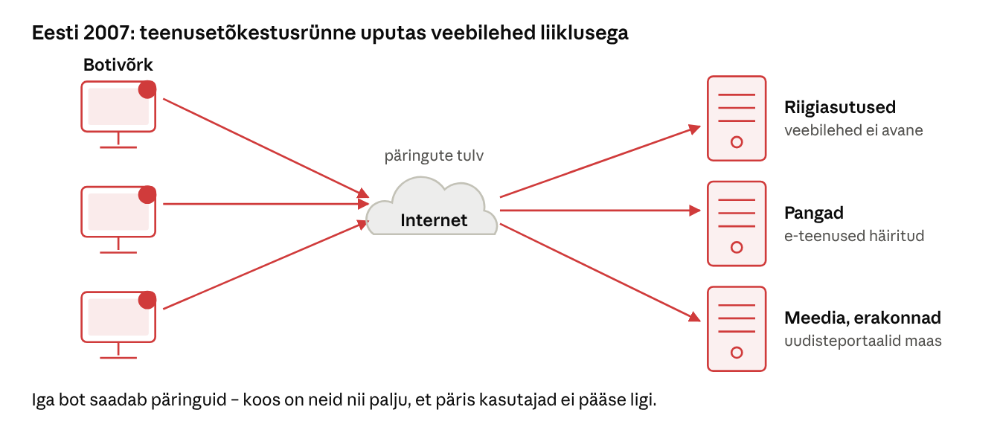

**Miks see lõppes nii, nagu lõppes.** Ründed olid ulatuslikud, kuid Eesti suutis need kontrolli alla saada. Hiljuti loodud CERT-EE koordineeris tegevust, internetiteenuse pakkujad ja pangad tegid tihedat koostööd ning mitmel juhul piirati ajutiselt välismaist liiklust. Eesti sai abi ka rahvusvahelistelt partneritelt.

**Mis sellest järgnes.** Juhtum oli üks esimesi riigi vastu suunatud ulatuslikke küberrünnakuid. 2008. aastal loodi Tallinnas NATO küberkaitsekoostöö keskus (CCDCOE). Eesti arendas välja küberturvalisuse strateegia ja Kaitseliidu küberkaitseüksuse.

**Õppetund.** Intsidendi lahendamine sõltub valmisolekust **koostööks**: asutuste, ettevõtete ja riikide vahel. Kontaktid ja kokkulepped tuleb luua enne kriisi, mitte selle ajal.

### Näide 2: ID-kaardi turvanõrkus ROCA (2017)

**Kes olid osapooled?** **RIA** (Riigi Infosüsteemi Amet) vastutab Eestis e-riigi turvalisuse eest. **PPA** (Politsei- ja Piirivalveamet) väljastab ID-kaarte. **Infineon** on Saksa ettevõte, mis tootis ID-kaardi kiibi. **Masaryki ülikool** on Tšehhi ülikool, mille teadlased vea avastasid.

**Mis juhtus.** 30. augustil 2017 teavitasid Tšehhi teadlased RIA-t, et Infineoni kiipide võtmegenereerimise teegis on viga, mis teeb võimalikuks privaatvõtme tuletamise avalikust võtmest. Viga puudutas ligi 750 000 Eesti ID-kaarti, elamisloakaarti, digi-ID-d ja e-residendi kaarti.

**Kuidas reageeriti.** Riik teatas avalikult võimalikust turvariskist 5. septembril – enne kui täpsed tehnilised üksikasjad avalikustati. Analüüsiti riski ja otsiti lahendusi koos tootjaga. 3. novembril peatati ohustatud kaartide sertifikaadid ning kasutajad said need kaugelt uuendada arvuti kaudu või teenindustes. Peatamise hetkeks oli uuendatud alla 6% ohustatud kaartidest ja mobiil-ID oli vaid veerandil aktiivsetest kasutajatest, mistõttu tekkisid teeninduspunktides järjekorrad ja e-teenuste kasutamine oli häiritud.

**Mis oleks võinud minna paremini.** TTÜ analüüs „ID-kaardi kaasuse õppetunnid“ (2018) kritiseeris riigi hädaolukorra plaane ja tõi välja, et kriisis sai toetuda ettevõtetele ja ülikoolidele. RIA andmetel imestasid teiste riikide kolleegid Eesti avameelse kommunikatsiooni üle. Hiljem kerkis ka vaidlus kaarditootjaga muude lepingurikkumiste üle.

**Õppetund.** Avatud ja varajane kommunikatsioon aitas säilitada usaldust e-riigi vastu. Intsidendiks valmistumine hõlmab ka **tarnijariske** – haavatavus võib olla toote sees, mida sa ise ei arenda.

### Näide 3: Uberi 2016. aasta lekke varjamine

**Kes nad on?** Sama taksoäpp **Uber** kui teema 5 näites 2, kuid kuus aastat varem. **Bug bounty** ehk vigade preemiaprogramm on süsteem, kus ettevõte maksab turvauurijatele raha, kui need leiavad ja teatavad haavatavusest. Uber kasutas seda programmi valesti, et maksta ründajatele vaikimise eest.

**Mis juhtus.** 2016. aastal varastasid ründajad Uberi pilvekeskkonnast umbes 57 miljoni sõitja ja juhi andmed. Ründajad leidsid ligipääsuvõtmed GitHubi repositooriumist. Uber ei teavitanud kasutajaid ega ametiasutusi, vaid maksis ründajatele 100 000 dollarit, esitledes makset vearaportite preemiaprogrammi tasuna, ja lasi neil allkirjastada konfidentsiaalsuslepingu.

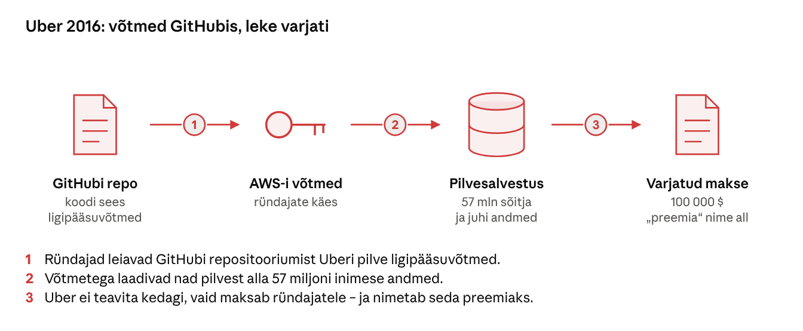

**Miks see lõppes halvasti.** Juhtum tuli avalikuks 2017. aasta novembris pärast juhtkonna vahetust. Uber maksis USA osariikidele 148 miljonit dollarit ja ettevõtte endine turvajuht mõisteti 2022. aastal süüdi õigusemõistmise takistamises ja kuriteo varjamises.

**Mis oleks aidanud.** Selge intsidendi käsitlemise ja teavitamise protseduur; õigusnõustaja kaasamine; juhatuse teavitamine; kasutajate ja asutuste õigeaegne teavitamine; ligipääsuvõtmete hoidmine väljaspool koodihoidlat.

**Õppetund.** Intsidendi varjamine on sageli kahjulikum kui intsident ise. Tehnilisest lekkest saab mainekriis ja kriminaalasi.

**Arutelu küsimused:**

1. Kui teie organisatsioonis krüpteeritakse reede õhtul kell 22 kõik serverid, siis kes on esimesed kolm inimest, kellele helistatakse? Kus on nende numbrid, kui telefonikataloog on krüpteeritud?
2. Milliseid teavitamiskohustusi (AKI, RIA, kliendid) on teie organisatsioonil ja millised on tähtajad?
3. Võrdle ROCA ja Uberi juhtumit: mille poolest erines kommunikatsioon ja mis oli tulemus?

## Kokkuvõte: põhimõtted toimivad koos

Üheski siin kirjeldatud juhtumis ei ebaõnnestunud ainult üks kaitsekiht. Tüüpiline rünnak kulgeb läbi mitme nõrkuse: lekkinud parool (4) ilma MFA-ta (5) annab sisenemise, lame võrk (10) ja liigsed õigused (8) võimaldavad liikuda, puuduv jälgimine (2) laseb tegutseda märkamatult ning testimata varundus (6) ja plaanita reageerimine (12) muudavad kahju suureks. Iga põhimõte, mis toimib, katkestab selle ahela.

Allolev tabel näitab, millist põhimõtet iga näide peamiselt illustreerib ja milliseid põhimõtteid samas juhtumis veel eirati.

| Juhtum | Aasta | Peamine põhimõte | Ka teised puudujäägid |
| --- | --- | --- | --- |
| WannaCry | 2017 | 1 Uuendamine | 3 Tulemüür, 10 Võrk |
| Equifax | 2017 | 1 Uuendamine | 2 Jälgimine, 11 Vastutus |
| Citrix Bleed | 2023 | 1 Uuendamine | 12 Intsidendi käsitlus |
| Emotet | 2014–2021 | 2 Pahavaratõrje | 7 Teadlikkus |
| EDR-i väljalülitamine (BYOVD) | 2022–2024 | 2 Pahavaratõrje | 8 Ligipääsud |
| CrowdStrike'i uuendus | 2024 | 2 Pahavaratõrje | 12 Taasteplaan |
| Capital One | 2019 | 3 Tulemüür | 8 Ligipääsud |
| MongoDB andmebaasid | 2017 | 3 Tulemüür | 6 Varundus |
| FortiGate'i seadistuste leke | 2022–2025 | 3 Tulemüür | 1 Uuendamine, 5 MFA |
| Dropbox | 2012 | 4 Paroolid | 5 MFA |
| 23andMe | 2023 | 4 Paroolid | 5 MFA |
| LastPass | 2022 | 4 Paroolid | 9 Seadmed |
| Colonial Pipeline | 2021 | 5 MFA | 8 Ligipääsud |
| Uber | 2022 | 5 MFA | 7 Teadlikkus, 4 Paroolid |
| Twilio ja Cloudflare | 2022 | 5 MFA | 7 Teadlikkus |
| Code Spaces | 2014 | 6 Varundus | 5 MFA, 8 Ligipääsud |
| GitLab.com | 2017 | 6 Varundus | 11 Protseduurid |
| Norsk Hydro | 2019 | 6 Varundus | 10 Võrk, 12 Kommunikatsioon |
| FACC | 2016 | 7 Teadlikkus | 11 Protseduurid |
| Twitter | 2020 | 7 Teadlikkus | 8 Ligipääsud, 5 MFA |
| Arup | 2024 | 7 Teadlikkus | 11 Protseduurid |
| Cash App | 2021–2022 | 8 Ligipääsud | 2 Jälgimine |
| Microsoft / Midnight Blizzard | 2023–2024 | 8 Ligipääsud | 4 Paroolid, 5 MFA |
| Morgan Stanley (siseringi leke) | 2015 | 8 Ligipääsud | 2 Jälgimine |
| USA veteranide amet | 2006 | 9 Seadmed | 11 Poliitika |
| HMRC | 2007 | 9 Seadmed | 11 Poliitika |
| Morgan Stanley (kõvakettad) | 2016 | 9 Seadmed | 11 Tarnijad |
| Target | 2013 | 10 Võrk | 5 MFA, 2 Jälgimine |
| Maersk / NotPetya | 2017 | 10 Võrk | 1 Uuendamine, 6 Varundus |
| Kasiino akvaarium | 2017 | 10 Võrk | 3 Tulemüür |
| Marriott / Starwood | 2014–2018 | 11 Poliitika | 2 Jälgimine |
| Samsung ja ChatGPT | 2023 | 11 Poliitika | 7 Teadlikkus |
| Microsofti 38 TB leke | 2023 | 11 Poliitika | 8 Ligipääsud |
| Eesti küberrünnakud | 2007 | 12 Intsidendi käsitlus | 10 Võrk |
| ID-kaardi ROCA | 2017 | 12 Intsidendi käsitlus | 11 Tarnijad |
| Uberi lekke varjamine | 2016 | 12 Intsidendi käsitlus | 4 Saladused koodis |

### Iseseisvad ülesanded

1. **Juhtumi süvaanalüüs.** Vali tabelist üks juhtum, mida tunnis põhjalikult ei käsitletud. Leia vähemalt kaks usaldusväärset allikat (ametlik aruanne, järelevalveasutuse otsus, turvafirma analüüs). Kirjelda rünnaku kulg etapiti (nt MITRE ATT&CK taktikate järgi), too välja kõik eiratud küberhügieeni põhimõtted ja koosta meetmete plaan, mis oleks rünnaku katkestanud. Maht 2–3 lehekülge.
2. **Oma organisatsiooni kontrollnimekiri.** Võta iga teema „Praktilised meetmed“ ja hinda oma (või õppe-) organisatsiooni skaalal: täidetud / osaliselt / täitmata / ei tea. Vali kolm suurima riskiga puudujääki ja põhjenda valikut.
3. **Laudharjutus.** Koosta 30-minutiline laudharjutuse stsenaarium, mis põhineb ühel selle materjali juhtumil, aga on kohandatud Eesti organisatsioonile. Lisa vähemalt 4 „sündmust“, mis harjutuse käigus avalduvad, ja iga sündmuse juurde küsimused osalejatele.
4. **Ahela katkestamine.** Vali Maerski, Targeti või Uberi 2022. aasta juhtum. Joonista rünnaku ahel lülidena ja märgi iga lüli juurde üks küberhügieeni põhimõte, mis oleks selle lüli katkestanud. Milline üksik meede oleks andnud suurima kaitse?

**Märkus allikate kohta:** juhtumikirjeldused põhinevad avalikult kättesaadavatel aruannetel ja ametlikel teadaannetel (viited on materjali lõpus peatükis „Allikad“); arvud on ümardatud ja võivad eri allikates veidi erineda. Õppijatel on soovitatav iga juhtumi puhul leida esmane allikas (nt ettevõtte enda teadaanne, järelevalveasutuse otsus või turvafirma tehniline analüüs).

## Allikad

Iga juhtumi kohta on toodud üks või kaks peamist allikat. Võimaluse korral on eelistatud esmaseid allikaid: ettevõtte enda teadaanne, järelevalveasutuse otsus, riiklik aruanne või turvafirma tehniline analüüs.

| Teema | Juhtum | Allikas |
| --- | --- | --- |
| 1 | WannaCry ja NHS | [NAO: Investigation: WannaCry cyber attack and the NHS](https://www.nao.org.uk/reports/investigation-wannacry-cyber-attack-and-the-nhs/) |
| 1 | Equifax | [GAO-18-559: Actions Taken by Equifax and Federal Agencies](https://www.gao.gov/products/GAO-18-559) |
| 1 | Citrix Bleed | [CISA AA23-325A: LockBit 3.0 Affiliates Exploit Citrix Bleed](https://cisa.gov/news-events/cybersecurity-advisories/aa23-325a) |
| 2 | Emotet | [Eurojust/Europol pressiteade (27.01.2021)](https://www.eurojust.europa.eu/worlds-most-dangerous-malware-emotet-disrupted-through-global-action); [USA justiitsministeerium](https://justice.gov/opa/pr/emotet-botnet-disrupted-international-cyber-operation) |
| 2 | AuKill / BYOVD | [Sophos X-Ops: AuKill EDR killer malware abuses Process Explorer driver](https://www.sophos.com/en-us/blog/aukill-edr-killer-malware-abuses-process-explorer-driver) |
| 2 | CrowdStrike | [CrowdStrike: Channel File 291 Root Cause Analysis](https://www.crowdstrike.com/en-us/blog/channel-file-291-rca-available/) |
| 3 | Capital One | [SecurityAffairs: OCC trahv Capital One'ile](https://securityaffairs.com/106933/data-breach/capital-one-fined.html) |
| 3 | MongoDB rünnakud | [KrebsOnSecurity: Extortionists Wipe Thousands of Databases](https://krebsonsecurity.com/2017/01/extortionists-wipe-thousands-of-databases-victims-who-pay-up-get-stiffed/) |
| 3 | FortiGate / Belsen | [Fortinet PSIRT: Analysis of Threat Actor Data Posting](https://fortinet.com/blog/psirt-blogs/analysis-of-threat-actor-data-posting); [Outpost24 analüüs](https://outpost24.com/blog/belsen-group-threat-group/) |
| 4 | Dropbox | [SecurityWeek: 68 Million Exposed in Old Dropbox Hack](https://www.securityweek.com/68-million-exposed-old-dropbox-hack) |
| 4 | 23andMe | [HIPAA Journal: 6.9 Million 23andMe Users Affected](https://www.hipaajournal.com/6-9-million-23andme-users-affected-by-data-breach/) |
| 4 | LastPass | [CSO Online: Hacked home computer of engineer led to second LastPass breach](https://www.csoonline.com/article/574613/hacked-home-computer-of-engineer-led-to-second-lastpass-data-breach.html) |
| 5 | Colonial Pipeline | [Dark Reading: tegevjuhi tunnistus USA Senatis](https://www.darkreading.com/attacks-breaches/colonial-pipeline-ceo-ransomware-attack-started-via-pilfered-legacy-vpn-account); [BankInfoSecurity](https://www.bankinfosecurity.net/colonial-ceo-at-senate-hearing-details-ransomware-attack-a-16836) |
| 5 | Uber 2022 | [Uberi turvateade (SEC 8-K lisa)](https://www.sec.gov/Archives/edgar/data/1543151/000155278122000558/e22427_ex99-1.htm) |
| 5 | Twilio ja Cloudflare | [Cloudflare: The mechanics of a sophisticated phishing scam and how we stopped it](https://blog.cloudflare.com/2022-07-sms-phishing-attacks/) |
| 6 | Code Spaces | [Help Net Security](https://www.helpnetsecurity.com/2014/06/19/code-hosting-code-spaces-destroyed-by-extortion-hack-attack/); [InfoWorld: Murder in the Amazon cloud](https://www.infoworld.com/article/2179073/murder-in-the-amazon-cloud.html) |
| 6 | GitLab.com | [GitLab: Postmortem of database outage of January 31](https://about.gitlab.com/blog/postmortem-of-database-outage-of-january-31/) |
| 6 | Norsk Hydro | [Computer Weekly: Norsk Hydro counts cost of cyber attack](https://computerweekly.com/news/252462778/Norsk-Hydro-urges-caution-as-it-counts-cost-of-cyber-attack); [CyberScoop](https://www.cyberscoop.com/cyber-insurance-norsk-hydro-lockergoga-attack/) |
| 7 | FACC | [SecurityWeek: Austrian Firm Fires CEO After $56-million Cyber Scam](https://www.securityweek.com/austrian-firm-fires-ceo-after-56-million-cyber-scam) |
| 7 | Twitter 2020 | [NYDFS: Twitter Investigation Report](https://www.dfs.ny.gov/reports_and_publications/press_releases/pr202010141) |
| 7 | Arup | [CNN: Arup revealed as $25 million deepfake scam victim](https://edition.cnn.com/2024/05/16/tech/arup-deepfake-scam-loss-hong-kong-intl-hnk) |
| 8 | Cash App / Block | [The Record: Block says former Cash App employee accessed data](https://therecord.media/block-says-former-cash-app-employee-accessed-data-from-us-customer-accounts) |
| 8 | Microsoft / Midnight Blizzard | [Microsoft: Midnight Blizzard – guidance for responders](https://www.microsoft.com/en-us/security/blog/2024/01/25/midnight-blizzard-guidance-for-responders-on-nation-state-attack/) |
| 8 | Morgan Stanley 2015 | [Wiley: SEC settlement over failure to protect customer data](https://wiley.law/alert-Morgan-Stanley-Pays-1-Million-in-Settlement-with-SEC-Over-Failure-to-Protect-Customer-Data-from-Insider) |
| 9 | USA veteranide amet | [CNN: VA will pay $20 million to settle lawsuit](https://edition.cnn.com/2009/POLITICS/01/27/va.data.theft/index.html) |
| 9 | HMRC | [ICO: Loss of UK child benefit data](https://ico.org.uk/for-the-public/ico-40/loss-of-uk-child-benefit-data/) |
| 9 | Morgan Stanley 2016 | [Banking Dive: SEC $35M penalty](https://www.bankingdive.com/news/morgan-stanley-fine-35m-sec-customer-data-disposal-online-auction/); [Banking Dive: OCC $60M](https://www.bankingdive.com/news/morgan-stanley-OCC-fine-data-oversight/586734/) |
| 10 | Target | [USA Senati kaubanduskomitee: A "Kill Chain" Analysis of the 2013 Target Data Breach](https://www.commerce.senate.gov/2014/3/rockefeller-staff-report-details-target-s-missed-opportunities-to-stop-massive-data-breach) |
| 10 | Maersk / NotPetya | [Wired: The Untold Story of NotPetya](https://www.wired.com/story/notpetya-cyberattack-ukraine-russia-code-crashed-the-world/) |
| 10 | Kasiino akvaarium | [Security Affairs: casino fish tank hack](https://securityaffairs.com/71433/hacking/fish-tank-hack.html) |
| 11 | Marriott / Starwood | [Yahoo Finance: ICO fines Marriott £18.4m](https://news.yahoo.com/ico-marriott-hotel-customers-personal-data-breach-security-hack-135645181.html) |
| 11 | Samsung ja ChatGPT | [Fortune: Samsung bans employee use of ChatGPT](https://fortune.com/2023/05/02/samsung-bans-employee-use-chatgpt-data-leak) |
| 11 | Microsofti 38 TB leke | [Wiz Research: 38TB of data accidentally exposed](https://wiz.io/blog/38-terabytes-of-private-data-accidentally-exposed-by-microsoft-ai-researchers) |
| 12 | Eesti 2007 | [CCDCOE: Cyber attacks against Estonia (2007)](<https://cyberlaw.ccdcoe.org/wiki/Cyber_attacks_against_Estonia_(2007)?oldid=2424>); [R. Ottis analüüs (CCDCOE)](https://www.ccdcoe.org/library/publications/analysis-of-the-2007-cyber-attacks-against-estonia-from-the-information-warfare-perspective) |
| 12 | ID-kaardi ROCA | [RIA kokkuvõte august/september 2017](https://ria.ee/sites/default/files/documents/2024-03/ria-ktt-kokkuvote-august-september-2017.pdf); [RIA kokkuvõte okt/nov 2017](https://ria.ee/sites/default/files/documents/2024-03/ria-ktt-kokkuvote-okt-nov-2017.pdf); [TTÜ: ID-kaardi kaasuse õppetunnid](https://www.ria.ee/sites/default/files/content-editors/EID/id-kaardi_oppetunnid.pdf) |
| 12 | Uber 2016 | [Insurance Journal: Uber's former security chief convicted](https://www.insurancejournal.com/news/national/2022/10/06/688645.htm) |
